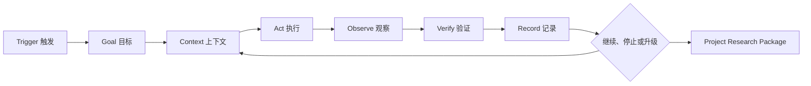
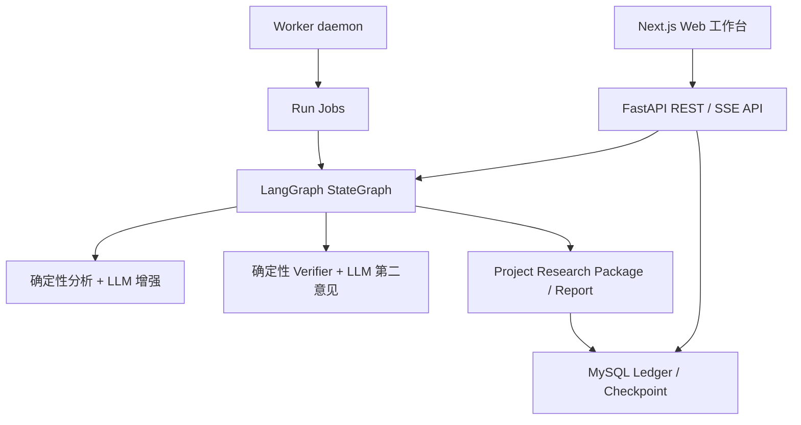
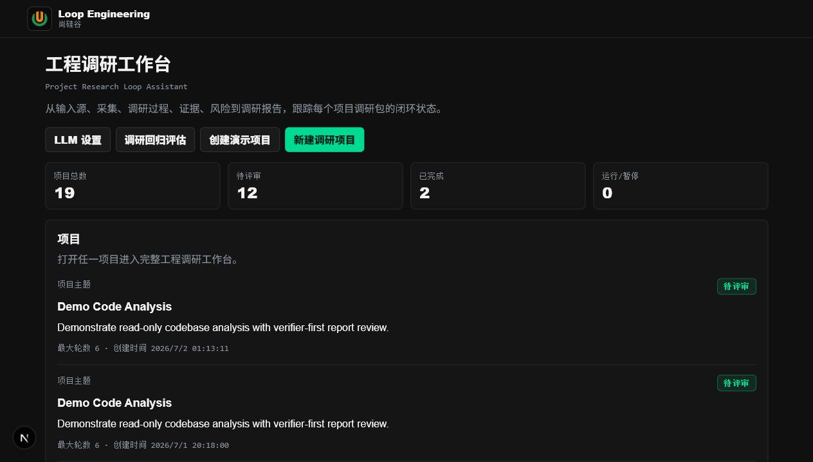
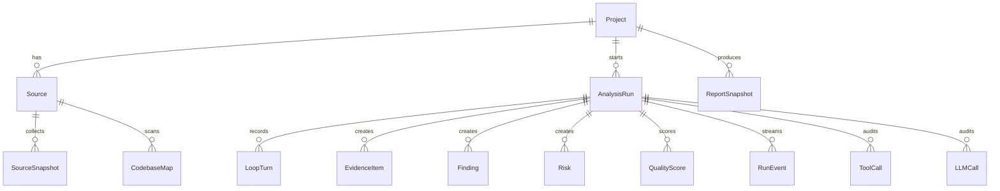
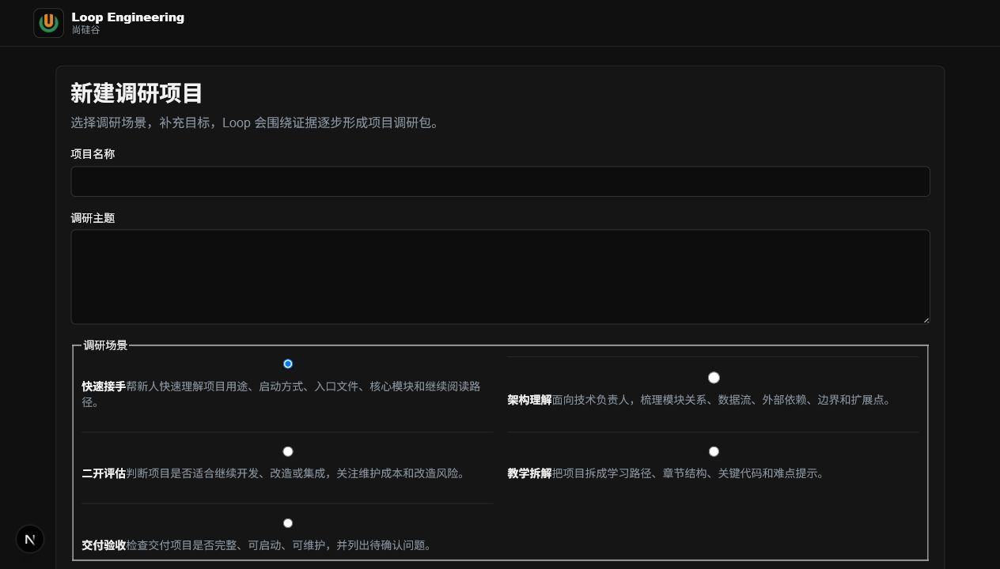
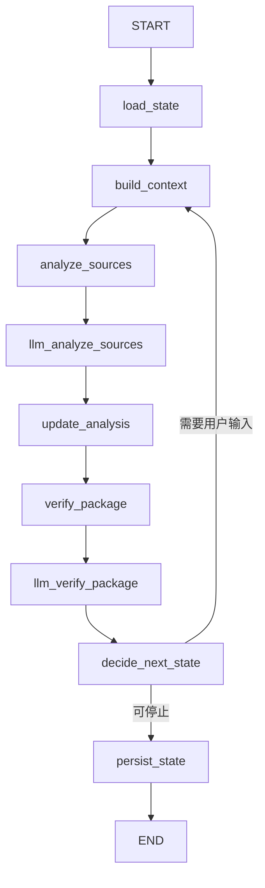
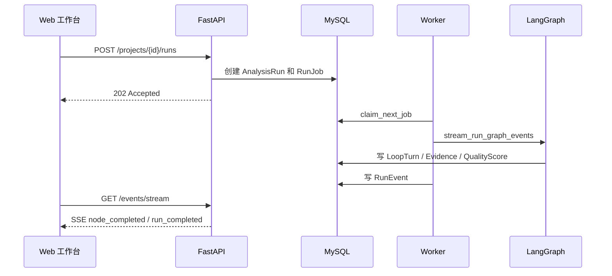
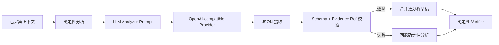
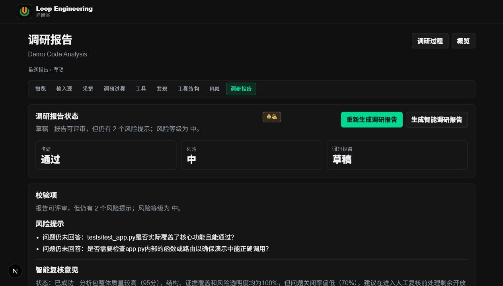

# Project Research Loop Assistant 项目实战课件

## 课程概览

本课程围绕一个真实项目展开：使用 FastAPI、LangGraph、MySQL、Next.js 和 OpenAI-compatible LLM provider，构建一个 **Project Research Loop Assistant / 工程调研 Loop 助手**。

系统的目标不是做一个会反复调用大模型的脚本，而是构建一个围绕目标、证据、状态、工具、验证器、人工评审和异常恢复运行的 Loop Runtime。最终产物是 **Project Research Package / 项目调研包**，它帮助开发者快速理解陌生工程、新代码库、二开风险和后续阅读路径。

完成本课程后，你应能理解并实现以下能力：

- 将 Loop Engineering 拆成触发、上下文、行动、观察、验证、记录和继续决策。
- 使用 MySQL 保存项目、输入源、运行、证据、报告、LLM 调用和运行事件。
- 使用 LangGraph `StateGraph` 编排可恢复的多节点分析流程。
- 通过 worker、job lease 和 SSE 让长任务可后台运行、可订阅、可恢复。
- 用 OpenAI-compatible 协议接入 DeepSeek、Qwen/DashScope 或自部署 vLLM。
- 用预算、账本、结构化 JSON、证据引用校验和确定性 verifier 约束 LLM。
- 通过 Web 工作台创建调研项目、运行 Loop、查看调研过程并评审报告。
- 使用项目资料包一次导入多类输入源，并通过调研档位控制 checklist、质量权重、验证器和报告章节。

本项目的技术亮点可以概括为一句话：**用 LangGraph 做可恢复 Agent Loop，用 MySQL 做运行事实账本，用后台队列和 SSE 做长任务体验，用 verifier、预算和 Tool Gateway 把 LLM 约束在可审计边界内。**

核心亮点包括：

- LangGraph 不只用 `StateGraph` 串节点，还接入 MySQL checkpointer、thread_id、checkpoint_id 和 native `interrupt()` / resume。
- HTTP 请求只负责创建 run job，真实分析由 worker daemon 异步执行，支持 lease、heartbeat、过期任务恢复和重试。
- 运行事件不是临时内存消息，而是 durable run events，可通过 SSE 断线续读。
- LLM 通过 OpenAI-compatible profile 路由接入 DeepSeek、Qwen/DashScope 或 vLLM，并有调用账本、预算拦截、JSON 提取、schema 校验和 evidence refs 校验。
- Tool Gateway 默认只开放 L0 只读工具，所有工具尝试都写入审计账本，避免 Agent 获得无限权限。
- Project Research Package 不是一次性 Markdown，而是由 source inventory、codebase map、evidence、finding、risk、question、quality score、verifier result 和 report snapshot 组成的 canonical source。
- Profile Benchmark Harness 用确定性 fixture 覆盖五类调研档位，验证 profile checks、quality metadata、报告章节和资料包摘要，防止核心调研能力退化。

## 第一章 项目背景与 Loop Engineering 闭环

### 1.1 学习目标

- 理解本项目为什么选择“工程调研”作为第一阶段场景。
- 理解 Loop Engineering 的概念来源、含义和当前行业形态。
- 区分普通 `/loop` 命令和可落地的 Loop Runtime。
- 明确系统的能力边界：只读分析、证据优先、人工最终评审。
- 建立 Project Research Package 的核心产物意识。

### 1.2 Loop Engineering 的来源、含义与现状

Loop Engineering 这个说法来自一类新的 Agent 开发实践：开发者不再只是手工写 prompt，而是设计一个能持续运行、观察结果、验证质量、保存状态、处理异常并决定下一步的循环系统。它和传统“提示词工程”的区别在于，提示词工程关注一次模型调用怎么写得更好，Loop Engineering 关注模型调用前后整个闭环怎么稳定工作。

当前行业里常见的 `/loop` 命令只是一个入口：它通常表示“按时间或条件重复执行某个提示”。这类命令很适合提醒、轮询、定时检查，但它本身不是完整工程系统。真正有生产价值的是 Loop Runtime：它必须回答以下问题：

- 目标是什么，完成条件能否被验证。
- 每一轮读取了哪些上下文，调用了哪些工具。
- 结果是否有证据，是否通过确定性 verifier。
- 失败、超时、超预算、权限越界和用户补充输入时如何处理。
- 运行状态如何持久化，系统崩溃后能否恢复。
- 人类在哪些风险点介入审批或评审。

因此，本课程中的 Loop Engineering 不是“给 AI 一个循环按钮”，而是把 Agent 做成可验证、可审计、可恢复的工程运行时。

### 1.3 业务背景

团队接手一个陌生项目时，常见问题不是“有没有 AI 能读代码”，而是：

- 输入资料分散在 README、代码目录、网页、文档和历史记录中。
- 一次性问答容易遗漏证据来源，也难以恢复和审计。
- 大模型生成的结论如果没有验证器和证据索引，很难进入企业流程。
- 项目调研需要反复补充上下文、形成报告、评审、继续追问。

因此，本项目把目标设定为：输入一个项目或代码目录，系统持续形成可验证、可追溯、可评审的项目调研包。

### 1.4 核心概念

#### 1.4.1 Loop Runtime

Loop Runtime 是驱动 Agent 持续工作的运行时。它不等于简单的循环调用 LLM，而是把每一步都落到状态、证据和验证结果上。



图中最关键的是 `Verify` 和 `Record`。没有验证器，系统只能生成“看似合理”的文本；没有记录，系统无法恢复、复盘或审计。

#### 1.4.2 `/loop` 命令与 Loop Runtime 的差异

很多工具把 Loop Engineering 表现为一个命令，例如 `/loop`。这个命令解决的是交互问题：用户如何快速让 Agent 重复做一件事。本项目解决的是运行时问题：Agent 重复工作时，如何知道自己是否完成、如何控制权限、如何持久化状态、如何处理失败、如何把最终产物交给用户评审。

```text
/loop command
  -> 重复执行 prompt
  -> 适合提醒、轮询、短期自动化

Loop Runtime
  -> 目标、状态、工具、验证器、记忆、审批、异常恢复
  -> 适合个人助手和企业 Agent 项目落地
```

这个差异决定了项目设计方向：本项目不会把核心能力做成一个“重复按钮”，而是把项目调研拆成可持久化、可恢复、可评审的多轮工程闭环。

#### 1.4.3 Project Research Package

Project Research Package 是系统内的 canonical source（规范源、唯一事实来源）。Markdown、PDF、Repo Wiki、Confluence、飞书文档或 Notion 都只是导出形态。

它包含：

| 项目                             | 说明                                                         |
| -------------------------------- | ------------------------------------------------------------ |
| **Executive Brief**              | **项目的一页纸总结**，5分钟就能知道这次研究的目标、结论和建议。 |
| **Research Profile**             | **这次研究的基本信息**，包括研究对象、范围、作者、时间、版本等，相当于项目身份证。 |
| **Source Bundle Summary**        | **本次参考资料的总体概览**，告诉你用了哪些类型的资料，各自主要讲什么。 |
| **Engineering Onboarding Guide** | **新人快速上手指南**，告诉第一次接触项目的人应该从哪里开始看。 |
| **Source Inventory**             | **所有资料的清单**，记录本次研究引用了哪些文档、代码库、论文、网页等。 |
| **Codebase Map**                 | **代码地图**，快速了解整个代码仓库有哪些模块、各模块负责什么。 |
| **Architecture Map**             | **系统架构图**，展示系统由哪些部分组成，以及它们之间如何协作。 |
| **Runbook**                      | **操作手册**，告诉别人如何部署、运行、调试和维护这个项目。   |
| **Findings**                     | **研究发现**，整理本次研究得到的重要结论和事实依据。         |
| **Risk Register**                | **风险清单**，列出目前发现的问题、潜在风险以及可能造成的影响。 |
| **Open Questions**               | **未解决的问题**，记录目前还没有答案、需要后续继续研究的内容。 |
| **Reading Path**                 | **推荐阅读顺序**，告诉读者应该按什么顺序阅读资料效率最高。   |
| **Evidence Index**               | **证据索引**，每个结论都能找到对应的证据来源，方便追溯和验证。 |
| **Verifier Result**              | **验证结果**，说明研究结论是否经过检查，以及验证是否通过。   |
| **Run Timeline**                 | **研究过程时间线**，记录整个研究过程中每一步是在什么时候完成的。 |
| **LLM Call Summary**             | **AI 调用统计**，记录本次研究调用了哪些大模型、调用次数、Token 消耗和成本。 |
| **Report Snapshot**              | **报告概览**，用几个关键数字快速展示本次研究的规模、成果和整体情况。 |

Project Research Package 应该分三层：

**1. 给人看的主产物**
最终用户运行完首先看这些：

- **Executive Brief / 执行摘要**：这个项目是什么、能不能接、核心风险是什么。
- **Engineering Onboarding Guide / 工程接手指南**：从哪里开始读代码、怎么启动、先看哪些模块。
- **Architecture Map / 架构地图**：核心模块、数据流、外部依赖、关键边界。
- **Runbook / 启动与运行线索**：怎么安装、怎么启动、怎么测试、有哪些配置。
- **Findings / 关键发现**：系统已经确认的事实。
- **Risk Register / 风险清单**：接手、二开、交付、教学时需要注意什么。
- **Recommendations / 建议与下一步**：下一步应该怎么做。

这部分应该是报告页默认展示的内容，也是人类用户真正要读的。

**2. 给人辅助核查的证据层**
用户不需要一开始读，但需要能点进去核对：

- **Source Inventory / 输入源清单**
- **Codebase Map / 代码地图**
- **Evidence Index / 证据索引**
- **Open Questions / 待确认问题**
- **Verifier Result / 校验结果**
- **Quality Score / 质量评分**

这部分的价值是：当用户怀疑某个结论时，可以追溯“它凭什么这么说”。

**3. 给系统看的运行与治理层**
普通最终用户不应该默认看，更多是调试、审计、企业治理时看：

- **Run Timeline / 运行时间线**
- **Loop Turns / 每轮节点记录**
- **LLM Call Summary / LLM 调用摘要**
- **Tool Call Ledger / 工具调用账本**
- **Checkpoint / Resume 信息**
- **Benchmark / Evaluation 结果**

### 1.5 重点难点

- Loop 的停止条件必须可验证，不能只让 LLM 自己说完成。
- LLM 输出必须被结构化解析和证据引用校验，不能直接写入最终结论。
- 外部动作必须经过权限边界。本项目第一阶段只允许只读分析。
- 项目运行过程必须能在后台继续、能中断恢复、能给前端订阅。

### 1.6 本章小结

本章确立了项目的第一性原理：系统的价值不在“自动循环”，而在“持续形成可验证、可审计、可恢复的调研结果”。后续章节会逐步实现这个闭环。

## 第二章 本地环境、目录结构与启动流程

### 2.1 学习目标

- 使用 uv 准备隔离的 Python 3.11 后端环境，并准备 Node.js 和 MySQL。
- 理解后端、前端、worker 和数据库之间的关系。
- 掌握项目的三个启动终端。
- 通过浏览器看到工程调研工作台。

### 2.2 系统架构

#### 架构亮点速览

这个项目看起来是“工程调研助手”，底层其实是一个小型 Agent Runtime 平台。它的先进性不在某一个模型调用，而在这些工程能力组合到一起：

- **可恢复 Agent 编排**：LangGraph `StateGraph` 负责节点流转，MySQL checkpointer 保存 graph checkpoint，`thread_id` 让同一个调研任务可以暂停后继续。
- **人类介入闭环**：当缺少关键输入时，图可以通过 interrupt 暂停；用户回答问题后，系统 resume 到同一个 Loop 上下文，而不是重新开始。
- **HTTP 异步化**：`POST /runs` 不直接执行长任务，而是创建 `RunJob`；worker daemon 后台领取 job，避免浏览器请求超时。
- **队列可靠性**：run job 有 lease、heartbeat、attempt_count、max_attempts 和 stale recovery，worker 崩溃后任务不会永久卡死。
- **可观察运行过程**：每个节点写入 durable run events，前端通过 SSE 订阅；断线后可以用 `after_sequence` 补历史事件。
- **LLM 工程治理**：OpenAI-compatible router 支持多 provider；预算在调用前拦截；所有调用进入 `llm_calls` 账本；结构化 JSON 和 evidence refs 校验失败时回退确定性路径。
- **工具权限边界**：Tool Gateway 默认只开放 L0 只读工具，未知工具、禁用工具和高风险工具都会被拒绝并审计。
- **质量可回归**：Evaluation Harness 同时覆盖基础扫描和 Profile Benchmark（带性能采样的基准测试），五类调研档位都有确定性基准用例。

这一组能力让项目不只是“一个会总结代码的 AI 应用”，而更像一个面向个人助手和企业 Agent 的运行时雏形：可恢复、可观察、可审计、可验证、可治理。



Web 工作台负责用户入口和报告评审；FastAPI 暴露项目、输入源、运行、报告、LLM 设置和评估接口；worker 从队列表领取后台任务；LangGraph 编排每轮分析；MySQL 保存所有可恢复事实。

### 2.3 目录结构

```text
services/api/
  .python-version  uv 使用的 Python 版本约束
  uv.lock          uv 解析出的后端依赖锁文件
  app/
    api/             FastAPI 路由
    db/              SQLAlchemy 模型与 Alembic 迁移
    engine/          LangGraph 编排、状态机和分析合并
    llm/             LLM provider、路由、预算和账本
    reports/         调研报告渲染、diff 和 PDF
    services/        业务服务：采集、报告、事件、job
    tools/           只读工具网关和扫描工具
    verifiers/       质量评分与校验器
    workers/         后台 worker
apps/web/
  app/               Next.js App Router 页面
  components/        工作台组件
  lib/               API client、标签和调研模板
```

### 2.4 环境配置

#### 文件：`.env`

用途：保存本地数据库、工作目录和 LLM provider 配置。真实密钥只放本地，不提交到仓库。

```env
DATABASE_URL=mysql+pymysql://root:<password>@localhost:3306/loop_engineering
WORKSPACE_ROOT=workspace/projects
NEXT_PUBLIC_API_BASE_URL=http://localhost:8000

LLM_PROVIDER=deepseek
LLM_API_KEY=<your-api-key>
LLM_BASE_URL=https://api.deepseek.com
LLM_MODEL=deepseek-chat
LLM_API_KEY_REQUIRED=true
LLM_TIMEOUT_SECONDS=30
```

关键点：

- `DATABASE_URL` 使用 MySQL，不使用 Postgres。
- `WORKSPACE_ROOT` 是本地只读采集和公开仓库 clone 的工作目录。
- `LLM_BASE_URL` 遵循 OpenAI-compatible API，因此可以换成 Qwen/DashScope 或自部署 vLLM。
- `.env` 已被 `.gitignore` 忽略，不能提交。

#### 文件：`services/api/.python-version`

用途：告诉 uv 后端项目默认使用 Python 3.11。不需要手动创建不同名称的虚拟环境，也不需要把系统 Python 直接暴露给项目。

```text
3.11
```

#### 文件：`services/api/uv.lock`

用途：锁定后端依赖解析结果。`pyproject.toml` 描述依赖范围，`uv.lock` 固定实际安装版本，`uv sync --extra dev` 会根据锁文件创建或更新本地 `.venv`。

`uv.lock` 是机器生成文件，体积较大。只需要知道三点：

- 它应该提交到仓库，用来保证不同机器安装到同一组依赖。
- 不要手动编辑它；需要更新依赖时使用 `uv lock` 或 `uv sync`。
- `.venv` 是 uv 在本机生成的隔离环境，已经被 `.gitignore` 忽略，不能提交。

### 2.5 启动命令

以下命令假设你已经拿到课程代码，并在代码根目录打开 PowerShell。三个长驻服务建议使用三个终端分别启动：API、Worker、Web。

#### 2.5.1 安装 uv

uv 用来管理后端 Python 版本、虚拟环境、依赖安装和命令运行。Windows 可以使用官方安装脚本：

```powershell
powershell -ExecutionPolicy ByPass -c "irm https://astral.sh/uv/install.ps1 | iex"
uv --version
```

如果本机已经安装 uv，可以直接执行 `uv --version` 确认版本。后续命令不再使用 `python -m venv`、手动激活 `.venv` 或 `pip install`。

#### 2.5.2 创建数据库

```powershell
mysql -uroot -p -e "CREATE DATABASE IF NOT EXISTS loop_engineering CHARACTER SET utf8mb4 COLLATE utf8mb4_unicode_ci;"
```

执行命令后输入本机 MySQL 密码。课程代码不内置真实密码，`.env` 中也只应填写自己的本机配置。

#### 2.5.3 同步后端环境并启动 API

```powershell
Set-Location services/api
uv python install 3.11
uv sync --extra dev
uv run alembic upgrade head
uv run python -m uvicorn app.main:app --reload --host 127.0.0.1 --port 8000
```

这组命令完成四件事：

- `uv python install 3.11` 确保本机有可用的 Python 3.11。
- `uv sync --extra dev` 根据 `pyproject.toml` 和 `uv.lock` 创建或更新 `.venv`，并安装测试依赖。
- `uv run alembic upgrade head` 在 uv 管理的隔离环境中执行数据库迁移。
- `uv run python -m uvicorn ...` 在同一个隔离环境中启动 FastAPI。

API 启动后，新开一个终端检查健康状态：

```powershell
Invoke-RestMethod http://127.0.0.1:8000/health
```

正常返回中应包含 `status = ok`。

#### 2.5.4 启动 Worker

```powershell
Set-Location services/api
$env:PYTHONPATH='.'
uv run python -m app.workers.worker_service --queue default --poll-interval 2
```

Worker 负责领取后台 run job，驱动 LangGraph 执行，并把运行事件写入数据库。没有 Worker 时，前端可以创建项目，但后台调研任务不会持续推进。

#### 2.5.5 安装并启动 Web

回到代码根目录，安装前端依赖并启动 Next.js：

```powershell
npm --prefix apps/web install
npm --prefix apps/web run dev -- --hostname 127.0.0.1 --port 3000
```

浏览器打开：

```text
http://127.0.0.1:3000/projects
```

如果能看到中文工程调研工作台、新建项目入口和评估入口，就说明前后端已经连通。

#### 2.5.6 后端验证命令速记

后续章节中的后端验证命令默认在 `services/api` 目录执行，并使用 uv 管理的环境：

```powershell
Set-Location services/api
uv run --extra dev python -m pytest tests -q
uv run python -m alembic -c alembic.ini current
```

如果在仓库根目录执行单个后端测试，也可以使用 `--project` 指向后端项目：

```powershell
uv run --project services/api --extra dev python -m pytest services/api/tests/test_health.py -q
```

### 2.6 关键代码

#### 文件：`services/api/app/main.py`

用途：创建 FastAPI 应用，注册所有业务路由。

```python
from fastapi import FastAPI
from fastapi.middleware.cors import CORSMiddleware

from app.api import (
    routes_demo,
    routes_evaluations,
    routes_events,
    routes_inventory,
    routes_llm,
    routes_projects,
    routes_reports,
    routes_runs,
    routes_sources,
    routes_tools,
)
from app.core.config import get_settings


def create_app() -> FastAPI:
    settings = get_settings()
    app = FastAPI(title=settings.app_name)
    app.add_middleware(
        CORSMiddleware,
        allow_origins=["http://127.0.0.1:3000", "http://localhost:3000"],
        allow_credentials=True,
        allow_methods=["*"],
        allow_headers=["*"],
    )
    app.include_router(routes_demo.router)
    app.include_router(routes_evaluations.router)
    app.include_router(routes_projects.router)
    app.include_router(routes_sources.router)
    app.include_router(routes_inventory.router)
    app.include_router(routes_events.router)
    app.include_router(routes_llm.router)
    app.include_router(routes_runs.router)
    app.include_router(routes_reports.router)
    app.include_router(routes_tools.router)

    @app.get("/health")
    def health() -> dict[str, str]:
        return {
            "status": "ok",
            "app": settings.app_name,
        }

    return app
```

关键点：

- API 路由按业务边界拆分，便于后续测试和演进。
- CORS 只放开本地 Web 工作台地址。
- `/health` 用于本地启动检查。

验证方式：

```powershell
Invoke-WebRequest http://127.0.0.1:8000/health
```

<!-- FULL_CODE_CH2_START -->
#### 本章后端完整代码清单

本章涉及启动入口、配置读取和数据库 session。下面给出完整后端代码，便于学员从零搭建服务骨架。

##### 文件：`services/api/app/main.py`

用途：创建 FastAPI 应用，注册项目、输入源、运行、报告、LLM、工具和评估路由。

~~~python
from fastapi import FastAPI
from fastapi.middleware.cors import CORSMiddleware

from app.api import (
    routes_demo,
    routes_evaluations,
    routes_events,
    routes_inventory,
    routes_llm,
    routes_projects,
    routes_research_profiles,
    routes_reports,
    routes_runs,
    routes_source_bundles,
    routes_sources,
    routes_tools,
)
from app.core.config import get_settings


def create_app() -> FastAPI:
    settings = get_settings()
    app = FastAPI(title=settings.app_name)
    app.add_middleware(
        CORSMiddleware,
        allow_origins=["http://127.0.0.1:3000", "http://localhost:3000"],
        allow_credentials=True,
        allow_methods=["*"],
        allow_headers=["*"],
    )
    app.include_router(routes_demo.router)
    app.include_router(routes_evaluations.router)
    app.include_router(routes_projects.router)
    app.include_router(routes_research_profiles.router)
    app.include_router(routes_source_bundles.router)
    app.include_router(routes_sources.router)
    app.include_router(routes_inventory.router)
    app.include_router(routes_events.router)
    app.include_router(routes_llm.router)
    app.include_router(routes_runs.router)
    app.include_router(routes_reports.router)
    app.include_router(routes_tools.router)

    @app.get("/health")
    def health() -> dict[str, str]:
        return {
            "status": "ok",
            "app": settings.app_name,
        }

    return app


app = create_app()
~~~

验证方式：启动 API 后访问 `GET /health`。

##### 文件：`services/api/app/core/config.py`

用途：集中读取 `.env` 配置，包含应用名、数据库、工作目录和默认 LLM provider。

~~~python
from functools import lru_cache
from pathlib import Path

from pydantic import model_validator
from pydantic_settings import BaseSettings, SettingsConfigDict

REPO_ROOT = Path(__file__).resolve().parents[4]


class Settings(BaseSettings):
    """应用配置固定从仓库根目录读取，避免不同启动目录导致配置漂移。"""

    model_config = SettingsConfigDict(env_file=REPO_ROOT / ".env", extra="ignore")

    app_name: str = "Loop Engineering API"
    database_url: str = "mysql+pymysql://root@localhost:3306/loop_engineering"
    workspace_root: Path = REPO_ROOT / "workspace" / "projects"
    source_max_file_bytes: int = 1_000_000
    source_excerpt_chars: int = 4_000
    web_fetch_timeout_seconds: float = 20
    git_clone_timeout_seconds: float = 120
    llm_provider: str = "openai-compatible"
    llm_api_key: str | None = None
    llm_base_url: str = ""
    llm_model: str = ""
    llm_api_key_required: bool = True
    llm_timeout_seconds: float = 30

    @model_validator(mode="after")
    def normalize_paths(self) -> "Settings":
        """相对运行目录会漂移，路径配置统一按仓库根目录解析。"""

        if not self.workspace_root.is_absolute():
            self.workspace_root = (REPO_ROOT / self.workspace_root).resolve()
        return self


@lru_cache
def get_settings() -> Settings:
    return Settings()
~~~

验证方式：启动 API 时配置能被 `get_settings()` 读取。

##### 文件：`services/api/app/db/session.py`

用途：创建 SQLAlchemy engine、session factory 和 FastAPI 依赖注入 session。

~~~python
from collections.abc import Generator

from sqlalchemy import create_engine
from sqlalchemy.orm import Session, sessionmaker

from app.core.config import get_settings

settings = get_settings()
engine = create_engine(settings.database_url, pool_pre_ping=True)
SessionLocal = sessionmaker(bind=engine, autoflush=False, autocommit=False)
WorkerSessionLocal = SessionLocal


def get_session() -> Generator[Session, None, None]:
    with SessionLocal() as session:
        yield session


def bind_worker_session_to(session: Session) -> None:
    """让本地 worker 复用当前运行环境的数据库 bind。

    生产环境默认使用 MySQL `SessionLocal`；测试和单进程开发环境会通过 FastAPI
    dependency override 注入内存库或临时库，enqueue 时同步 worker 的 session factory，
    避免 API 和 worker 看见两套数据库。
    """

    global WorkerSessionLocal
    WorkerSessionLocal = sessionmaker(bind=session.get_bind(), autoflush=False, autocommit=False)


def get_worker_session_factory() -> sessionmaker[Session]:
    return WorkerSessionLocal
~~~

验证方式：任意 API 测试能通过 dependency override 或真实 session 访问数据库。

<!-- FULL_CODE_CH2_END -->

### 2.7 横版截图



### 2.8 本章小结

本章完成了项目启动链路：MySQL、FastAPI、worker 和 Next.js。后续章节会从数据库模型开始，把运行过程变成可追踪的工程系统。

## 第三章 MySQL 数据模型与审计账本

### 3.1 学习目标

- 理解 Project、Source、Run、Evidence、Report 之间的关系。
- 掌握为什么 checkpoint、event、LLM call 和 tool call 都要落库。
- 理解 UTF-8、UTC 时间和 JSON 字段在本项目中的作用。

### 3.2 业务场景与设计意图

Agent 系统最怕“跑过但说不清做了什么”。本项目将运行事实拆到数据库中，使每个调研包都能回答：

- 输入来自哪里。
- 每轮 Loop 做了哪些节点。
- 形成了哪些证据、发现、风险和问题。
- 哪些 LLM 调用成功、失败、跳过或超预算。
- 哪些工具被尝试调用，是否被权限边界拒绝。
- 报告是哪个 run 的哪个 snapshot。

### 3.3 数据关系图



这个模型把“调研结论”和“运行过程”分开保存。Project Research Package 读取的是已落库事实，而不是再次让 LLM 重新推理。

### 3.4 关键代码

#### 文件：`services/api/app/db/models.py`

用途：定义项目、输入源、运行、证据、风险、报告、事件和账本等核心表。

```python
class Project(TimestampMixin, Base):
    """分析项目是 Loop Runtime 的主实体，后续 run、证据和报告都挂在项目下。"""

    __tablename__ = "projects"

    id: Mapped[str] = mapped_column(String(36), primary_key=True, default=new_id)
    name: Mapped[str] = mapped_column(String(160), nullable=False)
    topic: Mapped[str] = mapped_column(Text, nullable=False)
    analysis_goal: Mapped[str | None] = mapped_column(Text)
    status: Mapped[str] = mapped_column(String(40), nullable=False, default="draft")
    max_turns: Mapped[int] = mapped_column(Integer, nullable=False, default=6)
```

关键点：

- `Project` 是所有调研事实的聚合入口。
- `analysis_goal` 保存用户目标和调研模板组合后的文本。
- `max_turns` 是防止无限循环的第一层边界。

#### 文件：`services/api/app/db/models.py`

用途：保存一次 Loop 运行的状态和恢复信息。

```python
class AnalysisRun(TimestampMixin, Base):
    """一次 Loop 运行，是分析过程、产物和停止原因的聚合根。"""

    __tablename__ = "analysis_runs"

    id: Mapped[str] = mapped_column(String(36), primary_key=True, default=new_id)
    project_id: Mapped[str] = mapped_column(ForeignKey("projects.id"), nullable=False, index=True)
    status: Mapped[str] = mapped_column(String(40), nullable=False, default="running")
    current_turn: Mapped[int] = mapped_column(Integer, nullable=False, default=0)
    max_turns: Mapped[int] = mapped_column(Integer, nullable=False, default=6)
    thread_id: Mapped[str | None] = mapped_column(String(120), index=True)
    execution_mode: Mapped[str] = mapped_column(String(40), nullable=False, default="sync")
    last_checkpoint_id: Mapped[str | None] = mapped_column(String(120))
    resume_count: Mapped[int] = mapped_column(Integer, nullable=False, default=0)
    stop_reason: Mapped[str | None] = mapped_column(Text)
```

关键点：

- `thread_id` 对应 LangGraph 的可恢复线程。
- `last_checkpoint_id` 让系统能定位最近一次 checkpoint。
- `stop_reason` 让用户知道为什么停下，而不是只看到一个状态。

<!-- FULL_CODE_CH3_START -->
#### 本章后端完整代码清单

本章的数据模型是 Loop Runtime 的账本核心。下面完整展开 ORM 模型文件，后续章节的 run、event、checkpoint、LLM call、tool call 和 report 都依赖这些表。

##### 文件：`services/api/app/db/models.py`

用途：定义项目、输入源、采集快照、代码地图、运行、证据、发现、风险、问题、建议、质量分、报告、任务、事件、checkpoint、LLM 和工具账本。

~~~python
from datetime import UTC, datetime
from uuid import uuid4

from sqlalchemy import DateTime, Float, ForeignKey, Integer, JSON, String, Text, UniqueConstraint
from sqlalchemy.orm import Mapped, mapped_column, relationship
from sqlalchemy.types import TypeDecorator

from app.db.base import Base


class UTCDateTime(TypeDecorator[datetime]):
    """数据库可能丢失时区信息，读写时统一按 UTC 归一化。"""

    impl = DateTime(timezone=True)
    cache_ok = True

    def process_bind_param(self, value: datetime | None, dialect) -> datetime | None:
        if value is None:
            return None
        if value.tzinfo is None:
            return value.replace(tzinfo=UTC)
        return value.astimezone(UTC)

    def process_result_value(self, value: datetime | None, dialect) -> datetime | None:
        if value is None:
            return None
        if value.tzinfo is None:
            return value.replace(tzinfo=UTC)
        return value.astimezone(UTC)


def new_id() -> str:
    return str(uuid4())


def utc_now() -> datetime:
    return datetime.now(UTC)


class TimestampMixin:
    created_at: Mapped[datetime] = mapped_column(UTCDateTime(), default=utc_now)
    updated_at: Mapped[datetime] = mapped_column(
        UTCDateTime(),
        default=utc_now,
        onupdate=utc_now,
    )


class Project(TimestampMixin, Base):
    """分析项目是 Loop Runtime 的主实体，后续 run、证据和报告都挂在项目下。"""

    __tablename__ = "projects"

    id: Mapped[str] = mapped_column(String(36), primary_key=True, default=new_id)
    name: Mapped[str] = mapped_column(String(160), nullable=False)
    topic: Mapped[str] = mapped_column(Text, nullable=False)
    analysis_goal: Mapped[str | None] = mapped_column(Text)
    status: Mapped[str] = mapped_column(String(40), nullable=False, default="draft")
    research_profile: Mapped[str] = mapped_column(String(80), nullable=False, default="quick_onboarding")
    max_turns: Mapped[int] = mapped_column(Integer, nullable=False, default=6)

    sources: Mapped[list["Source"]] = relationship(
        back_populates="project",
        cascade="all, delete-orphan",
    )
    source_bundles: Mapped[list["SourceBundle"]] = relationship(
        back_populates="project",
        cascade="all, delete-orphan",
    )
    source_snapshots: Mapped[list["SourceSnapshot"]] = relationship(
        back_populates="project",
        cascade="all, delete-orphan",
    )
    codebase_maps: Mapped[list["CodebaseMap"]] = relationship(
        back_populates="project",
        cascade="all, delete-orphan",
    )
    analysis_runs: Mapped[list["AnalysisRun"]] = relationship(
        back_populates="project",
        cascade="all, delete-orphan",
    )
    report_snapshots: Mapped[list["ReportSnapshot"]] = relationship(
        back_populates="project",
        cascade="all, delete-orphan",
    )
    audit_events: Mapped[list["AuditEvent"]] = relationship(
        back_populates="project",
        cascade="all, delete-orphan",
    )


class Source(TimestampMixin, Base):
    """输入源只记录元数据和规范化位置；读取、clone、扫描由采集服务统一完成。"""

    __tablename__ = "sources"

    id: Mapped[str] = mapped_column(String(36), primary_key=True, default=new_id)
    project_id: Mapped[str] = mapped_column(ForeignKey("projects.id"), nullable=False, index=True)
    source_type: Mapped[str] = mapped_column(String(40), nullable=False)
    uri: Mapped[str] = mapped_column(Text, nullable=False)
    normalized_uri: Mapped[str] = mapped_column(Text, nullable=False)
    status: Mapped[str] = mapped_column(String(40), nullable=False, default="pending")
    metadata_json: Mapped[dict] = mapped_column(JSON, nullable=False, default=dict)

    project: Mapped[Project] = relationship(back_populates="sources")
    source_snapshots: Mapped[list["SourceSnapshot"]] = relationship(
        back_populates="source",
        cascade="all, delete-orphan",
    )
    codebase_maps: Mapped[list["CodebaseMap"]] = relationship(
        back_populates="source",
        cascade="all, delete-orphan",
    )


class SourceBundle(TimestampMixin, Base):
    """资料包把用户一次提交的多个输入固定下来，采集任务按条目状态处理它。"""

    __tablename__ = "source_bundles"

    id: Mapped[str] = mapped_column(String(36), primary_key=True, default=new_id)
    project_id: Mapped[str] = mapped_column(
        ForeignKey("projects.id", ondelete="CASCADE"),
        nullable=False,
        index=True,
    )
    name: Mapped[str] = mapped_column(String(160), nullable=False)
    status: Mapped[str] = mapped_column(String(40), nullable=False, default="pending")
    metadata_json: Mapped[dict] = mapped_column(JSON, nullable=False, default=dict)

    project: Mapped[Project] = relationship(back_populates="source_bundles")
    items: Mapped[list["SourceBundleItem"]] = relationship(
        back_populates="bundle",
        cascade="all, delete-orphan",
        order_by="SourceBundleItem.created_at, SourceBundleItem.id",
    )


class SourceBundleItem(TimestampMixin, Base):
    """资料包条目保留原始输入、规范化结果和失败原因，避免无效输入丢失上下文。"""

    __tablename__ = "source_bundle_items"

    id: Mapped[str] = mapped_column(String(36), primary_key=True, default=new_id)
    bundle_id: Mapped[str] = mapped_column(
        ForeignKey("source_bundles.id", ondelete="CASCADE"),
        nullable=False,
        index=True,
    )
    project_id: Mapped[str] = mapped_column(
        ForeignKey("projects.id", ondelete="CASCADE"),
        nullable=False,
        index=True,
    )
    source_id: Mapped[str | None] = mapped_column(
        ForeignKey("sources.id", ondelete="SET NULL"),
        index=True,
    )
    input_type: Mapped[str] = mapped_column(String(40), nullable=False)
    raw_value: Mapped[str] = mapped_column(Text, nullable=False)
    normalized_uri: Mapped[str | None] = mapped_column(Text)
    status: Mapped[str] = mapped_column(String(40), nullable=False, default="pending")
    error_message: Mapped[str | None] = mapped_column(Text)
    metadata_json: Mapped[dict] = mapped_column(JSON, nullable=False, default=dict)

    bundle: Mapped[SourceBundle] = relationship(back_populates="items")
    source: Mapped[Source | None] = relationship()


class SourceSnapshot(TimestampMixin, Base):
    """输入源采集结果快照，保存可审计的只读事实摘要和跳过原因。"""

    __tablename__ = "source_snapshots"

    id: Mapped[str] = mapped_column(String(36), primary_key=True, default=new_id)
    project_id: Mapped[str] = mapped_column(ForeignKey("projects.id"), nullable=False, index=True)
    source_id: Mapped[str] = mapped_column(ForeignKey("sources.id"), nullable=False, index=True)
    source_type: Mapped[str] = mapped_column(String(40), nullable=False)
    status: Mapped[str] = mapped_column(String(40), nullable=False, default="collected")
    title: Mapped[str | None] = mapped_column(Text)
    content_excerpt: Mapped[str | None] = mapped_column(Text)
    content_path: Mapped[str | None] = mapped_column(Text)
    metadata_json: Mapped[dict] = mapped_column(JSON, nullable=False, default=dict)
    skipped_items_json: Mapped[list] = mapped_column(JSON, nullable=False, default=list)
    error_message: Mapped[str | None] = mapped_column(Text)

    project: Mapped[Project] = relationship(back_populates="source_snapshots")
    source: Mapped[Source] = relationship(back_populates="source_snapshots")


class CodebaseMap(TimestampMixin, Base):
    """代码库地图保存确定性扫描结果，后续 Loop 只能基于这些证据做分析。"""

    __tablename__ = "codebase_maps"

    id: Mapped[str] = mapped_column(String(36), primary_key=True, default=new_id)
    project_id: Mapped[str] = mapped_column(ForeignKey("projects.id"), nullable=False, index=True)
    source_id: Mapped[str] = mapped_column(ForeignKey("sources.id"), nullable=False, index=True)
    root_label: Mapped[str] = mapped_column(Text, nullable=False)
    tech_stack_json: Mapped[list] = mapped_column(JSON, nullable=False, default=list)
    dependency_files_json: Mapped[list] = mapped_column(JSON, nullable=False, default=list)
    config_files_json: Mapped[list] = mapped_column(JSON, nullable=False, default=list)
    test_files_json: Mapped[list] = mapped_column(JSON, nullable=False, default=list)
    entrypoint_files_json: Mapped[list] = mapped_column(JSON, nullable=False, default=list)
    readme_excerpt: Mapped[str | None] = mapped_column(Text)
    file_tree_json: Mapped[list] = mapped_column(JSON, nullable=False, default=list)
    skipped_items_json: Mapped[list] = mapped_column(JSON, nullable=False, default=list)
    metadata_json: Mapped[dict] = mapped_column(JSON, nullable=False, default=dict)

    project: Mapped[Project] = relationship(back_populates="codebase_maps")
    source: Mapped[Source] = relationship(back_populates="codebase_maps")


class AuditEvent(TimestampMixin, Base):
    """审计事件记录用户和系统关键动作，保证分析过程可追溯。"""

    __tablename__ = "audit_events"
    __table_args__ = (
        UniqueConstraint("project_id", "sequence", name="uq_audit_events_project_sequence"),
    )

    id: Mapped[str] = mapped_column(String(36), primary_key=True, default=new_id)
    project_id: Mapped[str | None] = mapped_column(ForeignKey("projects.id"), index=True)
    sequence: Mapped[int] = mapped_column(Integer, nullable=False, default=1)
    event_type: Mapped[str] = mapped_column(String(80), nullable=False)
    message: Mapped[str] = mapped_column(Text, nullable=False)
    actor_id: Mapped[str] = mapped_column(String(80), nullable=False, default="local-user")
    payload_json: Mapped[dict] = mapped_column(JSON, nullable=False, default=dict)

    project: Mapped[Project | None] = relationship(back_populates="audit_events")


class AnalysisRun(TimestampMixin, Base):
    """一次 Loop 运行，是分析过程、产物和停止原因的聚合根。"""

    __tablename__ = "analysis_runs"

    id: Mapped[str] = mapped_column(String(36), primary_key=True, default=new_id)
    project_id: Mapped[str] = mapped_column(ForeignKey("projects.id"), nullable=False, index=True)
    status: Mapped[str] = mapped_column(String(40), nullable=False, default="running")
    current_turn: Mapped[int] = mapped_column(Integer, nullable=False, default=0)
    max_turns: Mapped[int] = mapped_column(Integer, nullable=False, default=6)
    thread_id: Mapped[str | None] = mapped_column(String(120), index=True)
    execution_mode: Mapped[str] = mapped_column(String(40), nullable=False, default="sync")
    last_checkpoint_id: Mapped[str | None] = mapped_column(String(120))
    resume_count: Mapped[int] = mapped_column(Integer, nullable=False, default=0)
    stop_reason: Mapped[str | None] = mapped_column(Text)
    started_at: Mapped[datetime] = mapped_column(UTCDateTime(), default=utc_now)
    completed_at: Mapped[datetime | None] = mapped_column(UTCDateTime())

    project: Mapped[Project] = relationship(back_populates="analysis_runs")
    turns: Mapped[list["LoopTurn"]] = relationship(
        back_populates="run",
        cascade="all, delete-orphan",
    )
    evidence_items: Mapped[list["EvidenceItem"]] = relationship(
        back_populates="run",
        cascade="all, delete-orphan",
    )
    findings: Mapped[list["Finding"]] = relationship(
        back_populates="run",
        cascade="all, delete-orphan",
    )
    risks: Mapped[list["Risk"]] = relationship(
        back_populates="run",
        cascade="all, delete-orphan",
    )
    questions: Mapped[list["Question"]] = relationship(
        back_populates="run",
        cascade="all, delete-orphan",
    )
    recommendations: Mapped[list["Recommendation"]] = relationship(
        back_populates="run",
        cascade="all, delete-orphan",
    )
    quality_scores: Mapped[list["QualityScore"]] = relationship(
        back_populates="run",
        cascade="all, delete-orphan",
    )
    report_snapshots: Mapped[list["ReportSnapshot"]] = relationship(
        back_populates="run",
        cascade="all, delete-orphan",
    )


class LoopTurn(TimestampMixin, Base):
    """Loop 每个节点的执行记录，用于恢复、审计和解释为什么继续或停止。"""

    __tablename__ = "loop_turns"

    id: Mapped[str] = mapped_column(String(36), primary_key=True, default=new_id)
    run_id: Mapped[str] = mapped_column(ForeignKey("analysis_runs.id"), nullable=False, index=True)
    project_id: Mapped[str] = mapped_column(ForeignKey("projects.id"), nullable=False, index=True)
    turn_index: Mapped[int] = mapped_column(Integer, nullable=False)
    node_name: Mapped[str] = mapped_column(String(80), nullable=False)
    action: Mapped[str] = mapped_column(Text, nullable=False)
    observation: Mapped[str] = mapped_column(Text, nullable=False)
    status: Mapped[str] = mapped_column(String(40), nullable=False, default="completed")
    started_at: Mapped[datetime] = mapped_column(UTCDateTime(), default=utc_now)
    completed_at: Mapped[datetime | None] = mapped_column(UTCDateTime(), default=utc_now)
    metadata_json: Mapped[dict] = mapped_column(JSON, nullable=False, default=dict)

    run: Mapped[AnalysisRun] = relationship(back_populates="turns")
    quality_scores: Mapped[list["QualityScore"]] = relationship(back_populates="turn")


class EvidenceItem(TimestampMixin, Base):
    """证据项保存可追溯事实，发现和风险只能引用证据而不是凭空判断。"""

    __tablename__ = "evidence_items"

    id: Mapped[str] = mapped_column(String(36), primary_key=True, default=new_id)
    project_id: Mapped[str] = mapped_column(ForeignKey("projects.id"), nullable=False, index=True)
    run_id: Mapped[str] = mapped_column(ForeignKey("analysis_runs.id"), nullable=False, index=True)
    source_id: Mapped[str | None] = mapped_column(ForeignKey("sources.id"), index=True)
    title: Mapped[str] = mapped_column(Text, nullable=False)
    summary: Mapped[str] = mapped_column(Text, nullable=False)
    evidence_type: Mapped[str] = mapped_column(String(80), nullable=False)
    reference: Mapped[str | None] = mapped_column(Text)
    confidence: Mapped[int] = mapped_column(Integer, nullable=False, default=80)
    metadata_json: Mapped[dict] = mapped_column(JSON, nullable=False, default=dict)

    run: Mapped[AnalysisRun] = relationship(back_populates="evidence_items")


class Finding(TimestampMixin, Base):
    """分析发现，必须尽量通过 evidence_refs_json 指向证据项。"""

    __tablename__ = "findings"

    id: Mapped[str] = mapped_column(String(36), primary_key=True, default=new_id)
    project_id: Mapped[str] = mapped_column(ForeignKey("projects.id"), nullable=False, index=True)
    run_id: Mapped[str] = mapped_column(ForeignKey("analysis_runs.id"), nullable=False, index=True)
    title: Mapped[str] = mapped_column(Text, nullable=False)
    summary: Mapped[str] = mapped_column(Text, nullable=False)
    category: Mapped[str] = mapped_column(String(80), nullable=False)
    impact_level: Mapped[str] = mapped_column(String(40), nullable=False, default="medium")
    confidence: Mapped[int] = mapped_column(Integer, nullable=False, default=75)
    evidence_refs_json: Mapped[list] = mapped_column(JSON, nullable=False, default=list)
    metadata_json: Mapped[dict] = mapped_column(JSON, nullable=False, default=dict)

    run: Mapped[AnalysisRun] = relationship(back_populates="findings")


class Risk(TimestampMixin, Base):
    """风险登记项记录严重级别、影响和缓解建议。"""

    __tablename__ = "risks"

    id: Mapped[str] = mapped_column(String(36), primary_key=True, default=new_id)
    project_id: Mapped[str] = mapped_column(ForeignKey("projects.id"), nullable=False, index=True)
    run_id: Mapped[str] = mapped_column(ForeignKey("analysis_runs.id"), nullable=False, index=True)
    title: Mapped[str] = mapped_column(Text, nullable=False)
    summary: Mapped[str] = mapped_column(Text, nullable=False)
    severity: Mapped[str] = mapped_column(String(40), nullable=False, default="medium")
    mitigation: Mapped[str] = mapped_column(Text, nullable=False)
    evidence_refs_json: Mapped[list] = mapped_column(JSON, nullable=False, default=list)
    metadata_json: Mapped[dict] = mapped_column(JSON, nullable=False, default=dict)

    run: Mapped[AnalysisRun] = relationship(back_populates="risks")


class Question(TimestampMixin, Base):
    """高风险缺口通过问题暂停 Loop，等待用户回答后恢复。"""

    __tablename__ = "questions"

    id: Mapped[str] = mapped_column(String(36), primary_key=True, default=new_id)
    project_id: Mapped[str] = mapped_column(ForeignKey("projects.id"), nullable=False, index=True)
    run_id: Mapped[str] = mapped_column(ForeignKey("analysis_runs.id"), nullable=False, index=True)
    prompt: Mapped[str] = mapped_column(Text, nullable=False)
    reason: Mapped[str] = mapped_column(Text, nullable=False)
    impact: Mapped[str] = mapped_column(String(40), nullable=False, default="medium")
    status: Mapped[str] = mapped_column(String(40), nullable=False, default="open")
    answer_text: Mapped[str | None] = mapped_column(Text)
    answered_at: Mapped[datetime | None] = mapped_column(UTCDateTime())
    metadata_json: Mapped[dict] = mapped_column(JSON, nullable=False, default=dict)

    run: Mapped[AnalysisRun] = relationship(back_populates="questions")


class Recommendation(TimestampMixin, Base):
    """推荐结论和下一步建议，是 Analysis Package 的收束点。"""

    __tablename__ = "recommendations"

    id: Mapped[str] = mapped_column(String(36), primary_key=True, default=new_id)
    project_id: Mapped[str] = mapped_column(ForeignKey("projects.id"), nullable=False, index=True)
    run_id: Mapped[str] = mapped_column(ForeignKey("analysis_runs.id"), nullable=False, index=True)
    summary: Mapped[str] = mapped_column(Text, nullable=False)
    rationale: Mapped[str] = mapped_column(Text, nullable=False)
    confidence: Mapped[int] = mapped_column(Integer, nullable=False, default=70)
    next_steps_json: Mapped[list] = mapped_column(JSON, nullable=False, default=list)
    metadata_json: Mapped[dict] = mapped_column(JSON, nullable=False, default=dict)

    run: Mapped[AnalysisRun] = relationship(back_populates="recommendations")


class QualityScore(TimestampMixin, Base):
    """Analysis Quality Rubric 每轮评分，驱动继续、暂停或停止决策。"""

    __tablename__ = "quality_scores"

    id: Mapped[str] = mapped_column(String(36), primary_key=True, default=new_id)
    project_id: Mapped[str] = mapped_column(ForeignKey("projects.id"), nullable=False, index=True)
    run_id: Mapped[str] = mapped_column(ForeignKey("analysis_runs.id"), nullable=False, index=True)
    turn_id: Mapped[str | None] = mapped_column(ForeignKey("loop_turns.id"), index=True)
    overall_score: Mapped[int] = mapped_column(Integer, nullable=False)
    structure_completeness: Mapped[int] = mapped_column(Integer, nullable=False)
    evidence_coverage: Mapped[int] = mapped_column(Integer, nullable=False)
    codebase_coverage: Mapped[int] = mapped_column(Integer, nullable=False)
    risk_transparency: Mapped[int] = mapped_column(Integer, nullable=False)
    question_resolution: Mapped[int] = mapped_column(Integer, nullable=False)
    recommendation_confidence: Mapped[int] = mapped_column(Integer, nullable=False)
    score_delta: Mapped[int] = mapped_column(Integer, nullable=False, default=0)
    reasons_json: Mapped[list] = mapped_column(JSON, nullable=False, default=list)
    next_actions_json: Mapped[list] = mapped_column(JSON, nullable=False, default=list)
    metadata_json: Mapped[dict] = mapped_column(JSON, nullable=False, default=dict)

    run: Mapped[AnalysisRun] = relationship(back_populates="quality_scores")
    turn: Mapped[LoopTurn | None] = relationship(back_populates="quality_scores")


class ReportSnapshot(TimestampMixin, Base):
    """报告快照把一次 Analysis Package 的校验结果、Markdown 和人工评审结论固化下来。"""

    __tablename__ = "report_snapshots"

    id: Mapped[str] = mapped_column(String(36), primary_key=True, default=new_id)
    project_id: Mapped[str] = mapped_column(ForeignKey("projects.id"), nullable=False, index=True)
    run_id: Mapped[str] = mapped_column(ForeignKey("analysis_runs.id"), nullable=False, index=True)
    status: Mapped[str] = mapped_column(String(40), nullable=False, default="draft", index=True)
    title: Mapped[str] = mapped_column(Text, nullable=False)
    markdown_content: Mapped[str] = mapped_column(Text, nullable=False)
    verifier_result_json: Mapped[dict] = mapped_column(JSON, nullable=False, default=dict)
    review_decision: Mapped[str | None] = mapped_column(String(40))
    review_comment: Mapped[str | None] = mapped_column(Text)
    reviewed_at: Mapped[datetime | None] = mapped_column(UTCDateTime())

    project: Mapped[Project] = relationship(back_populates="report_snapshots")
    run: Mapped[AnalysisRun] = relationship(back_populates="report_snapshots")


class LLMProfile(TimestampMixin, Base):
    """LLM 任务档位。API key 只通过环境变量名引用，不入库。"""

    __tablename__ = "llm_profiles"

    id: Mapped[str] = mapped_column(String(36), primary_key=True, default=new_id)
    name: Mapped[str] = mapped_column(String(120), nullable=False)
    task_type: Mapped[str] = mapped_column(String(40), nullable=False, index=True)
    provider: Mapped[str] = mapped_column(String(80), nullable=False)
    base_url: Mapped[str] = mapped_column(Text, nullable=False)
    model: Mapped[str] = mapped_column(String(160), nullable=False)
    # 只保存环境变量名，避免密钥进入数据库或测试快照。
    api_key_env_name: Mapped[str | None] = mapped_column(String(120))
    api_key_required: Mapped[bool] = mapped_column(Integer, nullable=False, default=True)
    max_tokens: Mapped[int] = mapped_column(Integer, nullable=False, default=1200)
    temperature: Mapped[float] = mapped_column(Float, nullable=False, default=0.2)
    timeout_seconds: Mapped[int] = mapped_column(Integer, nullable=False, default=30)
    daily_budget_cents: Mapped[int | None] = mapped_column(Integer)
    enabled: Mapped[bool] = mapped_column(Integer, nullable=False, default=True)


class LLMCall(TimestampMixin, Base):
    """每次 LLM 调用的可审计账本，不保存 API key。"""

    __tablename__ = "llm_calls"

    id: Mapped[str] = mapped_column(String(36), primary_key=True, default=new_id)
    project_id: Mapped[str | None] = mapped_column(ForeignKey("projects.id"), index=True)
    run_id: Mapped[str | None] = mapped_column(ForeignKey("analysis_runs.id"), index=True)
    report_id: Mapped[str | None] = mapped_column(ForeignKey("report_snapshots.id"), index=True)
    profile_id: Mapped[str | None] = mapped_column(ForeignKey("llm_profiles.id"), index=True)
    task_type: Mapped[str] = mapped_column(String(40), nullable=False, index=True)
    provider: Mapped[str] = mapped_column(String(80), nullable=False)
    model: Mapped[str] = mapped_column(String(160), nullable=False)
    prompt_hash: Mapped[str] = mapped_column(String(80), nullable=False)
    input_refs_json: Mapped[list] = mapped_column(JSON, nullable=False, default=list)
    output_ref: Mapped[str | None] = mapped_column(Text)
    usage_json: Mapped[dict] = mapped_column(JSON, nullable=False, default=dict)
    latency_ms: Mapped[int | None] = mapped_column(Integer)
    status: Mapped[str] = mapped_column(String(40), nullable=False, default="queued")
    error_message: Mapped[str | None] = mapped_column(Text)


class LLMAnalysisArtifact(TimestampMixin, Base):
    """LLM 输出的结构化产物。只有 accepted=True 的内容可合并进 Analysis Package。"""

    __tablename__ = "llm_analysis_artifacts"

    id: Mapped[str] = mapped_column(String(36), primary_key=True, default=new_id)
    project_id: Mapped[str] = mapped_column(ForeignKey("projects.id"), nullable=False, index=True)
    run_id: Mapped[str | None] = mapped_column(ForeignKey("analysis_runs.id"), index=True)
    call_id: Mapped[str | None] = mapped_column(ForeignKey("llm_calls.id"), index=True)
    artifact_type: Mapped[str] = mapped_column(String(80), nullable=False)
    content_json: Mapped[dict] = mapped_column(JSON, nullable=False, default=dict)
    validation_result_json: Mapped[dict] = mapped_column(JSON, nullable=False, default=dict)
    accepted: Mapped[bool] = mapped_column(Integer, nullable=False, default=False)


class ToolRegistration(TimestampMixin, Base):
    """Tool Gateway 的只读工具登记表，只描述能力和权限级别，不承载执行逻辑。"""

    __tablename__ = "tool_registrations"

    id: Mapped[str] = mapped_column(String(36), primary_key=True, default=new_id)
    name: Mapped[str] = mapped_column(String(120), nullable=False, unique=True, index=True)
    description: Mapped[str] = mapped_column(Text, nullable=False)
    permission_level: Mapped[str] = mapped_column(String(20), nullable=False, default="L0")
    input_schema_json: Mapped[dict] = mapped_column(JSON, nullable=False, default=dict)
    enabled: Mapped[bool] = mapped_column(Integer, nullable=False, default=True)


class ToolCall(TimestampMixin, Base):
    """工具调用审计账本，先记录 run 相关上下文和摘要，后续网关逻辑再写入。"""

    __tablename__ = "tool_calls"

    id: Mapped[str] = mapped_column(String(36), primary_key=True, default=new_id)
    project_id: Mapped[str | None] = mapped_column(ForeignKey("projects.id"), index=True)
    run_id: Mapped[str | None] = mapped_column(ForeignKey("analysis_runs.id"), index=True)
    turn_id: Mapped[str | None] = mapped_column(ForeignKey("loop_turns.id"), index=True)
    tool_name: Mapped[str] = mapped_column(String(120), nullable=False, index=True)
    permission_level: Mapped[str] = mapped_column(String(20), nullable=False, default="L0")
    status: Mapped[str] = mapped_column(String(40), nullable=False, default="queued", index=True)
    input_summary_json: Mapped[dict] = mapped_column(JSON, nullable=False, default=dict)
    output_summary_json: Mapped[dict] = mapped_column(JSON, nullable=False, default=dict)
    error_message: Mapped[str | None] = mapped_column(Text)
    latency_ms: Mapped[int | None] = mapped_column(Integer)


class LLMReportArtifact(TimestampMixin, Base):
    """LLM 报告生成产物，保存候选内容和校验结果，供后续确定性流程裁决。"""

    __tablename__ = "llm_report_artifacts"

    id: Mapped[str] = mapped_column(String(36), primary_key=True, default=new_id)
    project_id: Mapped[str] = mapped_column(ForeignKey("projects.id"), nullable=False, index=True)
    run_id: Mapped[str] = mapped_column(ForeignKey("analysis_runs.id"), nullable=False, index=True)
    report_id: Mapped[str | None] = mapped_column(ForeignKey("report_snapshots.id"), index=True)
    call_id: Mapped[str | None] = mapped_column(ForeignKey("llm_calls.id"), index=True)
    status: Mapped[str] = mapped_column(String(40), nullable=False, default="pending", index=True)
    content_json: Mapped[dict] = mapped_column(JSON, nullable=False, default=dict)
    validation_result_json: Mapped[dict] = mapped_column(JSON, nullable=False, default=dict)


class EvaluationRun(TimestampMixin, Base):
    """Evaluation Harness 的运行记录，保存摘要和 case 结果。"""

    __tablename__ = "evaluation_runs"

    id: Mapped[str] = mapped_column(String(36), primary_key=True, default=new_id)
    status: Mapped[str] = mapped_column(String(40), nullable=False, default="running", index=True)
    summary_json: Mapped[dict] = mapped_column(JSON, nullable=False, default=dict)
    case_results_json: Mapped[list] = mapped_column(JSON, nullable=False, default=list)
    started_at: Mapped[datetime] = mapped_column(UTCDateTime(), default=utc_now)
    completed_at: Mapped[datetime | None] = mapped_column(UTCDateTime())


class RunJob(TimestampMixin, Base):
    """后台运行任务，负责把 HTTP 请求和实际 LangGraph 执行解耦。"""

    __tablename__ = "run_jobs"

    id: Mapped[str] = mapped_column(String(36), primary_key=True, default=new_id)
    project_id: Mapped[str] = mapped_column(ForeignKey("projects.id"), nullable=False, index=True)
    run_id: Mapped[str] = mapped_column(ForeignKey("analysis_runs.id"), nullable=False, index=True)
    job_type: Mapped[str] = mapped_column(String(40), nullable=False)
    status: Mapped[str] = mapped_column(String(40), nullable=False, default="queued", index=True)
    attempt_count: Mapped[int] = mapped_column(Integer, nullable=False, default=0)
    max_attempts: Mapped[int] = mapped_column(Integer, nullable=False, default=3)
    queue_name: Mapped[str] = mapped_column(String(80), nullable=False, default="default", index=True)
    locked_by: Mapped[str | None] = mapped_column(String(120))
    locked_at: Mapped[datetime | None] = mapped_column(UTCDateTime())
    locked_until: Mapped[datetime | None] = mapped_column(UTCDateTime(), index=True)
    heartbeat_at: Mapped[datetime | None] = mapped_column(UTCDateTime())
    available_at: Mapped[datetime] = mapped_column(UTCDateTime(), default=utc_now)
    next_run_at: Mapped[datetime | None] = mapped_column(UTCDateTime(), index=True)
    last_error: Mapped[str | None] = mapped_column(Text)
    payload_json: Mapped[dict] = mapped_column(JSON, nullable=False, default=dict)


class RunEvent(TimestampMixin, Base):
    """运行事件是前端订阅和恢复 UI 状态的 durable 事件流。"""

    __tablename__ = "run_events"
    __table_args__ = (
        UniqueConstraint("run_id", "sequence", name="uq_run_events_run_sequence"),
    )

    id: Mapped[str] = mapped_column(String(36), primary_key=True, default=new_id)
    project_id: Mapped[str] = mapped_column(ForeignKey("projects.id"), nullable=False, index=True)
    run_id: Mapped[str] = mapped_column(ForeignKey("analysis_runs.id"), nullable=False, index=True)
    event_type: Mapped[str] = mapped_column(String(80), nullable=False)
    sequence: Mapped[int] = mapped_column(Integer, nullable=False)
    payload_json: Mapped[dict] = mapped_column(JSON, nullable=False, default=dict)


class GraphCheckpoint(TimestampMixin, Base):
    """LangGraph checkpoint tuple 的 MySQL 保存格式。"""

    __tablename__ = "graph_checkpoints"

    id: Mapped[str] = mapped_column(String(36), primary_key=True, default=new_id)
    thread_id: Mapped[str] = mapped_column(String(120), nullable=False, index=True)
    checkpoint_ns: Mapped[str] = mapped_column(String(120), nullable=False, default="")
    checkpoint_id: Mapped[str] = mapped_column(String(120), nullable=False, index=True)
    parent_checkpoint_id: Mapped[str | None] = mapped_column(String(120))
    checkpoint_json: Mapped[dict] = mapped_column(JSON, nullable=False, default=dict)
    metadata_json: Mapped[dict] = mapped_column(JSON, nullable=False, default=dict)
    channel_values_json: Mapped[dict] = mapped_column(JSON, nullable=False, default=dict)


class GraphCheckpointWrite(TimestampMixin, Base):
    """LangGraph pending writes，用于 interrupt/resume 恢复。"""

    __tablename__ = "graph_checkpoint_writes"

    id: Mapped[str] = mapped_column(String(36), primary_key=True, default=new_id)
    thread_id: Mapped[str] = mapped_column(String(120), nullable=False, index=True)
    checkpoint_ns: Mapped[str] = mapped_column(String(120), nullable=False, default="")
    checkpoint_id: Mapped[str] = mapped_column(String(120), nullable=False, index=True)
    task_id: Mapped[str] = mapped_column(String(120), nullable=False)
    write_index: Mapped[int] = mapped_column(Integer, nullable=False)
    channel: Mapped[str] = mapped_column(String(160), nullable=False)
    value_json: Mapped[dict] = mapped_column(JSON, nullable=False, default=dict)
    task_path: Mapped[str] = mapped_column(Text, nullable=False, default="")
~~~

验证方式：执行 `uv run --extra dev python -m pytest tests/test_inventory_models.py tests/test_runs_api.py -q`。

<!-- FULL_CODE_CH3_END -->

### 3.5 迁移验证

在 `services/api` 下执行：

```powershell
uv run python -m alembic -c alembic.ini current
```

预期看到当前数据库处于最新 head，例如：

```text
20260706_0014 (head)
```

### 3.6 本章小结

本章建立了 Loop Runtime 的持久化底座。数据库不是附属品，而是系统能审计、恢复、评审和继续一轮的基础。

## 第四章 输入源、只读采集与工程结构地图

### 4.1 学习目标

- 理解项目调研为什么要先收集 Source Inventory。
- 掌握本地目录和公开仓库的只读扫描边界。
- 使用调研模板创建更明确的目标。
- 理解 Codebase Map 如何成为后续分析证据。

### 4.2 业务场景与设计意图

工程调研的第一步不是让 LLM 猜项目结构，而是先把可验证输入转成结构化事实：

- README 摘要。
- 依赖文件。
- 配置文件。
- 测试文件。
- 入口文件。
- 文件树摘要。
- 敏感或超限文件跳过原因。

这些事实进入 Source Inventory 和 Codebase Map 后，后续分析只能基于这些证据生成发现和风险。

### 4.3 前端调研入口黑盒说明

前端不是本课程的源码重点，因此本章只把它当成黑盒入口使用。需要理解的是页面向后端提交了哪些业务字段，以及这些字段如何进入后续 Loop。

新建项目页承担三件事：

- 让用户填写项目名称、主题和补充目标。
- 让用户选择调研档位，例如快速接手、架构理解、二开评估、教学拆解或交付验收。
- 调用后端 `POST /projects`，把 `name`、`topic`、`analysis_goal`、`research_profile` 和 `max_turns` 保存为 `Project`。

前端调研模板只负责把用户目标表达得更清楚，不负责验证调研是否完成。真正的完成判断发生在后端 verifier、quality score 和 evaluation harness 中。

### 4.4 新建项目入口验收点

浏览器访问：

```text
http://127.0.0.1:3000/projects/new
```

验收时观察：

- 页面能展示五类调研档位。
- 创建项目后进入项目概览页。
- 项目概览页能显示所选调研档位。
- 后端数据库中的 `projects.research_profile` 与页面选择一致。

<!-- FULL_CODE_CH4_START -->
#### 本章后端完整代码清单

本章的后端重点是只读采集和代码结构地图。下面完整展开采集服务、扫描工具和路径安全策略。

##### 文件：`services/api/app/services/collection.py`

用途：根据输入源类型执行只读采集，生成 SourceSnapshot 和 CodebaseMap。

~~~python
from pathlib import Path

from sqlalchemy import select
from sqlalchemy.orm import Session

from app.core.config import Settings
from app.db.models import CodebaseMap, Project, Source, SourceSnapshot
from app.services.audit import record_event
from app.tools.code_scan_tools import scan_codebase
from app.tools.file_tools import read_local_file
from app.tools.git_tools import clone_public_github_repo
from app.tools.web_tools import fetch_web_url


def list_inventory(session: Session, project: Project) -> dict:
    snapshots = list(
        session.scalars(
            select(SourceSnapshot)
            .where(SourceSnapshot.project_id == project.id)
            .order_by(SourceSnapshot.created_at.asc(), SourceSnapshot.id.asc())
        ).all()
    )
    codebase_maps = list(
        session.scalars(
            select(CodebaseMap)
            .where(CodebaseMap.project_id == project.id)
            .order_by(CodebaseMap.created_at.asc(), CodebaseMap.id.asc())
        ).all()
    )
    return {
        "project_id": project.id,
        "snapshots": snapshots,
        "codebase_maps": codebase_maps,
    }


def collect_project_sources(
    session: Session,
    project: Project,
    settings: Settings,
    source_ids: set[str] | None = None,
) -> dict:
    statement = select(Source).where(Source.project_id == project.id)
    if source_ids is not None:
        if not source_ids:
            return list_inventory(session, project)
        statement = statement.where(Source.id.in_(source_ids))
    sources = list(
        session.scalars(
            statement.order_by(Source.created_at.asc(), Source.id.asc())
        ).all()
    )
    for source in sources:
        record_event(
            session,
            event_type="source.collection_started",
            message="Source collection started",
            project_id=project.id,
            payload={"source_id": source.id, "source_type": source.source_type},
        )
        try:
            snapshot_data, codebase_data = collect_one_source(source, project, settings)
            snapshot = SourceSnapshot(
                project_id=project.id,
                source_id=source.id,
                source_type=source.source_type,
                status=snapshot_data["status"],
                title=snapshot_data.get("title"),
                content_excerpt=snapshot_data.get("content_excerpt"),
                content_path=snapshot_data.get("content_path"),
                metadata_json=snapshot_data.get("metadata", {}),
                skipped_items_json=snapshot_data.get("skipped_items", []),
            )
            session.add(snapshot)
            if codebase_data is not None:
                session.add(
                    CodebaseMap(
                        project_id=project.id,
                        source_id=source.id,
                        root_label=codebase_data["root_label"],
                        tech_stack_json=codebase_data["tech_stack"],
                        dependency_files_json=codebase_data["dependency_files"],
                        config_files_json=codebase_data["config_files"],
                        test_files_json=codebase_data["test_files"],
                        entrypoint_files_json=codebase_data["entrypoint_files"],
                        readme_excerpt=codebase_data.get("readme_excerpt"),
                        file_tree_json=codebase_data["file_tree"],
                        skipped_items_json=codebase_data["skipped_items"],
                        metadata_json=codebase_data["metadata"],
                    )
                )
            source.status = snapshot_data["status"]
            record_event(
                session,
                event_type="source.collected",
                message="Source collected",
                project_id=project.id,
                payload={"source_id": source.id, "status": source.status},
            )
        except Exception as exc:  # noqa: BLE001 - 按源隔离失败，继续保留可审计快照。
            source.status = "failed"
            session.add(
                SourceSnapshot(
                    project_id=project.id,
                    source_id=source.id,
                    source_type=source.source_type,
                    status="failed",
                    title=source.normalized_uri,
                    metadata_json={},
                    skipped_items_json=[],
                    error_message=str(exc),
                )
            )
            record_event(
                session,
                event_type="source.collection_failed",
                message="Source collection failed",
                project_id=project.id,
                payload={"source_id": source.id, "error": str(exc)},
            )
    session.flush()
    return list_inventory(session, project)


def collect_one_source(source: Source, project: Project, settings: Settings) -> tuple[dict, dict | None]:
    if source.source_type == "web_url":
        return (
            fetch_web_url(
                source.normalized_uri,
                timeout_seconds=settings.web_fetch_timeout_seconds,
                excerpt_chars=settings.source_excerpt_chars,
            ),
            None,
        )
    if source.source_type == "local_file":
        return (
            read_local_file(
                Path(source.normalized_uri),
                max_file_bytes=settings.source_max_file_bytes,
                excerpt_chars=settings.source_excerpt_chars,
            ),
            None,
        )
    if source.source_type == "local_directory":
        codebase_data = scan_codebase(
            Path(source.normalized_uri),
            max_file_bytes=settings.source_max_file_bytes,
            excerpt_chars=settings.source_excerpt_chars,
        )
        snapshot_data = {
            "status": "collected",
            "title": codebase_data["root_label"],
            "content_excerpt": codebase_data.get("readme_excerpt"),
            "metadata": codebase_data["metadata"],
            "skipped_items": codebase_data["skipped_items"],
        }
        return snapshot_data, codebase_data
    if source.source_type == "github_repo":
        clone_data = clone_public_github_repo(
            source.normalized_uri,
            workspace_root=settings.workspace_root,
            project_id=project.id,
            timeout_seconds=settings.git_clone_timeout_seconds,
        )
        codebase_data = scan_codebase(
            Path(clone_data["metadata"]["local_path"]),
            max_file_bytes=settings.source_max_file_bytes,
            excerpt_chars=settings.source_excerpt_chars,
        )
        snapshot_data = {
            **clone_data,
            "content_excerpt": codebase_data.get("readme_excerpt"),
            "metadata": {
                **clone_data["metadata"],
                "scan": codebase_data["metadata"],
            },
            "skipped_items": codebase_data["skipped_items"],
        }
        return snapshot_data, codebase_data
    raise ValueError(f"Unsupported source type: {source.source_type}")
~~~

验证方式：执行 `uv run --extra dev python -m pytest tests/test_collection_api.py -q`。

##### 文件：`services/api/app/tools/code_scan_tools.py`

用途：扫描本地目录，识别 README、依赖文件、配置、测试、入口文件、文件树和跳过项。

~~~python
from pathlib import Path
from os import walk

from app.tools.file_tools import read_text_excerpt
from app.tools.path_policy import should_skip_path, to_relative_posix


DEPENDENCY_FILE_NAMES = {
    "go.mod",
    "package-lock.json",
    "package.json",
    "pom.xml",
    "pyproject.toml",
    "requirements.txt",
    "uv.lock",
}
CONFIG_FILE_NAMES = {
    ".editorconfig",
    ".gitignore",
    "docker-compose.yml",
    "Dockerfile",
    "eslint.config.js",
    "next.config.ts",
    "pytest.ini",
    "tsconfig.json",
}
ENTRYPOINT_FILE_NAMES = {
    "app.py",
    "main.py",
    "server.py",
}
ENTRYPOINT_RELATIVE_PATHS = {
    "app/main.py",
    "src/index.js",
    "src/index.ts",
    "src/main.js",
    "src/main.ts",
}


def detect_stack(relative_path: str) -> set[str]:
    lowered = relative_path.lower()
    stack: set[str] = set()
    if lowered.endswith(".py") or lowered.endswith("pyproject.toml") or lowered.endswith("requirements.txt"):
        stack.add("python")
    if lowered.endswith((".ts", ".tsx")) or lowered.endswith("tsconfig.json"):
        stack.add("typescript")
    if lowered.endswith((".js", ".jsx")) or lowered.endswith("package.json"):
        stack.add("javascript")
    if lowered.endswith("go.mod") or lowered.endswith(".go"):
        stack.add("go")
    if lowered.endswith("pom.xml") or lowered.endswith(".java"):
        stack.add("java")
    return stack


def is_test_file(relative_path: str) -> bool:
    lowered = relative_path.lower()
    parts = lowered.split("/")
    name = parts[-1]
    return (
        "tests" in parts
        or "test" in parts
        or name.startswith("test_")
        or name.endswith("_test.py")
        or ".test." in name
        or ".spec." in name
    )


def scan_codebase(root: Path, max_file_bytes: int, excerpt_chars: int) -> dict:
    """扫描代码目录的结构线索；不执行脚本，不跟随 symlink。"""

    root = root.resolve()
    tech_stack: set[str] = set()
    dependency_files: list[str] = []
    config_files: list[str] = []
    test_files: list[str] = []
    entrypoint_files: list[str] = []
    file_tree: list[dict] = []
    skipped_items: list[dict] = []
    readme_excerpt: str | None = None

    for current_root_raw, dir_names, file_names in walk(root, topdown=True, followlinks=False):
        current_root = Path(current_root_raw)
        kept_dir_names: list[str] = []
        for dir_name in sorted(dir_names):
            dir_path = current_root / dir_name
            decision = should_skip_path(dir_path, root, max_file_bytes)
            if decision is not None:
                skipped_items.append(decision)
                continue
            kept_dir_names.append(dir_name)
            file_tree.append({"path": to_relative_posix(dir_path, root), "kind": "directory"})
        dir_names[:] = kept_dir_names

        for file_name in sorted(file_names):
            file_path = current_root / file_name
            decision = should_skip_path(file_path, root, max_file_bytes)
            if decision is not None:
                skipped_items.append(decision)
                continue

            relative_path = to_relative_posix(file_path, root)
            lowered_name = file_name.lower()
            file_tree.append(
                {
                    "path": relative_path,
                    "kind": "file",
                    "size_bytes": file_path.stat().st_size,
                }
            )
            tech_stack.update(detect_stack(relative_path))

            if file_name in DEPENDENCY_FILE_NAMES:
                dependency_files.append(relative_path)
            if file_name in CONFIG_FILE_NAMES:
                config_files.append(relative_path)
            if is_test_file(relative_path):
                test_files.append(relative_path)
            if file_name in ENTRYPOINT_FILE_NAMES or relative_path in ENTRYPOINT_RELATIVE_PATHS:
                entrypoint_files.append(relative_path)
            if readme_excerpt is None and lowered_name.startswith("readme"):
                readme_excerpt = read_text_excerpt(file_path, excerpt_chars)

    return {
        "root_label": root.name,
        "tech_stack": sorted(tech_stack),
        "dependency_files": sorted(dependency_files),
        "config_files": sorted(config_files),
        "test_files": sorted(test_files),
        "entrypoint_files": sorted(entrypoint_files),
        "readme_excerpt": readme_excerpt,
        "file_tree": file_tree,
        "skipped_items": skipped_items,
        "metadata": {
            "root_path": str(root),
            "total_files": sum(1 for item in file_tree if item["kind"] == "file"),
            "total_directories": sum(1 for item in file_tree if item["kind"] == "directory"),
        },
    }
~~~

验证方式：执行 `uv run --extra dev python -m pytest tests/test_readonly_scanners.py -q`。

##### 文件：`services/api/app/tools/path_policy.py`

用途：定义敏感路径、隐藏目录、文件大小上限和只读扫描边界。

~~~python
from pathlib import Path


GENERATED_OR_VENDOR_PARTS = {
    ".git",
    ".venv",
    "build",
    "dist",
    "node_modules",
    "target",
}
SENSITIVE_EXACT_NAMES = {
    ".env",
    "id_rsa",
}
SENSITIVE_PREFIXES = (
    ".env.",
    "credentials.",
    "secrets.",
)
SENSITIVE_SUFFIXES = (
    ".key",
    ".pem",
)


def to_relative_posix(path: Path, root: Path) -> str:
    """统一用 POSIX 风格相对路径，方便前端展示和测试断言。"""

    try:
        return path.relative_to(root).as_posix()
    except ValueError:
        return path.name


def should_skip_path(path: Path, root: Path, max_file_bytes: int) -> dict | None:
    """判断路径是否应该跳过，并返回可审计的跳过原因。"""

    relative_path = to_relative_posix(path, root)
    name = path.name
    lowered_name = name.lower()
    parts = {part.lower() for part in path.relative_to(root).parts} if path != root else set()

    if path.is_symlink():
        return {
            "path": relative_path,
            "reason": "symlink",
        }

    if parts & GENERATED_OR_VENDOR_PARTS:
        return {
            "path": relative_path,
            "reason": "generated_or_vendor_path",
        }

    if (
        lowered_name in SENSITIVE_EXACT_NAMES
        or lowered_name.startswith(SENSITIVE_PREFIXES)
        or lowered_name.endswith(SENSITIVE_SUFFIXES)
    ):
        return {
            "path": relative_path,
            "reason": "sensitive_path",
        }

    if path.is_file():
        size_bytes = path.stat().st_size
        if size_bytes > max_file_bytes:
            return {
                "path": relative_path,
                "reason": "large_file",
                "size_bytes": size_bytes,
            }

    return None
~~~

验证方式：执行 `uv run --extra dev python -m pytest tests/test_readonly_scanners.py -q`。

<!-- FULL_CODE_CH4_END -->

### 4.5 横版截图



### 4.6 运行验证

创建项目后，可以调用项目列表接口确认记录已落库：

```powershell
Invoke-WebRequest http://127.0.0.1:8000/projects
```

前端访问：

```text
http://127.0.0.1:3000/projects/new
```

### 4.7 本章小结

本章完成了“目标层”和“输入层”的连接。模板让用户目标更可验证，Source Inventory 和 Codebase Map 让后续分析不脱离证据。

## 第五章 LangGraph Loop Runtime 与可恢复执行

### 5.1 学习目标

- 理解为什么使用 LangGraph `StateGraph` 编排 Loop。
- 掌握节点拆分、checkpoint 和 interrupt/resume。
- 理解确定性分析、LLM 增强、验证器和停止决策的顺序。

### 5.2 Loop 节点图



图中每个节点都写入 `LoopTurn`。这样前端不仅能展示最终报告，还能解释每一轮为什么继续、暂停或停止。

这一章要重点观察三层设计：

- `StateGraph` 负责“下一步去哪”：它把分析拆成可组合节点，而不是把所有逻辑塞进一个大函数。
- MySQL checkpointer 负责“跑到哪了”：它把 graph checkpoint 和 pending writes 外置到数据库，进程重启后仍能恢复。
- `interrupt()` / resume 负责“不确定时问人”：当输入不足时系统暂停等待用户补充，而不是让模型继续猜。

这三层合在一起，才让 Loop 从“多调用几次模型”升级为“可恢复的 Agent 运行时”。

### 5.3 关键代码

#### 文件：`services/api/app/engine/langgraph_runner.py`

用途：构建真实 LangGraph `StateGraph`。

```python
def build_loop_graph(checkpointer: SqlAlchemyCheckpointSaver | None = None):
    """构建 Loop StateGraph。"""

    builder = StateGraph(LoopGraphState)
    builder.add_node("load_state", load_state_node)
    builder.add_node("build_context", build_context_node)
    builder.add_node("analyze_sources", analyze_sources_node)
    builder.add_node("llm_analyze_sources", llm_analyze_sources_node)
    builder.add_node("update_analysis", update_analysis_node)
    builder.add_node("verify_package", verify_package_node)
    builder.add_node("llm_verify_package", llm_verify_package_node)
    builder.add_node("decide_next_state", decide_next_state_node)
    builder.add_node("persist_state", persist_state_node)

    builder.add_edge(START, "load_state")
    builder.add_edge("load_state", "build_context")
    builder.add_edge("build_context", "analyze_sources")
    builder.add_edge("analyze_sources", "llm_analyze_sources")
    builder.add_edge("llm_analyze_sources", "update_analysis")
    builder.add_edge("update_analysis", "verify_package")
    builder.add_edge("verify_package", "llm_verify_package")
    builder.add_edge("llm_verify_package", "decide_next_state")
    builder.add_conditional_edges(
        "decide_next_state",
        route_after_decision,
        {
            "rebuild_after_interrupt": "build_context",
            "persist": "persist_state",
        },
    )
    builder.add_edge("persist_state", END)
    if checkpointer is None:
        return builder.compile()
    return builder.compile(checkpointer=checkpointer)
```

关键点：

- 确定性分析先运行，LLM 只做增强。
- `decide_next_state` 是继续、暂停或停止的决策点。
- checkpointer 存在时，图运行可以恢复。

#### 文件：`services/api/app/engine/langgraph_runner.py`

用途：让 graph state 只保存可序列化数据。

```python
class LoopGraphState(TypedDict, total=False):
    """可 checkpoint 的 LangGraph 运行态，只包含 ID 和 JSON 结构。"""

    project_id: str
    run_id: str
    context: dict[str, Any]
    analysis: dict[str, Any]
    persisted: dict[str, Any]
    score: dict[str, Any]
    decision: dict[str, Any]
    pending_interrupt: dict[str, Any]
```

关键点：

- 数据库 session 不进入 graph state。
- state 中只保留 ID 和 JSON，便于 MySQL checkpoint。
- `pending_interrupt` 用于用户补充信息后的恢复路径。

<!-- FULL_CODE_CH5_START -->
#### 本章后端完整代码清单

本章是 Agent Loop 的核心。下面完整展开 LangGraph runner 和 MySQL checkpointer，重点观察 StateGraph、checkpoint、thread_id、interrupt/resume 和节点持久化。

##### 文件：`services/api/app/engine/langgraph_runner.py`

用途：构建 LangGraph StateGraph，串联上下文、确定性分析、LLM 增强、验证器、决策、interrupt 和持久化。

~~~python
from __future__ import annotations

import json
from contextvars import ContextVar
from typing import Any, Generator, TypedDict

from langgraph.graph import END, START, StateGraph
from langgraph.types import Command, interrupt
from sqlalchemy.orm import Session

from app.context.builder import build_analysis_context
from app.db.models import AnalysisRun, LLMAnalysisArtifact, LLMCall, Project, QualityScore, utc_now
from app.engine.analyzer import analyze_context
from app.engine.checkpointer import SqlAlchemyCheckpointSaver
from app.engine.llm_merge import merge_llm_analysis
from app.engine.runner import NODE_ORDER, append_turn, latest_previous_score, persist_analysis_artifacts
from app.engine.state_machine import decide_terminal_state
from app.llm.analyzer import validate_llm_analysis_output
from app.llm.json_tools import extract_json_object
from app.llm.router import LLMRouter
from app.services.audit import record_event
from app.verifiers.llm_assisted import validate_llm_verifier_output
from app.verifiers.quality import score_analysis_package

LANGGRAPH_NODE_ORDER = NODE_ORDER
ORCHESTRATOR_NAME = "langgraph"

_GRAPH_SESSION: ContextVar[Session | None] = ContextVar("loop_graph_session", default=None)


class LoopGraphState(TypedDict, total=False):
    """可 checkpoint 的 LangGraph 运行态，只包含 ID 和 JSON 结构。

    数据库 session 通过 context variable 注入节点执行环境，不写入 graph state。
    这样既能复用 FastAPI 测试注入的 session，也能让 checkpoint 只保存可序列化数据。
    """

    project_id: str
    run_id: str
    context: dict[str, Any]
    analysis: dict[str, Any]
    persisted: dict[str, Any]
    score: dict[str, Any]
    decision: dict[str, Any]
    pending_interrupt: dict[str, Any]


def execute_run_graph(
    session: Session,
    project_id: str,
    run_id: str,
    thread_id: str,
    checkpointer: SqlAlchemyCheckpointSaver | None = None,
) -> None:
    """通过真实 LangGraph 编排执行一次 Loop，并写入 checkpoint。"""

    token = _GRAPH_SESSION.set(session)
    saver = checkpointer or SqlAlchemyCheckpointSaver.from_session_bind(session)
    try:
        graph = build_loop_graph(saver)
        graph.invoke({"project_id": project_id, "run_id": run_id}, graph_config(thread_id), durability="sync")
        update_run_checkpoint_id(session, run_id, thread_id, saver)
    finally:
        _GRAPH_SESSION.reset(token)


def resume_run_graph(
    session: Session,
    project_id: str,
    run_id: str,
    thread_id: str,
    resume_payload: dict[str, Any],
    checkpointer: SqlAlchemyCheckpointSaver | None = None,
) -> None:
    """从 LangGraph interrupt checkpoint 恢复同一个 run/thread。"""

    token = _GRAPH_SESSION.set(session)
    saver = checkpointer or SqlAlchemyCheckpointSaver.from_session_bind(session)
    try:
        graph = build_loop_graph(saver)
        graph.invoke(Command(resume=resume_payload), graph_config(thread_id), durability="sync")
        update_run_checkpoint_id(session, run_id, thread_id, saver)
    finally:
        _GRAPH_SESSION.reset(token)


def stream_run_graph_events(
    session: Session,
    project_id: str,
    run_id: str,
    thread_id: str,
    checkpointer: SqlAlchemyCheckpointSaver | None = None,
) -> Generator[dict[str, Any], None, None]:
    """逐节点执行 LangGraph，并把节点完成状态暴露给外层 SSE。"""

    saver = checkpointer or SqlAlchemyCheckpointSaver.from_session_bind(session)
    graph = build_loop_graph(saver)
    graph_events = graph.stream(
        {"project_id": project_id, "run_id": run_id},
        graph_config(thread_id),
        stream_mode="updates",
        durability="sync",
    )
    while True:
        token = _GRAPH_SESSION.set(session)
        try:
            try:
                chunk = next(graph_events)
            except StopIteration:
                break
        finally:
            _GRAPH_SESSION.reset(token)
        for node_name in chunk:
            run = session.get(AnalysisRun, run_id)
            project = session.get(Project, project_id)
            yield {
                "run_id": run_id,
                "project_id": project_id,
                "node_name": node_name,
                "turn_index": run.current_turn if run else 0,
                "run_status": run.status if run else "unknown",
                "project_status": project.status if project else "unknown",
                "orchestrator": ORCHESTRATOR_NAME,
            }
    update_run_checkpoint_id(session, run_id, thread_id, saver)


def build_loop_graph(checkpointer: SqlAlchemyCheckpointSaver | None = None):
    """构建 Loop StateGraph。"""

    builder = StateGraph(LoopGraphState)
    builder.add_node("load_state", load_state_node)
    builder.add_node("build_context", build_context_node)
    builder.add_node("analyze_sources", analyze_sources_node)
    builder.add_node("llm_analyze_sources", llm_analyze_sources_node)
    builder.add_node("update_analysis", update_analysis_node)
    builder.add_node("verify_package", verify_package_node)
    builder.add_node("llm_verify_package", llm_verify_package_node)
    builder.add_node("decide_next_state", decide_next_state_node)
    builder.add_node("persist_state", persist_state_node)

    builder.add_edge(START, "load_state")
    builder.add_edge("load_state", "build_context")
    builder.add_edge("build_context", "analyze_sources")
    builder.add_edge("analyze_sources", "llm_analyze_sources")
    builder.add_edge("llm_analyze_sources", "update_analysis")
    builder.add_edge("update_analysis", "verify_package")
    builder.add_edge("verify_package", "llm_verify_package")
    builder.add_edge("llm_verify_package", "decide_next_state")
    builder.add_conditional_edges(
        "decide_next_state",
        route_after_decision,
        {
            "rebuild_after_interrupt": "build_context",
            "persist": "persist_state",
        },
    )
    builder.add_edge("persist_state", END)
    if checkpointer is None:
        return builder.compile()
    return builder.compile(checkpointer=checkpointer)


def graph_config(thread_id: str) -> dict[str, dict[str, str]]:
    return {"configurable": {"thread_id": thread_id, "checkpoint_ns": ""}}


def route_after_decision(state: LoopGraphState) -> str:
    """用户回答 interrupt 后回到上下文构建节点，避免持久化中断前的旧 decision。"""

    if state.get("pending_interrupt", {}).get("resume") is not None:
        return "rebuild_after_interrupt"
    return "persist"


def current_session() -> Session:
    session = _GRAPH_SESSION.get()
    if session is None:
        raise RuntimeError("Loop graph session is not configured")
    return session


def load_project_run(session: Session, state: LoopGraphState) -> tuple[Project, AnalysisRun]:
    project = session.get(Project, state["project_id"])
    run = session.get(AnalysisRun, state["run_id"])
    if project is None:
        raise ValueError("Project not found")
    if run is None:
        raise ValueError("Run not found")
    return project, run


def commit_graph_step(session: Session) -> None:
    """每个 LangGraph 节点结束时提交业务事实，保证 checkpoint 对应的状态可恢复。"""

    session.commit()


def update_run_checkpoint_id(
    session: Session,
    run_id: str,
    thread_id: str,
    saver: SqlAlchemyCheckpointSaver,
) -> None:
    latest = saver.get_tuple(graph_config(thread_id))
    if latest is None:
        return
    run = session.get(AnalysisRun, run_id)
    if run is not None:
        run.last_checkpoint_id = latest.config["configurable"].get("checkpoint_id")
        session.commit()


def load_state_node(state: LoopGraphState) -> dict[str, Any]:
    session = current_session()
    project, run = load_project_run(session, state)
    append_turn(
        session,
        run,
        project,
        "load_state",
        "加载项目与运行状态",
        f"项目状态为 {project.status}。",
        node_metadata("load_state"),
    )
    commit_graph_step(session)
    return {}


def build_context_node(state: LoopGraphState) -> dict[str, Any]:
    session = current_session()
    project, run = load_project_run(session, state)
    context = build_analysis_context(session, project.id)
    append_turn(
        session,
        run,
        project,
        "build_context",
        "根据采集清单构建上下文包",
        f"已加载 {len(context['snapshots'])} 个快照和 {len(context['codebase_maps'])} 个代码库地图。",
        node_metadata("build_context"),
    )
    commit_graph_step(session)
    return {"context": context, "pending_interrupt": {}}


def analyze_sources_node(state: LoopGraphState) -> dict[str, Any]:
    session = current_session()
    project, run = load_project_run(session, state)
    analysis = analyze_context(state["context"])
    append_turn(
        session,
        run,
        project,
        "analyze_sources",
        "分析已采集的输入事实",
        (
            f"生成了 {len(analysis['evidence'])} 条证据草稿、"
            f"{len(analysis['findings'])} 条发现和 {len(analysis['risks'])} 个风险。"
        ),
        node_metadata("analyze_sources"),
    )
    commit_graph_step(session)
    return {"analysis": analysis}


def llm_analyze_sources_node(state: LoopGraphState) -> dict[str, Any]:
    session = current_session()
    project, run = load_project_run(session, state)
    analysis = state["analysis"]
    allowed_refs = {
        item["client_ref"]
        for item in analysis.get("evidence", [])
        if isinstance(item, dict) and isinstance(item.get("client_ref"), str)
    }
    messages = [
        {
            "role": "system",
            "content": (
                "你是 Loop Engineering 的智能分析增强节点。只输出一个 JSON 对象，不要使用 Markdown。"
                "只能基于用户提供的上下文和已有证据，不要编造证据、文件、指标或外部事实。"
                "引用已有证据时必须使用现有 client_ref；如果需要新增派生证据，client_ref 必须以 llm: 开头。"
            ),
        },
        {
            "role": "user",
            "content": build_llm_analyzer_prompt(state["context"], analysis),
        },
    ]

    try:
        result = LLMRouter(session).chat(
            task_type="analyzer",
            project_id=project.id,
            run_id=run.id,
            report_id=None,
            messages=messages,
            input_refs=[f"project:{project.id}", f"run:{run.id}"],
        )
    except Exception as exc:
        # 路由层理论上会把非 required 调用降级为 failed；这里兜底保证图运行不中断。
        result = {
            "status": "failed",
            "call_id": None,
            "text": "",
            "usage": {},
            "error_message": str(exc),
        }

    llm_status = result.get("status")
    call_id = result.get("call_id")
    if llm_status != "succeeded":
        append_turn(
            session,
            run,
            project,
            "llm_analyze_sources",
            "智能分析增强",
            f"LLM 调用状态为 {llm_status or 'unknown'}，已回退到确定性分析。",
            node_metadata(
                "llm_analyze_sources",
                {
                    "accepted": False,
                    "llm_status": llm_status,
                    "call_id": call_id,
                    "error_message": result.get("error_message"),
                },
            ),
        )
        commit_graph_step(session)
        return {"analysis": analysis}

    try:
        payload = extract_json_object(result.get("text", ""))
        validation = validate_llm_analysis_output(payload, allowed_refs)
    except Exception as exc:
        validation = validate_llm_analysis_output({}, allowed_refs)
        validation.validation["messages"].append(f"解析 LLM JSON 失败：{exc}")

    merged_analysis = analysis
    if validation.accepted:
        try:
            merged_analysis = merge_llm_analysis(analysis, validation.content)
        except Exception as exc:
            # accepted=True 也必须先成功合并才允许进入 Analysis Package。
            validation.accepted = False
            validation.validation["passed"] = False
            validation.validation["messages"].append(f"合并 LLM 分析失败：{exc}")

    artifact_call_id = normalize_llm_call_id(session, call_id)
    session.add(
        LLMAnalysisArtifact(
            project_id=project.id,
            run_id=run.id,
            call_id=artifact_call_id,
            artifact_type="analyzer_output",
            content_json=validation.content,
            validation_result_json=validation.validation,
            accepted=validation.accepted,
        )
    )
    append_turn(
        session,
        run,
        project,
        "llm_analyze_sources",
        "智能分析增强",
        (
            "LLM 输出已通过校验并合并进分析包草稿。"
            if validation.accepted
            else "LLM 输出未通过校验，已记录产物并回退到确定性分析。"
        ),
        node_metadata(
            "llm_analyze_sources",
            {
                "accepted": validation.accepted,
                "llm_status": llm_status,
                "call_id": call_id,
                "validation": validation.validation,
            },
        ),
    )
    commit_graph_step(session)
    return {"analysis": merged_analysis}


def normalize_llm_call_id(session: Session, call_id: Any) -> str | None:
    """LLM 产物的 call_id 是外键，只有账本里存在的调用才能持久化引用。"""

    if not isinstance(call_id, str) or not call_id:
        return None
    if session.get(LLMCall, call_id) is None:
        return None
    return call_id


def build_llm_analyzer_prompt(context: dict[str, Any], analysis: dict[str, Any]) -> str:
    """构造分析增强提示词，让 LLM 只能围绕已采集事实和现有 evidence refs 补充结构化判断。"""

    prompt_payload = {
        "project": context.get("project", {}),
        "snapshots": context.get("snapshots", []),
        "codebase_maps": context.get("codebase_maps", []),
        "review_feedback": context.get("review_feedback", []),
        "deterministic_analysis": analysis,
        "output_schema": {
            "reasoning_summary": "string，可选，简述推理但不要泄露链式思考",
            "coverage_notes": ["string，可选，说明没有覆盖的事实边界"],
            "evidence": [
                {
                    "client_ref": "llm:evidence:short-name",
                    "title": "string",
                    "summary": "string",
                    "evidence_type": "llm_analysis",
                    "confidence": 0,
                    "metadata": {},
                }
            ],
            "findings": [
                {
                    "title": "string",
                    "summary": "string",
                    "category": "string",
                    "impact_level": "low|medium|high",
                    "confidence": 0,
                    "evidence_refs": ["existing client_ref or llm:*"],
                    "metadata": {},
                }
            ],
            "risks": [
                {
                    "title": "string",
                    "summary": "string",
                    "severity": "low|medium|high",
                    "mitigation": "string",
                    "evidence_refs": ["existing client_ref or llm:*"],
                    "metadata": {},
                }
            ],
            "questions": [
                {
                    "prompt": "string",
                    "reason": "string",
                    "impact": "low|medium|high",
                    "status": "open",
                    "metadata": {},
                }
            ],
            "recommendations": [
                {
                    "summary": "string",
                    "rationale": "string",
                    "confidence": 0,
                    "next_steps": ["string"],
                    "metadata": {},
                }
            ],
        },
    }
    return (
        "请基于下面的项目上下文和确定性分析结果，输出一个可被系统解析的 JSON 对象。\n"
        "硬性要求：\n"
        "1. 只输出 JSON 对象，不要解释、不要 Markdown 代码块。\n"
        "2. 不要编造上下文中不存在的源文件、测试、指标、依赖或外部事实。\n"
        "3. findings 和 risks 的 evidence_refs 只能引用 deterministic_analysis.evidence 中的 client_ref，"
        "或引用本次新增的 llm:* evidence client_ref。\n"
        "4. 如果没有可靠补充，请返回所有集合为空数组，但仍保留必需键。\n\n"
        f"{json.dumps(prompt_payload, ensure_ascii=False, indent=2, default=str)}"
    )


def update_analysis_node(state: LoopGraphState) -> dict[str, Any]:
    session = current_session()
    project, run = load_project_run(session, state)
    persisted = persist_analysis_artifacts(session, project, run, state["analysis"])
    append_turn(
        session,
        run,
        project,
        "update_analysis",
        "保存分析包草稿",
        "已保存证据、发现、风险、问题和建议草稿。",
        node_metadata("update_analysis"),
    )
    commit_graph_step(session)
    return {"persisted": persisted}


def verify_package_node(state: LoopGraphState) -> dict[str, Any]:
    session = current_session()
    project, run = load_project_run(session, state)
    previous_score = latest_previous_score(session, run)
    score = score_analysis_package(
        snapshots=state["context"]["snapshots"],
        codebase_maps=state["context"]["codebase_maps"],
        evidence=state["persisted"]["evidence"],
        findings=state["persisted"]["findings"],
        risks=state["persisted"]["risks"],
        questions=state["persisted"]["questions"],
        recommendations=state["persisted"]["recommendations"],
        previous_overall=previous_score,
        research_profile=project.research_profile,
    )
    verify_turn = append_turn(
        session,
        run,
        project,
        "verify_package",
        "计算分析质量评分",
        f"总体得分为 {score['overall_score']}。",
        node_metadata("verify_package"),
    )
    session.add(
        QualityScore(
            project_id=project.id,
            run_id=run.id,
            turn_id=verify_turn.id,
            overall_score=score["overall_score"],
            structure_completeness=score["structure_completeness"],
            evidence_coverage=score["evidence_coverage"],
            codebase_coverage=score["codebase_coverage"],
            risk_transparency=score["risk_transparency"],
            question_resolution=score["question_resolution"],
            recommendation_confidence=score["recommendation_confidence"],
            score_delta=score["score_delta"],
            reasons_json=score["reasons"],
            next_actions_json=score["next_actions"],
            metadata_json=score.get("metadata", {}),
        )
    )
    commit_graph_step(session)
    return {"score": score}


def llm_verify_package_node(state: LoopGraphState) -> dict[str, Any]:
    session = current_session()
    project, run = load_project_run(session, state)
    score = dict(state["score"])
    messages = [
        {
            "role": "system",
            "content": (
                "你是 Loop Engineering 的 LLM 辅助复核节点。只输出一个 JSON 对象，不要使用 Markdown。"
                "确定性校验已经完成，你只能提供第二意见、风险提醒和下一步建议，不能覆盖确定性阻塞结论。"
                "不要编造上下文中不存在的证据、文件、指标或外部事实。"
            ),
        },
        {
            "role": "user",
            "content": build_llm_verifier_prompt(project, state),
        },
    ]

    try:
        result = LLMRouter(session).chat(
            task_type="verifier",
            project_id=project.id,
            run_id=run.id,
            report_id=None,
            messages=messages,
            input_refs=[f"run:{run.id}", "analysis_package"],
        )
    except Exception as exc:
        result = {
            "status": "failed",
            "call_id": None,
            "text": "",
            "usage": {},
            "error_message": sanitize_llm_verifier_error(exc),
        }

    call_id = result.get("call_id")
    llm_status = result.get("status") or "unknown"
    if llm_status != "succeeded":
        llm_assisted = {
            "status": llm_status,
            "issues": [],
            "summary": "",
        }
    else:
        try:
            payload = extract_json_object(result.get("text", ""))
            llm_assisted = validate_llm_verifier_output(payload)
            llm_assisted["status"] = "succeeded"
        except Exception as exc:
            llm_assisted = {
                "status": "validation_failed",
                "passed": False,
                "confidence": 0.0,
                "issues": [
                    {
                        "severity": "warning",
                        "message": f"LLM verifier output validation failed: {sanitize_llm_verifier_error(exc)}",
                    }
                ],
                "suggested_next_actions": [],
                "summary": "",
            }

    score["llm_assisted"] = llm_assisted
    append_turn(
        session,
        run,
        project,
        "llm_verify_package",
        "智能复核分析包",
        llm_verifier_observation(llm_assisted),
        node_metadata(
            "llm_verify_package",
            {
                "llm_assisted": llm_assisted,
                "call_id": call_id,
            },
        ),
    )
    commit_graph_step(session)
    return {"score": score}


def build_llm_verifier_prompt(project: Project, state: LoopGraphState) -> str:
    """构造复核提示词，只给 LLM 已沉淀的分析包和确定性评分。"""

    prompt_payload = {
        "project": {
            "id": project.id,
            "name": project.name,
            "topic": project.topic,
            "analysis_goal": project.analysis_goal,
        },
        "context": {
            "snapshots": state.get("context", {}).get("snapshots", []),
            "codebase_maps": state.get("context", {}).get("codebase_maps", []),
        },
        "analysis_package": {
            "analysis": state.get("analysis", {}),
            "persisted": state.get("persisted", {}),
            "quality_score": state.get("score", {}),
        },
        "output_schema": {
            "passed": "boolean，表示 LLM 第二意见是否认为分析包可进入人工复核",
            "confidence": "number，0 到 1 之间",
            "issues": [
                {
                    "severity": "info|warning|error",
                    "message": "string，必须非空；只能描述复核提醒，不能宣称覆盖确定性结论",
                }
            ],
            "suggested_next_actions": ["string"],
            "summary": "string，简短说明 LLM 复核结论",
        },
    }
    return (
        "请基于下面的 Analysis Package 和确定性质量评分做一次辅助复核，输出可解析 JSON 对象。\n"
        "硬性要求：\n"
        "1. 只输出 JSON 对象，不要解释，不要 Markdown 代码块。\n"
        "2. 不能修改、覆盖或否定确定性校验的阻塞结论；如发现问题，只能写入 issues。\n"
        "3. 不要引入上下文中没有的证据、文件路径、测试结果、外部事实或性能指标。\n"
        "4. 如果没有额外提醒，issues 和 suggested_next_actions 返回空数组。\n\n"
        f"{json.dumps(prompt_payload, ensure_ascii=False, indent=2, default=str)}"
    )


def llm_verifier_observation(llm_assisted: dict[str, Any]) -> str:
    status = llm_assisted.get("status", "unknown")
    issue_count = len(llm_assisted.get("issues", [])) if isinstance(llm_assisted.get("issues"), list) else 0
    if status == "succeeded":
        return f"LLM 辅助复核完成，记录 {issue_count} 条提醒。"
    if status == "validation_failed":
        return "LLM 辅助复核输出未通过校验，已记录为提醒。"
    return f"LLM 辅助复核状态为 {status}，已保留确定性校验结果。"


def sanitize_llm_verifier_error(exc: Exception) -> str:
    return str(exc).replace("\r", " ").replace("\n", " ").strip()[:300]


def decide_next_state_node(state: LoopGraphState) -> dict[str, Any]:
    session = current_session()
    project, run = load_project_run(session, state)
    decision = decide_terminal_state(
        snapshots=state["context"]["snapshots"],
        findings=state["persisted"]["findings"],
        risks=state["persisted"]["risks"],
        questions=state["persisted"]["questions"],
        recommendations=state["persisted"]["recommendations"],
        quality_score=state["score"],
    )
    append_turn(
        session,
        run,
        project,
        "decide_next_state",
        "决定停止、暂停或进入评审",
        decision["reason"],
        node_metadata("decide_next_state", {"decision": decision}),
    )
    if decision["status"] == "paused_for_input":
        run.status = "paused_for_input"
        run.stop_reason = decision["reason"]
        project.status = "paused_for_input"
        append_turn(
            session,
            run,
            project,
            "interrupt_for_input",
            "等待用户补充关键输入",
            decision["reason"],
            node_metadata(
                "interrupt_for_input",
                {"pause_source": "langgraph_interrupt", "decision": decision},
            ),
        )
        commit_graph_step(session)
        open_questions = [
            question
            for question in state["persisted"]["questions"]
            if question.get("status") == "open"
        ]
        resume_payload = interrupt(
            {
                "run_id": run.id,
                "project_id": project.id,
                "reason": decision["reason"],
                "questions": open_questions,
            }
        )
        return {
            "pending_interrupt": {"resume": resume_payload},
            "decision": decision,
        }
    commit_graph_step(session)
    return {"decision": decision}


def persist_state_node(state: LoopGraphState) -> dict[str, Any]:
    session = current_session()
    project, run = load_project_run(session, state)
    decision = state["decision"]
    run.status = decision["status"]
    run.stop_reason = decision["reason"]
    project.status = decision["status"]
    if run.status != "paused_for_input":
        run.completed_at = utc_now()
    append_turn(
        session,
        run,
        project,
        "persist_state",
        "保存最终运行状态",
        f"运行已停止，状态为 {run.status}。",
        node_metadata("persist_state"),
    )
    record_event(
        session,
        event_type="run.stopped",
        message="Loop 运行已停止",
        project_id=project.id,
        payload={"run_id": run.id, "status": run.status, "reason": run.stop_reason},
    )
    commit_graph_step(session)
    return {}


def node_metadata(node_name: str, extra: dict[str, Any] | None = None) -> dict[str, Any]:
    node_order = (
        LANGGRAPH_NODE_ORDER.index(node_name) + 1
        if node_name in LANGGRAPH_NODE_ORDER
        else len(LANGGRAPH_NODE_ORDER) + 1
    )
    metadata: dict[str, Any] = {
        "node_order": node_order,
        "orchestrator": ORCHESTRATOR_NAME,
    }
    if extra:
        metadata.update(extra)
    return metadata
~~~

验证方式：执行 `uv run --extra dev python -m pytest tests/test_langgraph_runner.py tests/test_interrupt_resume.py -q`。

##### 文件：`services/api/app/engine/checkpointer.py`

用途：把 LangGraph checkpoint 和 pending writes 保存到 MySQL，让图运行可恢复。

~~~python
from __future__ import annotations

import base64
import json
from collections.abc import Iterator, Sequence
from contextlib import contextmanager
from threading import RLock
from typing import Any

from langchain_core.runnables import RunnableConfig
from langgraph.checkpoint.base import (
    BaseCheckpointSaver,
    Checkpoint,
    CheckpointMetadata,
    CheckpointTuple,
    get_checkpoint_id,
)
from langgraph.checkpoint.serde.jsonplus import JsonPlusSerializer
from sqlalchemy import select
from sqlalchemy.orm import Session, sessionmaker

from app.db.models import GraphCheckpoint, GraphCheckpointWrite

VALUE_KEY = "__value__"
SERDE_TYPE_KEY = "__serde_type__"
SERDE_DATA_KEY = "__serde_data__"
SERDE = JsonPlusSerializer()


class SqlAlchemyCheckpointSaver(BaseCheckpointSaver[str]):
    """MySQL/SQLAlchemy backed LangGraph checkpointer.

    checkpoint 用于支撑恢复执行；用户可见事实仍来自 Analysis Package 相关表。
    当前实现覆盖 LangGraph 同步执行路径需要的最小接口。
    """

    def __init__(
        self,
        session: Session | None = None,
        session_factory: sessionmaker[Session] | None = None,
    ):
        super().__init__()
        if session is None and session_factory is None:
            raise ValueError("session or session_factory is required")
        self.session = session
        self.session_factory = session_factory
        self._session_lock = RLock()

    @classmethod
    def from_session_bind(cls, session: Session) -> "SqlAlchemyCheckpointSaver":
        """基于业务 session 的 bind 创建线程隔离的 checkpoint saver。

        LangGraph 会在后台线程中调用 checkpointer。SQLAlchemy Session 不是线程安全对象，
        因此运行图默认不能复用业务写入的 session，而是按每次 checkpoint 回调打开短 session。
        """

        return cls(session_factory=sessionmaker(bind=session.get_bind(), autoflush=False, autocommit=False))

    def put(
        self,
        config: RunnableConfig,
        checkpoint: Checkpoint,
        metadata: CheckpointMetadata,
        new_versions: dict,
    ) -> RunnableConfig:
        thread_id = config["configurable"]["thread_id"]
        checkpoint_ns = config["configurable"].get("checkpoint_ns", "")
        checkpoint_id = checkpoint["id"]
        parent_checkpoint_id = config["configurable"].get("checkpoint_id")
        checkpoint_copy = dict(checkpoint)
        channel_values = dict(checkpoint_copy.pop("channel_values", {}))

        with self._write_session() as session:
            row = self._get_checkpoint(session, thread_id, checkpoint_ns, checkpoint_id)
            if row is None:
                row = GraphCheckpoint(
                    thread_id=thread_id,
                    checkpoint_ns=checkpoint_ns,
                    checkpoint_id=checkpoint_id,
                )
                session.add(row)
            row.parent_checkpoint_id = parent_checkpoint_id
            row.checkpoint_json = checkpoint_copy
            row.metadata_json = dict(metadata)
            row.channel_values_json = channel_values
        return {
            "configurable": {
                "thread_id": thread_id,
                "checkpoint_ns": checkpoint_ns,
                "checkpoint_id": checkpoint_id,
            }
        }

    def get_tuple(self, config: RunnableConfig) -> CheckpointTuple | None:
        thread_id = config["configurable"]["thread_id"]
        checkpoint_ns = config["configurable"].get("checkpoint_ns", "")
        checkpoint_id = get_checkpoint_id(config)
        with self._read_session() as session:
            row = (
                self._get_checkpoint(session, thread_id, checkpoint_ns, checkpoint_id)
                if checkpoint_id
                else self._latest_checkpoint(session, thread_id, checkpoint_ns)
            )
            if row is None:
                return None
            return self._to_tuple(session, row)

    def list(
        self,
        config: RunnableConfig | None,
        *,
        filter: dict[str, Any] | None = None,
        before: RunnableConfig | None = None,
        limit: int | None = None,
    ) -> Iterator[CheckpointTuple]:
        statement = select(GraphCheckpoint)
        if config:
            statement = statement.where(GraphCheckpoint.thread_id == config["configurable"]["thread_id"])
            checkpoint_ns = config["configurable"].get("checkpoint_ns")
            if checkpoint_ns is not None:
                statement = statement.where(GraphCheckpoint.checkpoint_ns == checkpoint_ns)
            checkpoint_id = get_checkpoint_id(config)
            if checkpoint_id:
                statement = statement.where(GraphCheckpoint.checkpoint_id == checkpoint_id)
        if before and (before_checkpoint_id := get_checkpoint_id(before)):
            statement = statement.where(GraphCheckpoint.checkpoint_id < before_checkpoint_id)
        statement = statement.order_by(GraphCheckpoint.checkpoint_id.desc(), GraphCheckpoint.id.desc())
        if limit is not None:
            statement = statement.limit(limit)

        with self._read_session() as session:
            tuples: list[CheckpointTuple] = []
            for row in session.scalars(statement).all():
                if filter and not all(row.metadata_json.get(key) == value for key, value in filter.items()):
                    continue
                tuples.append(self._to_tuple(session, row))

        yield from tuples

    def put_writes(
        self,
        config: RunnableConfig,
        writes: Sequence[tuple[str, Any]],
        task_id: str,
        task_path: str = "",
    ) -> None:
        thread_id = config["configurable"]["thread_id"]
        checkpoint_ns = config["configurable"].get("checkpoint_ns", "")
        checkpoint_id = config["configurable"]["checkpoint_id"]
        with self._write_session() as session:
            for index, (channel, value) in enumerate(writes):
                existing = self._get_write(session, thread_id, checkpoint_ns, checkpoint_id, task_id, index)
                if existing is not None:
                    continue
                session.add(
                    GraphCheckpointWrite(
                        thread_id=thread_id,
                        checkpoint_ns=checkpoint_ns,
                        checkpoint_id=checkpoint_id,
                        task_id=task_id,
                        write_index=index,
                        channel=channel,
                    value_json=pack_checkpoint_value(value),
                        task_path=task_path,
                    )
                )

    @contextmanager
    def _read_session(self) -> Iterator[Session]:
        if self.session_factory is None:
            if self.session is None:
                raise RuntimeError("Checkpoint session is not configured")
            with self._session_lock:
                yield self.session
            return

        with self._session_lock:
            with self.session_factory() as session:
                yield session

    @contextmanager
    def _write_session(self) -> Iterator[Session]:
        if self.session_factory is None:
            if self.session is None:
                raise RuntimeError("Checkpoint session is not configured")
            with self._session_lock:
                yield self.session
                self.session.flush()
            return

        with self._session_lock:
            with self.session_factory() as session:
                yield session
                session.commit()

    def _get_checkpoint(
        self,
        session: Session,
        thread_id: str,
        checkpoint_ns: str,
        checkpoint_id: str,
    ) -> GraphCheckpoint | None:
        return session.scalar(
            select(GraphCheckpoint).where(
                GraphCheckpoint.thread_id == thread_id,
                GraphCheckpoint.checkpoint_ns == checkpoint_ns,
                GraphCheckpoint.checkpoint_id == checkpoint_id,
            )
        )

    def _latest_checkpoint(self, session: Session, thread_id: str, checkpoint_ns: str) -> GraphCheckpoint | None:
        return session.scalar(
            select(GraphCheckpoint)
            .where(GraphCheckpoint.thread_id == thread_id, GraphCheckpoint.checkpoint_ns == checkpoint_ns)
            .order_by(GraphCheckpoint.checkpoint_id.desc(), GraphCheckpoint.id.desc())
        )

    def _get_write(
        self,
        session: Session,
        thread_id: str,
        checkpoint_ns: str,
        checkpoint_id: str,
        task_id: str,
        write_index: int,
    ) -> GraphCheckpointWrite | None:
        return session.scalar(
            select(GraphCheckpointWrite).where(
                GraphCheckpointWrite.thread_id == thread_id,
                GraphCheckpointWrite.checkpoint_ns == checkpoint_ns,
                GraphCheckpointWrite.checkpoint_id == checkpoint_id,
                GraphCheckpointWrite.task_id == task_id,
                GraphCheckpointWrite.write_index == write_index,
            )
        )

    def _writes_for(
        self,
        session: Session,
        thread_id: str,
        checkpoint_ns: str,
        checkpoint_id: str,
    ) -> list[GraphCheckpointWrite]:
        return list(
            session.scalars(
                select(GraphCheckpointWrite)
                .where(
                    GraphCheckpointWrite.thread_id == thread_id,
                    GraphCheckpointWrite.checkpoint_ns == checkpoint_ns,
                    GraphCheckpointWrite.checkpoint_id == checkpoint_id,
                )
                .order_by(GraphCheckpointWrite.task_id.asc(), GraphCheckpointWrite.write_index.asc())
            ).all()
        )

    def _to_tuple(self, session: Session, row: GraphCheckpoint) -> CheckpointTuple:
        checkpoint = {**row.checkpoint_json, "channel_values": row.channel_values_json}
        pending_writes = [
            (write.task_id, write.channel, unpack_checkpoint_value(write.value_json))
            for write in self._writes_for(session, row.thread_id, row.checkpoint_ns, row.checkpoint_id)
        ]
        return CheckpointTuple(
            config={
                "configurable": {
                    "thread_id": row.thread_id,
                    "checkpoint_ns": row.checkpoint_ns,
                    "checkpoint_id": row.checkpoint_id,
                }
            },
            checkpoint=checkpoint,
            metadata=row.metadata_json,
            parent_config=(
                {
                    "configurable": {
                        "thread_id": row.thread_id,
                        "checkpoint_ns": row.checkpoint_ns,
                        "checkpoint_id": row.parent_checkpoint_id,
                    }
                }
                if row.parent_checkpoint_id
                else None
            ),
            pending_writes=pending_writes,
        )


def pack_value(value: Any) -> dict[str, Any]:
    """把任意 JSON 值包成 dict，匹配当前模型字段类型。"""

    return {VALUE_KEY: value}


def unpack_value(value: dict[str, Any]) -> Any:
    return value.get(VALUE_KEY)


def pack_checkpoint_value(value: Any) -> dict[str, Any]:
    """把 pending write 包成 JSON dict，必要时使用 LangGraph serializer。

    interrupt 会写入 `Interrupt` 对象；这类值不是 JSON 原生类型，但 resume 又需要
    原样还原，所以不能简单转成字符串。
    """

    try:
        json.dumps(value)
    except TypeError:
        serde_type, data = SERDE.dumps_typed(value)
        return {
            SERDE_TYPE_KEY: serde_type,
            SERDE_DATA_KEY: base64.b64encode(data).decode("ascii"),
        }
    return {VALUE_KEY: value}


def unpack_checkpoint_value(value: dict[str, Any]) -> Any:
    if SERDE_TYPE_KEY in value:
        return SERDE.loads_typed(
            (
                value[SERDE_TYPE_KEY],
                base64.b64decode(value[SERDE_DATA_KEY].encode("ascii")),
            )
        )
    return value.get(VALUE_KEY)
~~~

验证方式：执行 `uv run --extra dev python -m pytest tests/test_mysql_checkpointer.py -q`。

<!-- FULL_CODE_CH5_END -->

### 5.4 interrupt/resume 的边界

当 verifier 发现关键输入不足时，系统可以暂停而不是继续猜测。用户回答后，系统通过同一个 `thread_id` 恢复，重新构建上下文并继续运行。

这种设计让 Loop 具备三个工程特性：

- 不确定时暂停问人。
- 不丢失前面已记录的证据。
- 不从头重跑整个项目。

### 5.5 运行验证

后端测试覆盖 LangGraph runner、interrupt/resume 和 checkpointer：

```powershell
uv run --extra dev python -m pytest tests/test_langgraph_runner.py tests/test_interrupt_resume.py tests/test_mysql_checkpointer.py -q
```

### 5.6 本章小结

本章实现了 Loop Runtime 的核心：状态图、节点、checkpoint 和恢复。下一章会把这个运行时从同步调用推进到后台 worker 和实时事件流。

## 第六章 后台 Worker、事件流与只读 Tool Gateway

### 6.1 学习目标

- 理解为什么长任务不能放在 HTTP 请求内执行。
- 掌握 run job、lease、heartbeat 和 stale recovery。
- 使用 SSE 订阅 durable run events。
- 理解只读 Tool Gateway 的权限边界和审计账本。

### 6.2 后台执行架构



HTTP 请求只负责排队，worker 负责实际执行。这样页面不会因为长任务阻塞，失败后也可以从数据库状态恢复。

本章的工程含量集中在四个词：异步、租约、事件、边界。

- 异步：API 返回 run/job，不把长任务压在一次 HTTP 请求里。
- 租约：worker 领取任务后必须续约，避免重复执行和永久占用。
- 事件：节点进度写入数据库，再通过 SSE 推给前端。
- 边界：Tool Gateway 把工具调用统一收口，只允许只读工具自动执行。

这套设计接近企业 Agent 平台的基础运行面：任务可排队、执行可恢复、过程可观察、权限可审计。

> 关于租约的说明：租约就是“有过期时间的任务锁”。它让任务在 worker 活着时不被别人抢，又能在 worker 死掉后自动回收。
>
> 这句话可以拆成两半理解：
>
> ```
> 避免重复执行
> 避免永久占用
> ```
>
> 它解决的是 **多个 worker 并发 + worker 可能崩溃** 的问题。
>
> ------
>
> 假设没有租约，会发生什么？
>
> 有一个任务：
>
> ```
> run_job_1 status = queued
> ```
>
> 两个 worker 同时查数据库：
>
> ```
> worker A：看到 run_job_1 可以执行
> worker B：也看到 run_job_1 可以执行
> ```
>
> 如果没有“领取锁”，两个 worker 可能同时执行同一个调研任务。
>
> 这就是 **重复执行**。
>
> ------
>
> 所以 worker 领取任务时会加锁：
>
> ```
> status = running
> locked_by = worker-A
> locked_until = 2026-07-01 10:05:00
> heartbeat_at = 2026-07-01 10:00:00
> ```
>
> 意思是：
>
> > worker-A 拿到了这个任务的执行权，这个执行权有效到 10:05。
>
> 这个 `locked_until` 就是租约到期时间。
>
> ------
>
> 为什么不是永久锁？
>
> 因为 worker 可能崩溃。
>
> 比如：
>
> ```
> 10:00 worker-A 领取任务
> 10:01 worker-A 进程崩了
> ```
>
> 如果只写：
>
> ```
> status = running
> locked_by = worker-A
> ```
>
> 那这个任务会永远停在 running。
>
> 其他 worker 会认为：
>
> ```
> 这个任务已经有人执行了，我不能碰
> ```
>
> 结果任务永久卡死。
>
> 这就是 **永久占用**。
>
> ------
>
> 所以需要租约：
>
> ```
> locked_until = 当前时间 + lease_seconds
> ```
>
> 只要 worker 正常活着，就定期续约：
>
> ```
> heartbeat_at = 当前时间
> locked_until = 当前时间 + lease_seconds
> ```
>
> 意思是：
>
> > 我还活着，我还在执行，请继续把这个任务租给我。
>
> 如果 worker 崩溃，不会再续约。
>
> 等时间过了：
>
> ```
> now > locked_until
> ```
>
> 系统就知道：
>
> > 原来的 worker 可能死了，这个任务不能永远占着，要释放出来。
>
> 然后 `recover_stale_jobs()` 可以把它恢复成：
>
> ```
> status = queued
> locked_by = null
> locked_until = null
> ```
>
> 其他 worker 就能重新领取。
>
> ------
>
> 所以这句话的完整意思是：
>
> > worker 领取任务时不是永久占有任务，而是拿到一个有过期时间的执行权。正常执行期间 worker 要不断刷新这个过期时间；如果 worker 崩溃或失联，租约过期后任务会被释放回队列，避免任务永久卡死。同时，在租约有效期内，其他 worker 不会领取同一个任务，避免重复执行。
>
> ------
>
> 用生活类比：
>
> 租约就像“共享会议室预约”。
>
> 你预约了会议室到 10:30：
>
> ```
> locked_until = 10:30
> ```
>
> 别人看到这段时间被占，就不能进来。
>
> 如果你会议还没结束，可以续约到 11:00。
>
> 如果你人走了、不续约，到点后会议室自动释放，别人可以用。
>
> ------
>
> 项目里大概对应字段：
>
> ```
> run_jobs.status
> run_jobs.locked_by
> run_jobs.locked_at
> run_jobs.locked_until
> run_jobs.heartbeat_at
> ```
>
> worker 正常执行时：
>
> ```
> 领取任务 -> 设置 locked_by / locked_until
> 执行中 -> 定期 heartbeat / 延长 locked_until
> 执行成功 -> status = succeeded
> 执行失败 -> status = failed 或重新 queued
> worker 崩溃 -> 不再 heartbeat
> 租约过期 -> recover_stale_jobs 释放任务
> ```

### 6.3 关键代码

#### 文件：`services/api/app/workers/run_worker.py`

用途：领取一个 queued job，驱动 LangGraph，并在每个节点后写入事件。

```python
def run_one_job(
    worker_id: str | None = None,
    queue_name: str = "default",
    lease_seconds: int = 60,
) -> bool:
    """执行一个排队中的 run job，便于本地开发、测试和 daemon 复用。"""

    worker_id = worker_id or f"local-worker-{uuid4()}"
    session_factory = get_worker_session_factory()
    with session_factory() as session:
        job = claim_next_job(
            session,
            worker_id=worker_id,
            queue_name=queue_name,
            lease_seconds=lease_seconds,
        )
        if job is None:
            return False
        run = require_run(session, job.run_id)
        project = require_project(session, job.project_id)
        run.status = "running" if job.job_type != "resume" else "resuming"
        project.status = run.status
        record_run_event(session, project.id, run.id, "run_started", {"status": run.status, "job_id": job.id})
        session.commit()
```

关键点：

- `claim_next_job` 会把任务锁给当前 worker。
- `lease_seconds` 防止一个崩溃 worker 永久占用任务。
- `record_run_event` 让前端可以看到运行已经开始。

#### 文件：`services/api/app/services/run_events.py`

用途：记录和编码 SSE 事件。

```python
def encode_sse(event: RunEvent) -> str:
    payload = {
        "id": event.id,
        "project_id": event.project_id,
        "run_id": event.run_id,
        "sequence": event.sequence,
        "created_at": event.created_at.isoformat(),
        **event.payload_json,
    }
    return (
        f"id: {event.sequence}\n"
        f"event: {event.event_type}\n"
        f"data: {json.dumps(payload, ensure_ascii=False)}\n\n"
    )
```

关键点：

- SSE `id` 使用单调递增 `sequence`，断线后可通过 `after_sequence` 补历史。
- 事件内容来自数据库，不依赖内存队列。
- 终态事件包括 `run_completed`、`run_failed`、`run_cancelled`。

### 6.4 只读 Tool Gateway

#### 文件：`services/api/app/tools/gateway.py`

用途：集中管理工具权限，当前只允许 L0 只读工具。

```python
READONLY_PERMISSION_LEVEL = "L0"


def invoke_readonly_tool(
    session: Session,
    *,
    tool_name: str,
    input_json: dict[str, Any] | None = None,
    project_id: str | None = None,
    run_id: str | None = None,
    turn_id: str | None = None,
    registry: Mapping[str, ToolDefinition] = DEFAULT_READONLY_TOOL_REGISTRY,
) -> dict[str, Any]:
    """所有工具调用必须先过网关，并写入 ToolCall 账本。"""

    input_json = input_json or {}
    tool = registry.get(tool_name)
    permission_level = tool.permission_level if tool is not None else "unknown"
    call = ToolCall(
        project_id=project_id,
        run_id=run_id,
        turn_id=turn_id,
        tool_name=tool_name,
        permission_level=permission_level,
        status="running",
        input_summary_json=_summarize_json(input_json),
        output_summary_json={},
    )
```

关键点：

- 未注册工具、禁用工具和非 L0 工具都会被拒绝。
- 成功和失败都会写入 `ToolCall` 账本。
- `local_filesystem_scan` 只读取目录结构，不执行项目脚本。

<!-- FULL_CODE_CH6_START -->
#### 本章后端完整代码清单

本章把 Loop 从同步函数升级为后台运行系统。下面完整展开 worker、daemon、run job、durable event 和 Tool Gateway。

##### 文件：`services/api/app/workers/run_worker.py`

用途：领取 run job，驱动 LangGraph，并把节点事件写入数据库。

~~~python
from __future__ import annotations

from collections.abc import Callable
from uuid import uuid4

from sqlalchemy.orm import Session

from app.db.models import AnalysisRun, Project, RunJob
from app.db.session import get_worker_session_factory
from app.engine import langgraph_runner
from app.services.run_events import record_run_event
from app.services.run_jobs import claim_next_job, heartbeat_job, mark_job_failed, mark_job_succeeded


class JobLeaseLost(RuntimeError):
    """当前 worker 不再持有 job 租约时停止本轮执行，避免覆盖新 worker 状态。"""


def run_one_job(
    worker_id: str | None = None,
    queue_name: str = "default",
    lease_seconds: int = 60,
) -> bool:
    """执行一个排队中的 run job，便于本地开发、测试和 daemon 复用。"""

    worker_id = worker_id or f"local-worker-{uuid4()}"
    session_factory = get_worker_session_factory()
    with session_factory() as session:
        job = claim_next_job(
            session,
            worker_id=worker_id,
            queue_name=queue_name,
            lease_seconds=lease_seconds,
        )
        if job is None:
            return False
        run = require_run(session, job.run_id)
        project = require_project(session, job.project_id)
        run.status = "running" if job.job_type != "resume" else "resuming"
        project.status = run.status
        record_run_event(session, project.id, run.id, "run_started", {"status": run.status, "job_id": job.id})
        job_id = job.id
        project_id = project.id
        run_id = run.id
        thread_id = run.thread_id or f"run:{run.id}"
        job_type = job.job_type
        payload = job.payload_json
        session.commit()

    try:
        with session_factory() as session:
            if job_type == "resume":
                ensure_job_still_owned(session_factory, job_id, worker_id)
                langgraph_runner.resume_run_graph(session, project_id, run_id, thread_id, payload)
                heartbeat_current_job(session_factory, job_id, worker_id, lease_seconds)
            else:
                for event_payload in langgraph_runner.stream_run_graph_events(session, project_id, run_id, thread_id):
                    ensure_job_still_owned(session_factory, job_id, worker_id)
                    record_run_event(session, project_id, run_id, "node_completed", event_payload)
                    session.commit()
                    heartbeat_current_job(session_factory, job_id, worker_id, lease_seconds)

        with session_factory() as session:
            job = require_job(session, job_id)
            ensure_loaded_job_still_owned(job, worker_id)
            heartbeat_job(job, worker_id=worker_id, lease_seconds=lease_seconds)
            run = require_run(session, run_id)
            project = require_project(session, project_id)
            mark_job_succeeded(job)
            record_run_event(
                session,
                project.id,
                run.id,
                "run_completed",
                {"status": run.status, "turn_count": run.current_turn, "job_id": job.id},
            )
            session.commit()
        return True
    except JobLeaseLost:
        return True
    except Exception as exc:
        with session_factory() as session:
            job = require_job(session, job_id)
            if job.status != "running" or job.locked_by != worker_id:
                return True
            run = require_run(session, run_id)
            project = require_project(session, project_id)
            run.status = "failed"
            run.stop_reason = str(exc)
            project.status = "failed"
            mark_job_failed(job, str(exc))
            record_run_event(session, project.id, run.id, "run_failed", {"message": str(exc), "job_id": job.id})
            session.commit()
        return True


def ensure_job_still_owned(
    session_factory: Callable[[], Session],
    job_id: str,
    worker_id: str,
) -> None:
    """重新读取 job 租约；取消或换 owner 后立即停止，避免继续写节点事件。"""

    with session_factory() as session:
        job = require_job(session, job_id)
        ensure_loaded_job_still_owned(job, worker_id)


def ensure_loaded_job_still_owned(job: RunJob, worker_id: str) -> None:
    if job.status != "running" or job.locked_by != worker_id:
        raise JobLeaseLost("Run job lease is no longer owned by this worker")


def heartbeat_current_job(
    session_factory: Callable[[], Session],
    job_id: str,
    worker_id: str,
    lease_seconds: int,
) -> None:
    """节点事件提交后单独续租，避免长图执行期间 daemon 误判为 stale job。"""

    try:
        with session_factory() as session:
            job = require_job(session, job_id)
            heartbeat_job(job, worker_id=worker_id, lease_seconds=lease_seconds)
            session.commit()
    except ValueError as exc:
        raise JobLeaseLost("Run job lease was claimed by another worker") from exc


def require_job(session: Session, job_id: str) -> RunJob:
    job = session.get(RunJob, job_id)
    if job is None:
        raise RuntimeError("Run job not found")
    return job


def require_run(session: Session, run_id: str) -> AnalysisRun:
    run = session.get(AnalysisRun, run_id)
    if run is None:
        raise RuntimeError("Run not found")
    return run


def require_project(session: Session, project_id: str) -> Project:
    project = session.get(Project, project_id)
    if project is None:
        raise RuntimeError("Project not found")
    return project
~~~

验证方式：执行 `uv run --extra dev python -m pytest tests/test_worker_leases.py -q`。

##### 文件：`services/api/app/workers/worker_service.py`

用途：常驻 worker daemon 入口，周期性轮询队列并执行 job。

~~~python
from __future__ import annotations

import argparse
import time
from uuid import uuid4

from app.db.session import get_worker_session_factory
from app.services.run_jobs import recover_stale_jobs
from app.workers.run_worker import run_one_job


def run_worker_loop(worker_id: str, queue_name: str, poll_interval: float, lease_seconds: int) -> None:
    session_factory = get_worker_session_factory()
    while True:
        with session_factory() as session:
            recover_stale_jobs(session)
            session.commit()
        did_work = run_one_job(worker_id=worker_id, queue_name=queue_name, lease_seconds=lease_seconds)
        if not did_work:
            time.sleep(poll_interval)


def main() -> None:
    parser = argparse.ArgumentParser(description="Loop Engineering local worker service")
    parser.add_argument("--worker-id", default=f"local-worker-{uuid4()}")
    parser.add_argument("--queue", default="default")
    parser.add_argument("--poll-interval", type=float, default=2.0)
    parser.add_argument("--lease-seconds", type=int, default=60)
    args = parser.parse_args()
    run_worker_loop(args.worker_id, args.queue, args.poll_interval, args.lease_seconds)


if __name__ == "__main__":
    main()
~~~

验证方式：本地运行 `python -m app.workers.worker_service --queue default --poll-interval 2`。

##### 文件：`services/api/app/services/run_jobs.py`

用途：实现 job enqueue、claim、lease、heartbeat、retry、cancel 和 stale recovery。

~~~python
from datetime import datetime, timedelta

from sqlalchemy import or_, select
from sqlalchemy.orm import Session

from app.db.models import AnalysisRun, Project, RunJob, utc_now
from app.services.run_events import record_run_event

ACTIVE_JOB_STATUSES = {"queued", "running"}


def get_active_job_for_run(session: Session, run_id: str, job_type: str | None = None) -> RunJob | None:
    """查找同一 run 上仍处于排队或执行中的任务，避免重复入队。"""

    session.flush()
    statement = select(RunJob).where(RunJob.run_id == run_id, RunJob.status.in_(ACTIVE_JOB_STATUSES))
    if job_type:
        statement = statement.where(RunJob.job_type == job_type)
    return session.scalar(statement.order_by(RunJob.created_at.desc(), RunJob.id.desc()))


def create_run_job(
    session: Session,
    project_id: str,
    run_id: str,
    job_type: str,
    payload: dict | None = None,
    queue_name: str = "default",
) -> RunJob:
    """创建后台运行任务；相同 run/type 的 active job 会复用原队列。"""

    existing = get_active_job_for_run(session, run_id, job_type)
    if existing is not None:
        return existing
    job = RunJob(
        project_id=project_id,
        run_id=run_id,
        job_type=job_type,
        payload_json=payload or {},
        queue_name=queue_name,
    )
    session.add(job)
    session.flush()
    return job


def claim_next_job(
    session: Session,
    *,
    worker_id: str,
    queue_name: str = "default",
    lease_seconds: int = 60,
) -> RunJob | None:
    """按队列领取一个可运行 job，并写入 worker 租约字段。"""

    now = utc_now()
    job = session.scalar(
        select(RunJob)
        .where(
            RunJob.status == "queued",
            RunJob.queue_name == queue_name,
            RunJob.available_at <= now,
            or_(RunJob.next_run_at.is_(None), RunJob.next_run_at <= now),
        )
        .order_by(RunJob.available_at.asc(), RunJob.created_at.asc(), RunJob.id.asc())
        .with_for_update(skip_locked=True)
        .limit(1)
    )
    if job is None:
        return None
    mark_job_running(job, worker_id, now=now, lease_seconds=lease_seconds)
    session.flush()
    return job


def heartbeat_job(job: RunJob, *, worker_id: str, lease_seconds: int = 60) -> None:
    """只有持有当前租约的 worker 可以续租，避免旧 worker 覆盖新 owner。"""

    if job.status != "running" or job.locked_by != worker_id:
        raise ValueError("Worker does not own this run job lease")
    now = utc_now()
    job.heartbeat_at = now
    job.locked_until = now + timedelta(seconds=lease_seconds)


def recover_stale_jobs(session: Session, *, now: datetime | None = None) -> list[RunJob]:
    """恢复租约过期的 running job；耗尽重试次数的 job 直接失败。"""

    now = now or utc_now()
    jobs = list(
        session.scalars(
            select(RunJob)
            .where(
                RunJob.status == "running",
                RunJob.locked_until.is_not(None),
                RunJob.locked_until <= now,
            )
            .order_by(RunJob.locked_until.asc(), RunJob.created_at.asc(), RunJob.id.asc())
            .with_for_update(skip_locked=True)
        ).all()
    )
    for job in jobs:
        if job.attempt_count < job.max_attempts:
            job.status = "queued"
            job.last_error = None
            job.next_run_at = now
            clear_job_lock(job)
        else:
            job.status = "failed"
            job.last_error = f"Worker lease expired after {job.attempt_count} attempts"
            job.next_run_at = None
            clear_job_lock(job)
            run = session.get(AnalysisRun, job.run_id)
            project = session.get(Project, job.project_id)
            if run is not None:
                run.status = "failed"
                run.stop_reason = job.last_error
            if project is not None:
                project.status = "failed"
            if run is not None and project is not None:
                record_run_event(
                    session,
                    project.id,
                    run.id,
                    "run_failed",
                    {
                        "message": job.last_error,
                        "job_id": job.id,
                        "source": "worker_lease_recovery",
                    },
                )
    session.flush()
    return jobs


def mark_job_running(
    job: RunJob,
    worker_id: str,
    *,
    now: datetime | None = None,
    lease_seconds: int = 60,
) -> None:
    now = now or utc_now()
    job.status = "running"
    job.locked_by = worker_id
    job.locked_at = now
    job.locked_until = now + timedelta(seconds=lease_seconds)
    job.heartbeat_at = now
    job.attempt_count += 1


def mark_job_succeeded(job: RunJob) -> None:
    job.status = "succeeded"
    job.last_error = None
    clear_job_lock(job)


def mark_job_failed(job: RunJob, error: str) -> None:
    job.status = "failed"
    job.last_error = error
    clear_job_lock(job)


def mark_job_cancelled(job: RunJob) -> None:
    job.status = "cancelled"
    clear_job_lock(job)


def clear_job_lock(job: RunJob) -> None:
    job.locked_by = None
    job.locked_at = None
    job.locked_until = None
    job.heartbeat_at = None


def cancel_run_jobs(session: Session, run_id: str) -> list[RunJob]:
    """取消同一 run 上仍处于 active 状态的 job。"""

    jobs = list(
        session.scalars(
            select(RunJob).where(RunJob.run_id == run_id, RunJob.status.in_(ACTIVE_JOB_STATUSES))
        ).all()
    )
    for job in jobs:
        mark_job_cancelled(job)
    return jobs
~~~

验证方式：执行 `uv run --extra dev python -m pytest tests/test_worker_leases.py -q`。

##### 文件：`services/api/app/services/run_events.py`

用途：记录 durable run events，并编码 SSE 响应。

~~~python
import json
from collections.abc import Iterable
from time import monotonic, sleep

from sqlalchemy import func, select
from sqlalchemy.exc import IntegrityError
from sqlalchemy.orm import Session

from app.db.models import RunEvent, RunJob

TERMINAL_RUN_EVENTS = {"run_completed", "run_failed", "run_cancelled"}
RUN_EVENT_SEQUENCE_RETRIES = 5


def next_sequence(session: Session, run_id: str) -> int:
    """为单个 run 生成单调递增事件序号，便于前端断线后补历史。"""

    current = session.scalar(select(func.max(RunEvent.sequence)).where(RunEvent.run_id == run_id))
    return int(current or 0) + 1


def is_run_event_sequence_conflict(exc: IntegrityError) -> bool:
    message = str(getattr(exc, "orig", exc)).lower()
    return "uq_run_events_run_sequence" in message or (
        "unique" in message and "run_events" in message and "sequence" in message
    )


def record_run_event(
    session: Session,
    project_id: str,
    run_id: str,
    event_type: str,
    payload: dict | None = None,
) -> RunEvent:
    """记录 durable run event。

    前端事件流从这里读取；事件不替代 Analysis Package，只描述运行过程。
    """

    last_conflict: IntegrityError | None = None
    for _ in range(RUN_EVENT_SEQUENCE_RETRIES):
        event = RunEvent(
            project_id=project_id,
            run_id=run_id,
            event_type=event_type,
            sequence=next_sequence(session, run_id),
            payload_json=payload or {},
        )
        try:
            # sequence 仍由当前最大值推导；并发撞号时只回滚本次事件插入，再重读序号。
            with session.begin_nested():
                session.add(event)
                session.flush()
            return event
        except IntegrityError as exc:
            if event in session:
                session.expunge(event)
            if not is_run_event_sequence_conflict(exc):
                raise
            last_conflict = exc

    raise RuntimeError("Failed to allocate a unique run event sequence") from last_conflict


def list_run_events(session: Session, project_id: str, run_id: str, after_sequence: int = 0) -> list[RunEvent]:
    return list(
        session.scalars(
            select(RunEvent)
            .where(
                RunEvent.project_id == project_id,
                RunEvent.run_id == run_id,
                RunEvent.sequence > after_sequence,
            )
            .order_by(RunEvent.sequence.asc(), RunEvent.id.asc())
        ).all()
    )


def encode_sse(event: RunEvent) -> str:
    payload = {
        "id": event.id,
        "project_id": event.project_id,
        "run_id": event.run_id,
        "sequence": event.sequence,
        "created_at": event.created_at.isoformat(),
        **event.payload_json,
    }
    return (
        f"id: {event.sequence}\n"
        f"event: {event.event_type}\n"
        f"data: {json.dumps(payload, ensure_ascii=False)}\n\n"
    )


def encode_keepalive_sse() -> str:
    return ": keepalive\n\n"


def encode_many_sse(events: Iterable[RunEvent]) -> str:
    return "".join(encode_sse(event) for event in events)


def run_has_active_job(session: Session, run_id: str) -> bool:
    return (
        session.scalar(
            select(RunJob.id)
            .where(
                RunJob.run_id == run_id,
                RunJob.status.in_({"queued", "running"}),
            )
            .limit(1)
        )
        is not None
    )


def stream_run_events_live(
    session_factory,
    *,
    project_id: str,
    run_id: str,
    after_sequence: int = 0,
    poll_interval_seconds: float = 0.5,
    keepalive_seconds: float = 10.0,
):
    """持续读取 durable run events，支持断线后按 sequence 补发。

    每次轮询都使用新的 session，避免长连接占住请求 session，也让 worker 新提交的
    事件能被下一轮读取到。遇到终态事件直接结束；没有活动 job 时也结束，避免已完成
    或孤立 run 的 TestClient/浏览器一直等待。
    """

    last_sequence = max(0, after_sequence)
    last_keepalive_at = monotonic()
    while True:
        with session_factory() as session:
            events = list_run_events(session, project_id, run_id, last_sequence)
            if events:
                for event in events:
                    yield encode_sse(event)
                    last_sequence = event.sequence
                    last_keepalive_at = monotonic()
                    if event.event_type in TERMINAL_RUN_EVENTS:
                        return
                continue

            if not run_has_active_job(session, run_id):
                return

        now = monotonic()
        if now - last_keepalive_at >= keepalive_seconds:
            yield encode_keepalive_sse()
            last_keepalive_at = now
        sleep(poll_interval_seconds)
~~~

验证方式：执行 `uv run --extra dev python -m pytest tests/test_live_run_events.py -q`。

##### 文件：`services/api/app/tools/gateway.py`

用途：集中执行只读工具权限校验、调用和 ToolCall 账本记录。

~~~python
from __future__ import annotations

import subprocess
from collections.abc import Callable, Mapping
from dataclasses import dataclass, field
from datetime import datetime
from pathlib import Path
from time import perf_counter
from typing import Any

from sqlalchemy.orm import Session

from app.db.models import ToolCall, utc_now
from app.tools.code_scan_tools import scan_codebase

READONLY_PERMISSION_LEVEL = "L0"
MAX_LEDGER_LIST_ITEMS = 80
MAX_LEDGER_STRING_CHARS = 600


class ToolGatewayError(RuntimeError):
    """工具网关拒绝或执行失败时抛出的领域异常。"""


@dataclass(frozen=True)
class ToolDefinition:
    id: str
    name: str
    description: str
    permission_level: str
    input_schema_json: dict[str, Any]
    enabled: bool
    executor: Callable[[dict[str, Any]], dict[str, Any]]
    created_at: datetime = field(default_factory=utc_now)
    updated_at: datetime = field(default_factory=utc_now)


def local_filesystem_scan(input_json: dict[str, Any]) -> dict[str, Any]:
    """只读取目录结构和少量摘要，不读取敏感文件、不执行脚本。"""

    path_value = input_json.get("path") or Path.cwd()
    root = Path(str(path_value)).expanduser().resolve()
    if not root.exists() or not root.is_dir():
        raise ToolGatewayError("local_filesystem_scan requires an existing directory path")

    raw_result = scan_codebase(root, max_file_bytes=256 * 1024, excerpt_chars=500)
    file_tree = raw_result["file_tree"][:MAX_LEDGER_LIST_ITEMS]
    skipped_items = raw_result["skipped_items"][:MAX_LEDGER_LIST_ITEMS]
    return {
        "status": "collected",
        "root_label": raw_result["root_label"],
        "tech_stack": raw_result["tech_stack"],
        "dependency_files": raw_result["dependency_files"][:MAX_LEDGER_LIST_ITEMS],
        "config_files": raw_result["config_files"][:MAX_LEDGER_LIST_ITEMS],
        "test_files": raw_result["test_files"][:MAX_LEDGER_LIST_ITEMS],
        "entrypoint_files": raw_result["entrypoint_files"][:MAX_LEDGER_LIST_ITEMS],
        "readme_excerpt": raw_result["readme_excerpt"],
        "file_tree": file_tree,
        "skipped_items": skipped_items,
        "metadata": {
            **raw_result["metadata"],
            "file_tree_returned": len(file_tree),
            "skipped_items_returned": len(skipped_items),
            "file_tree_truncated": len(raw_result["file_tree"]) > len(file_tree),
            "skipped_items_truncated": len(raw_result["skipped_items"]) > len(skipped_items),
        },
    }


def git_metadata_read(input_json: dict[str, Any]) -> dict[str, Any]:
    """通过 git 只读命令读取仓库元数据，不执行 checkout、reset、commit 等写操作。"""

    path_value = input_json.get("path") or Path.cwd()
    root = Path(str(path_value)).expanduser().resolve()
    if root.is_file():
        root = root.parent
    if not root.exists():
        raise ToolGatewayError("git_metadata_read requires an existing path")

    inside_repo = _run_git(root, ["rev-parse", "--is-inside-work-tree"])
    if inside_repo["status"] == "unsupported":
        return inside_repo
    if inside_repo["returncode"] != 0 or inside_repo["stdout"].strip() != "true":
        return {"status": "not_git_repo", "is_git_repo": False, "root_path": str(root)}

    repo_root = _run_git(root, ["rev-parse", "--show-toplevel"])
    branch = _run_git(root, ["symbolic-ref", "--short", "HEAD"])
    short_head = _run_git(root, ["rev-parse", "--short", "HEAD"])
    latest_commit = _run_git(
        root,
        ["log", "-1", "--pretty=format:%H%x1f%h%x1f%an%x1f%ad%x1f%s", "--date=iso-strict"],
    )
    commit_summary: dict[str, str] | None = None
    if latest_commit["returncode"] == 0 and latest_commit["stdout"].strip():
        parts = latest_commit["stdout"].split("\x1f", maxsplit=4)
        if len(parts) == 5:
            commit_summary = {
                "hash": parts[0],
                "short_hash": parts[1],
                "author": parts[2],
                "date": parts[3],
                "subject": parts[4],
            }

    return {
        "status": "collected",
        "is_git_repo": True,
        "root_path": repo_root["stdout"].strip() if repo_root["returncode"] == 0 else str(root),
        "branch": branch["stdout"].strip() if branch["returncode"] == 0 else None,
        "head": short_head["stdout"].strip() if short_head["returncode"] == 0 else None,
        "latest_commit": commit_summary,
    }


def web_fetch_read(input_json: dict[str, Any]) -> dict[str, Any]:
    """当前只保留占位能力，避免在只读网关中引入真实网络依赖。"""

    return {
        "status": "skipped",
        "unsupported": True,
        "reason": "web_fetch_read is registered as a read-only placeholder; network fetch is disabled.",
        "requested_url": input_json.get("url"),
    }


DEFAULT_READONLY_TOOL_REGISTRY: dict[str, ToolDefinition] = {
    "local_filesystem_scan": ToolDefinition(
        id="local_filesystem_scan",
        name="local_filesystem_scan",
        description="只读本地目录扫描：返回目录结构、技术栈和跳过项摘要，不执行脚本或写文件。",
        permission_level=READONLY_PERMISSION_LEVEL,
        input_schema_json={
            "type": "object",
            "properties": {"path": {"type": "string", "description": "要扫描的本地目录路径"}},
        },
        enabled=True,
        executor=local_filesystem_scan,
    ),
    "git_metadata_read": ToolDefinition(
        id="git_metadata_read",
        name="git_metadata_read",
        description="只读 Git 元数据读取：检查是否为仓库，并读取当前分支和最近 commit 摘要。",
        permission_level=READONLY_PERMISSION_LEVEL,
        input_schema_json={
            "type": "object",
            "properties": {"path": {"type": "string", "description": "Git 仓库或其子目录路径"}},
        },
        enabled=True,
        executor=git_metadata_read,
    ),
    "web_fetch_read": ToolDefinition(
        id="web_fetch_read",
        name="web_fetch_read",
        description="只读 Web 抓取占位工具：当前不发起真实网络请求，只返回 skipped/unsupported。",
        permission_level=READONLY_PERMISSION_LEVEL,
        input_schema_json={
            "type": "object",
            "properties": {"url": {"type": "string", "description": "未来只读抓取目标 URL"}},
        },
        enabled=True,
        executor=web_fetch_read,
    ),
}


def list_default_tools() -> list[ToolDefinition]:
    return sorted(DEFAULT_READONLY_TOOL_REGISTRY.values(), key=lambda tool: tool.name)


def invoke_readonly_tool(
    session: Session,
    *,
    tool_name: str,
    input_json: dict[str, Any] | None = None,
    project_id: str | None = None,
    run_id: str | None = None,
    turn_id: str | None = None,
    registry: Mapping[str, ToolDefinition] = DEFAULT_READONLY_TOOL_REGISTRY,
) -> dict[str, Any]:
    """所有工具调用必须先过网关，并写入 ToolCall 账本。

    权限边界：当前网关只允许 L0 只读工具。未知工具、禁用工具和未来 L1/L2 工具即使被误注册，
    也会在执行前拒绝。账本目的：让每次工具尝试都可追溯，失败同样提交，便于审计和恢复。
    """

    input_json = input_json or {}
    tool = registry.get(tool_name)
    permission_level = tool.permission_level if tool is not None else "unknown"
    started_at = perf_counter()
    call = ToolCall(
        project_id=project_id,
        run_id=run_id,
        turn_id=turn_id,
        tool_name=tool_name,
        permission_level=permission_level,
        status="running",
        input_summary_json=_summarize_json(input_json),
        output_summary_json={},
    )
    session.add(call)
    session.commit()
    session.refresh(call)

    try:
        if tool is None:
            raise ToolGatewayError(f"Tool '{tool_name}' is not registered in the read-only gateway")
        if not tool.enabled:
            raise ToolGatewayError(f"Tool '{tool_name}' is disabled")
        if tool.permission_level != READONLY_PERMISSION_LEVEL:
            raise ToolGatewayError(
                f"Only L0 read-only tools are allowed; '{tool_name}' is {tool.permission_level}"
            )

        output = tool.executor(input_json)
        call.status = "succeeded"
        call.output_summary_json = _summarize_json(output)
        call.error_message = None
        call.latency_ms = _elapsed_ms(started_at)
        session.commit()
        return output
    except ToolGatewayError as exc:
        _mark_failed_call(session, call, started_at, str(exc))
        raise
    except Exception as exc:
        message = f"Tool '{tool_name}' failed: {exc}"
        _mark_failed_call(session, call, started_at, message)
        raise ToolGatewayError(message) from exc


def _mark_failed_call(session: Session, call: ToolCall, started_at: float, message: str) -> None:
    call.status = "failed"
    call.error_message = message
    call.latency_ms = _elapsed_ms(started_at)
    session.commit()


def _elapsed_ms(started_at: float) -> int:
    return max(0, int((perf_counter() - started_at) * 1000))


def _run_git(root: Path, args: list[str]) -> dict[str, Any]:
    try:
        completed = subprocess.run(
            ["git", "-C", str(root), *args],
            capture_output=True,
            check=False,
            text=True,
            timeout=5,
        )
    except FileNotFoundError:
        return {"status": "unsupported", "unsupported": True, "reason": "git executable not found"}
    except subprocess.TimeoutExpired:
        return {"status": "failed", "returncode": 124, "stdout": "", "stderr": "git command timed out"}

    return {
        "status": "completed",
        "returncode": completed.returncode,
        "stdout": completed.stdout.strip(),
        "stderr": completed.stderr.strip(),
    }


def _summarize_json(value: Any) -> dict[str, Any]:
    summarized = _summarize_value(value)
    if isinstance(summarized, dict):
        return summarized
    return {"value": summarized}


def _summarize_value(value: Any) -> Any:
    if isinstance(value, dict):
        return {str(key): _summarize_value(nested) for key, nested in value.items()}
    if isinstance(value, list):
        limited = [_summarize_value(item) for item in value[:MAX_LEDGER_LIST_ITEMS]]
        if len(value) > len(limited):
            limited.append({"truncated": True, "omitted_count": len(value) - len(limited)})
        return limited
    if isinstance(value, tuple):
        return _summarize_value(list(value))
    if isinstance(value, str):
        if len(value) <= MAX_LEDGER_STRING_CHARS:
            return value
        return f"{value[:MAX_LEDGER_STRING_CHARS]}...<truncated {len(value) - MAX_LEDGER_STRING_CHARS} chars>"
    if value is None or isinstance(value, (bool, int, float)):
        return value
    return str(value)
~~~

验证方式：执行 `uv run --extra dev python -m pytest tests/test_tool_gateway.py -q`。

<!-- FULL_CODE_CH6_END -->

### 6.5 运行验证

```powershell
uv run --extra dev python -m pytest tests/test_worker_leases.py tests/test_live_run_events.py tests/test_tool_gateway.py -q
```

前端运行页可检查：

```text
http://127.0.0.1:3000/projects/{project_id}/run
```

### 6.6 本章小结

本章把 Loop 从“函数调用”升级为后台运行系统。worker 保证任务可持续执行，SSE 保证页面可观察，Tool Gateway 保证动作边界可审计。

## 第七章 OpenAI-compatible LLM 接入、预算与结构化增强

### 7.1 学习目标

- 理解为什么不能把 LLM 当成无边界执行者。
- 使用 OpenAI-compatible provider 接入多种模型。
- 掌握 LLM 调用账本和预算拦截。
- 理解结构化 JSON、证据引用校验和 fallback。

### 7.2 LLM 在本项目中的位置



LLM 只增强分析，不直接拥有最终裁决权。即使 LLM 不可用，系统也能走确定性路径生成调研包。

本项目对 LLM 的态度是“强能力、弱授权”：允许它参与分析、复核和报告增强，但不给它最终裁决权，也不给它直接外部写权限。工程上通过五层约束实现：

- provider profile：不同任务选择不同模型和配置。
- budget gate：调用前估算成本并拦截超预算请求。
- ledger：每次调用记录 provider、model、prompt hash、usage、status 和错误。
- structured output：LLM analyzer 必须输出可解析 JSON。
- evidence ref validation：LLM 只能引用系统已知证据，不能编造文件和结论。

### 7.3 Provider 配置

本项目不写死 DeepSeek。只要 provider 兼容 OpenAI Chat Completions 形态，就可以通过 profile 接入。

```env
# DeepSeek
LLM_PROVIDER=deepseek
LLM_BASE_URL=https://api.deepseek.com
LLM_MODEL=deepseek-chat
LLM_API_KEY=<your-api-key>

# Qwen / DashScope
LLM_PROVIDER=qwen
LLM_BASE_URL=https://dashscope.aliyuncs.com/compatible-mode/v1
LLM_MODEL=qwen-plus
LLM_API_KEY=<your-api-key>

# Self-hosted vLLM
LLM_PROVIDER=vllm
LLM_BASE_URL=http://127.0.0.1:8001/v1
LLM_MODEL=<served-model-name>
LLM_API_KEY_REQUIRED=false
```

### 7.4 关键代码

#### 文件：`services/api/app/llm/router.py`

用途：为 analyzer、verifier、report 等任务选择 profile，并在 provider 调用前做配置和预算检查。

```python
requested_cents = estimate_request_cents(messages, profile.max_tokens)
budget_decision = profile_budget_decision(self.session, profile, requested_cents=requested_cents)
if not budget_decision.allowed:
    usage = {
        "budget": {
            "used_cents": budget_decision.used_cents,
            "requested_cents": budget_decision.requested_cents,
            "limit_cents": budget_decision.limit_cents,
        }
    }
    call = record_llm_call(
        self.session,
        project_id=project_id,
        run_id=run_id,
        report_id=report_id,
        profile_id=profile.id,
        task_type=task_type,
        provider=profile.provider,
        model=profile.model,
        messages=messages,
        input_refs=input_refs,
        output_ref=output_ref,
        usage=usage,
        latency_ms=None,
        status="budget_exceeded",
        error_message=BUDGET_EXCEEDED_ERROR,
    )
```

关键点：

- 预算检查发生在 provider 调用前。
- 超预算也会写入 `llm_calls`，因此失败可审计。
- `required=False` 时返回 fallback 状态，不中断主流程。

#### 文件：`services/api/app/engine/langgraph_runner.py`

用途：LLM analyzer 只接受结构化 JSON，并校验证据引用。

```python
try:
    payload = extract_json_object(result.get("text", ""))
    validation = validate_llm_analysis_output(payload, allowed_refs)
except Exception as exc:
    validation = validate_llm_analysis_output({}, allowed_refs)
    validation.validation["messages"].append(f"解析 LLM JSON 失败：{exc}")

merged_analysis = analysis
if validation.accepted:
    try:
        merged_analysis = merge_llm_analysis(analysis, validation.content)
    except Exception as exc:
        validation.accepted = False
        validation.validation["passed"] = False
        validation.validation["messages"].append(f"合并 LLM 分析失败：{exc}")
```

关键点：

- LLM 文本先提取 JSON。
- JSON 通过 schema 和 evidence refs 校验后才能合并。
- accepted 也不代表可以盲目落库，合并失败仍然回退。

<!-- FULL_CODE_CH7_START -->
#### 本章后端完整代码清单

本章展示 LLM 工程治理的完整后端代码。重点观察 provider 路由、预算前置拦截、调用账本、JSON 提取、LLM analyzer 和合并边界。

##### 文件：`services/api/app/llm/router.py`

用途：选择 LLM profile，检查配置和预算，调用 provider，并记录调用账本。

~~~python
import os
from time import perf_counter
from typing import Any

import httpx
from sqlalchemy.orm import Session

from app.core.config import get_settings
from app.db.models import LLMProfile
from app.llm.budget import BUDGET_EXCEEDED_ERROR, estimate_request_cents, profile_budget_decision
from app.llm.ledger import record_llm_call
from app.llm.openai_compatible import OpenAICompatibleClient
from app.llm.profiles import default_profile_from_settings, get_enabled_profile, profile_is_configured


UNCONFIGURED_ERROR = "LLM profile is not configured"


class LLMRouter:
    def __init__(self, session: Session, transport: httpx.BaseTransport | None = None) -> None:
        self.session = session
        self.transport = transport

    def profile_for(self, task_type: str) -> LLMProfile | None:
        db_profile = get_enabled_profile(self.session, task_type)
        if db_profile is not None:
            return db_profile
        return default_profile_from_settings(get_settings(), task_type)

    def _profile_for_call(self, task_type: str, profile_id: str | None) -> LLMProfile | None:
        if profile_id is None:
            return self.profile_for(task_type)
        return self.session.get(LLMProfile, profile_id)

    def _profile_and_api_key_for_call(
        self,
        task_type: str,
        profile_id: str | None,
    ) -> tuple[LLMProfile | None, str | None]:
        if profile_id is not None:
            profile = self.session.get(LLMProfile, profile_id)
            return profile, self._api_key_from_env(profile)

        db_profile = get_enabled_profile(self.session, task_type)
        if db_profile is not None:
            return db_profile, self._api_key_from_env(db_profile)

        settings = get_settings()
        profile = default_profile_from_settings(settings, task_type)
        if profile is None:
            return None, None
        return profile, settings.llm_api_key or self._api_key_from_env(profile)

    @staticmethod
    def _api_key_from_env(profile: LLMProfile | None) -> str | None:
        if profile is None or not profile.api_key_env_name:
            return None
        return os.getenv(profile.api_key_env_name)

    def chat(
        self,
        *,
        task_type: str,
        messages: list[dict[str, Any]],
        project_id: str | None = None,
        run_id: str | None = None,
        report_id: str | None = None,
        profile_id: str | None = None,
        input_refs: list[str] | None = None,
        output_ref: str | None = None,
        required: bool = False,
    ) -> dict:
        profile, api_key = self._profile_and_api_key_for_call(task_type, profile_id)
        if profile is None or not profile_is_configured(profile, api_key=api_key):
            call = record_llm_call(
                self.session,
                project_id=project_id,
                run_id=run_id,
                report_id=report_id,
                profile_id=profile.id if profile is not None else None,
                task_type=task_type,
                provider=profile.provider if profile is not None else "",
                model=profile.model if profile is not None else "",
                messages=messages,
                input_refs=input_refs,
                output_ref=output_ref,
                usage={},
                latency_ms=None,
                status="skipped",
                error_message=UNCONFIGURED_ERROR,
            )
            if required:
                # required=True 时先提交账本，避免请求异常导致 session 关闭时回滚审计证据。
                self.session.commit()
                raise ValueError(UNCONFIGURED_ERROR)
            return {
                "status": "skipped",
                "call_id": call.id,
                "text": "",
                "usage": {},
                "error_message": UNCONFIGURED_ERROR,
            }

        requested_cents = estimate_request_cents(messages, profile.max_tokens)
        budget_decision = profile_budget_decision(self.session, profile, requested_cents=requested_cents)
        if not budget_decision.allowed:
            usage = {
                "budget": {
                    "used_cents": budget_decision.used_cents,
                    "requested_cents": budget_decision.requested_cents,
                    "limit_cents": budget_decision.limit_cents,
                }
            }
            call = record_llm_call(
                self.session,
                project_id=project_id,
                run_id=run_id,
                report_id=report_id,
                profile_id=profile.id,
                task_type=task_type,
                provider=profile.provider,
                model=profile.model,
                messages=messages,
                input_refs=input_refs,
                output_ref=output_ref,
                usage=usage,
                latency_ms=None,
                status="budget_exceeded",
                error_message=BUDGET_EXCEEDED_ERROR,
            )
            if required:
                # Commit the audit row before raising so required calls remain traceable.
                self.session.commit()
                raise ValueError(BUDGET_EXCEEDED_ERROR)
            return {
                "status": "budget_exceeded",
                "call_id": call.id,
                "text": "",
                "usage": call.usage_json,
                "error_message": BUDGET_EXCEEDED_ERROR,
            }

        client = OpenAICompatibleClient(
            provider=profile.provider,
            api_key=api_key,
            base_url=profile.base_url,
            model=profile.model,
            api_key_required=bool(profile.api_key_required),
            timeout_seconds=profile.timeout_seconds,
            transport=self.transport,
        )

        started = perf_counter()
        try:
            result = client.chat(
                messages=messages,
                max_tokens=profile.max_tokens,
                temperature=profile.temperature,
            )
        except Exception as exc:
            latency_ms = int((perf_counter() - started) * 1000)
            call = record_llm_call(
                self.session,
                project_id=project_id,
                run_id=run_id,
                report_id=report_id,
                profile_id=profile.id,
                task_type=task_type,
                provider=profile.provider,
                model=profile.model,
                messages=messages,
                input_refs=input_refs,
                output_ref=output_ref,
                usage={},
                latency_ms=latency_ms,
                status="failed",
                error_message=str(exc),
            )
            if required:
                # required=True 时先提交账本，避免请求异常导致 session 关闭时回滚审计证据。
                self.session.commit()
                raise
            return {
                "status": "failed",
                "call_id": call.id,
                "text": "",
                "usage": {},
                "error_message": str(exc),
            }

        latency_ms = int((perf_counter() - started) * 1000)
        call = record_llm_call(
            self.session,
            project_id=project_id,
            run_id=run_id,
            report_id=report_id,
            profile_id=profile.id,
            task_type=task_type,
            provider=profile.provider,
            model=profile.model,
            messages=messages,
            input_refs=input_refs,
            output_ref=output_ref,
            usage=result.get("usage", {}),
            latency_ms=latency_ms,
            status="succeeded",
            error_message=None,
        )
        return {
            "status": "succeeded",
            "call_id": call.id,
            "text": result.get("text", ""),
            "usage": result.get("usage", {}),
        }
~~~

验证方式：执行 `uv run --extra dev python -m pytest tests/test_llm_profiles.py tests/test_llm_budget.py -q`。

##### 文件：`services/api/app/llm/openai_compatible.py`

用途：封装 OpenAI-compatible Chat Completions 请求，适配 DeepSeek、Qwen/DashScope 和 vLLM。

~~~python
from urllib.parse import urljoin

import httpx


class OpenAICompatibleClient:
    """OpenAI-compatible chat adapter，支持 DeepSeek、Qwen、vLLM 等兼容端点。"""

    def __init__(
        self,
        provider: str,
        api_key: str | None,
        base_url: str,
        model: str,
        api_key_required: bool = True,
        timeout_seconds: float = 30,
        transport: httpx.BaseTransport | None = None,
    ) -> None:
        self.provider = provider
        self.api_key = api_key
        self.base_url = base_url.rstrip("/")
        self.model = model
        self.api_key_required = api_key_required
        self.timeout_seconds = timeout_seconds
        self.transport = transport

    def status(self) -> dict:
        """返回可展示的 provider 状态，永远不包含 API key。"""

        return {
            "provider": self.provider,
            "configured": self.is_configured(),
            "api_key_required": self.api_key_required,
            "base_url": self.base_url,
            "model": self.model,
        }

    def is_configured(self) -> bool:
        has_endpoint = bool(self.base_url and self.model)
        has_required_key = bool(self.api_key) or not self.api_key_required
        return has_endpoint and has_required_key

    def chat(
        self,
        messages: list[dict],
        max_tokens: int = 512,
        temperature: float = 0.2,
    ) -> dict:
        if not self.is_configured():
            raise ValueError("LLM provider is not configured")

        payload = {
            "model": self.model,
            "messages": messages,
            "max_tokens": max_tokens,
            "temperature": temperature,
            "stream": False,
        }
        headers = {"Content-Type": "application/json"}
        if self.api_key:
            headers["Authorization"] = f"Bearer {self.api_key}"

        with httpx.Client(timeout=self.timeout_seconds, transport=self.transport) as client:
            response = client.post(
                urljoin(f"{self.base_url}/", "chat/completions"),
                headers=headers,
                json=payload,
            )
        response.raise_for_status()
        body = response.json()
        choices = body.get("choices") or []
        text = ""
        if choices:
            text = choices[0].get("message", {}).get("content") or ""
        return {
            "provider": self.provider,
            "model": self.model,
            "text": text,
            "usage": body.get("usage", {}),
        }
~~~

验证方式：执行 `uv run --extra dev python -m pytest tests/test_llm_provider.py -q`。

##### 文件：`services/api/app/llm/budget.py`

用途：估算请求成本并判断 profile daily budget 是否允许继续调用。

~~~python
import json
from dataclasses import dataclass
from datetime import timedelta

from sqlalchemy import select
from sqlalchemy.orm import Session

from app.db.models import LLMCall, LLMProfile, utc_now


BUDGET_EXCEEDED_ERROR = "LLM budget exceeded"


@dataclass(frozen=True)
class BudgetDecision:
    allowed: bool
    reason: str | None = None
    used_cents: int = 0
    requested_cents: int = 0
    limit_cents: int | None = None


def estimate_usage_cents(usage: object) -> int:
    if not isinstance(usage, dict):
        return 0

    try:
        total_tokens = int(usage.get("total_tokens") or 0)
    except (TypeError, ValueError):
        # 历史账本中的 provider usage 可能残缺或格式异常，预算聚合不能因此中断运行。
        return 0

    if total_tokens <= 0:
        return 0
    return (total_tokens + 999) // 1000


def estimate_request_cents(messages: list[dict], max_output_tokens: int | None) -> int:
    try:
        prompt_chars = len(json.dumps(messages, ensure_ascii=False))
    except (TypeError, ValueError):
        prompt_chars = 0

    # 这里不追求 tokenizer 级精确，而是用保守估算在 provider 调用前保护预算。
    prompt_tokens = max(1, (prompt_chars + 3) // 4)
    try:
        output_tokens = max(0, int(max_output_tokens or 0))
    except (TypeError, ValueError):
        output_tokens = 0
    return estimate_usage_cents({"total_tokens": prompt_tokens + output_tokens})


def profile_budget_decision(
    session: Session,
    profile: LLMProfile,
    *,
    requested_cents: int = 0,
) -> BudgetDecision:
    requested_cents = max(0, int(requested_cents or 0))

    if profile.daily_budget_cents is None:
        return BudgetDecision(allowed=True, requested_cents=requested_cents, limit_cents=None)

    if profile.daily_budget_cents <= 0:
        return BudgetDecision(
            allowed=False,
            reason=BUDGET_EXCEEDED_ERROR,
            requested_cents=requested_cents,
            limit_cents=profile.daily_budget_cents,
        )

    since = utc_now() - timedelta(hours=24)
    calls = session.scalars(
        select(LLMCall).where(
            LLMCall.profile_id == profile.id,
            LLMCall.created_at >= since,
            LLMCall.status == "succeeded",
        )
    ).all()
    used = sum(estimate_usage_cents(call.usage_json) for call in calls)
    allowed = used + requested_cents <= profile.daily_budget_cents
    return BudgetDecision(
        allowed=allowed,
        reason=None if allowed else BUDGET_EXCEEDED_ERROR,
        used_cents=used,
        requested_cents=requested_cents,
        limit_cents=profile.daily_budget_cents,
    )
~~~

验证方式：执行 `uv run --extra dev python -m pytest tests/test_llm_budget.py -q`。

##### 文件：`services/api/app/llm/ledger.py`

用途：记录 LLM 调用摘要、prompt hash、usage、latency、状态和错误信息。

~~~python
import hashlib
import json
from typing import Any

from sqlalchemy.orm import Session

from app.db.models import LLMCall


def prompt_hash(messages: list[dict[str, Any]]) -> str:
    serialized = json.dumps(messages, ensure_ascii=False, sort_keys=True, separators=(",", ":"))
    digest = hashlib.sha256(serialized.encode("utf-8")).hexdigest()
    return f"sha256:{digest}"


def record_llm_call(
    session: Session,
    *,
    task_type: str,
    provider: str,
    model: str,
    messages: list[dict[str, Any]],
    status: str,
    project_id: str | None = None,
    run_id: str | None = None,
    report_id: str | None = None,
    profile_id: str | None = None,
    input_refs: list[str] | None = None,
    output_ref: str | None = None,
    usage: dict[str, Any] | None = None,
    latency_ms: int | None = None,
    error_message: str | None = None,
) -> LLMCall:
    call = LLMCall(
        project_id=project_id,
        run_id=run_id,
        report_id=report_id,
        profile_id=profile_id,
        task_type=task_type,
        provider=provider,
        model=model,
        prompt_hash=prompt_hash(messages),
        input_refs_json=list(input_refs or []),
        output_ref=output_ref,
        usage_json=dict(usage or {}),
        latency_ms=latency_ms,
        status=status,
        error_message=error_message,
    )
    session.add(call)
    session.flush()
    return call
~~~

验证方式：执行 `uv run --extra dev python -m pytest tests/test_llm_ledger.py -q`。

##### 文件：`services/api/app/llm/analyzer.py`

用途：构造 LLM analyzer prompt，校验结构化输出和 evidence refs。

~~~python
from copy import deepcopy
from dataclasses import dataclass
from typing import Any


REQUIRED_COLLECTION_KEYS = ["evidence", "findings", "risks", "questions", "recommendations"]


@dataclass
class LLMAnalysisValidation:
    accepted: bool
    content: dict[str, Any]
    validation: dict[str, Any]


def _normalize_collection(
    payload: dict[str, Any],
    key: str,
    messages: list[str],
    *,
    required: bool = False,
) -> list[Any]:
    if key not in payload:
        if required:
            messages.append(f"{key} is required")
        return []

    value = payload[key]
    if not isinstance(value, list):
        messages.append(f"{key} must be a list")
        return []
    return deepcopy(value)


def _reasoning_summary(payload: dict[str, Any]) -> str:
    value = payload.get("reasoning_summary", "")
    if not isinstance(value, str):
        return ""
    return value.strip()


def _message_prefix(key: str, index: int, field: str) -> str:
    return f"{key}[{index}].{field}"


def _is_non_empty_string(value: Any) -> bool:
    return isinstance(value, str) and bool(value.strip())


def _validate_required_string(
    item: dict[str, Any], key: str, index: int, field: str, messages: list[str]
) -> None:
    if not _is_non_empty_string(item.get(field)):
        messages.append(f"{_message_prefix(key, index, field)} must be a non-empty string")


def _validate_optional_string(
    item: dict[str, Any], key: str, index: int, field: str, messages: list[str]
) -> None:
    if field in item and not isinstance(item[field], str):
        messages.append(f"{_message_prefix(key, index, field)} must be a string")


def _validate_optional_confidence(
    item: dict[str, Any], key: str, index: int, messages: list[str]
) -> None:
    if "confidence" not in item:
        return

    value = item["confidence"]
    if isinstance(value, bool) or not isinstance(value, (int, float)) or not 0 <= value <= 100:
        messages.append(f"{_message_prefix(key, index, 'confidence')} must be between 0 and 100")


def _validate_optional_metadata(
    item: dict[str, Any], key: str, index: int, messages: list[str]
) -> None:
    if "metadata" not in item:
        item["metadata"] = {}
        return
    if not isinstance(item["metadata"], dict):
        messages.append(f"{_message_prefix(key, index, 'metadata')} must be an object")


def _validate_evidence_refs(
    item: dict[str, Any],
    key: str,
    index: int,
    allowed_evidence_refs: set[str],
    messages: list[str],
) -> None:
    refs = item.get("evidence_refs")
    if not isinstance(refs, list) or len(refs) == 0:
        messages.append(f"{_message_prefix(key, index, 'evidence_refs')} must be a non-empty list")
        item["evidence_refs"] = []
        return

    for ref in refs:
        if not isinstance(ref, str) or not ref.strip():
            messages.append(
                f"{_message_prefix(key, index, 'evidence_refs')} must be a non-empty list of strings"
            )
            continue
        if ref not in allowed_evidence_refs:
            messages.append(f"Unknown evidence ref: {ref}")


def _validate_items_are_objects(
    content: dict[str, Any], key: str, messages: list[str]
) -> list[tuple[int, dict[str, Any]]]:
    objects: list[tuple[int, dict[str, Any]]] = []
    for index, item in enumerate(content[key]):
        if not isinstance(item, dict):
            messages.append(f"{key}[{index}] must be an object")
            continue
        objects.append((index, item))
    return objects


def _validate_evidence_client_ref(
    item: dict[str, Any],
    index: int,
    allowed_evidence_refs: set[str],
    seen_client_refs: set[str],
    messages: list[str],
) -> str | None:
    client_ref = item.get("client_ref")
    if not _is_non_empty_string(client_ref):
        return None

    valid = True
    if client_ref in allowed_evidence_refs:
        messages.append(
            f"evidence[{index}].client_ref conflicts with existing evidence ref: {client_ref}"
        )
        valid = False
    if not client_ref.startswith("llm:"):
        messages.append(f"evidence[{index}].client_ref must start with llm:")
        valid = False
    if client_ref in seen_client_refs:
        messages.append(f"Duplicate evidence client_ref: {client_ref}")
        valid = False
    seen_client_refs.add(client_ref)
    if valid:
        return client_ref
    return None


def _validate_evidence_items(
    content: dict[str, Any], allowed_evidence_refs: set[str], messages: list[str]
) -> set[str]:
    seen_client_refs: set[str] = set()
    payload_llm_evidence_refs: set[str] = set()
    for index, item in _validate_items_are_objects(content, "evidence", messages):
        for field in ["client_ref", "title", "summary", "evidence_type"]:
            _validate_required_string(item, "evidence", index, field, messages)
        payload_ref = _validate_evidence_client_ref(
            item,
            index,
            allowed_evidence_refs,
            seen_client_refs,
            messages,
        )
        if payload_ref is not None:
            payload_llm_evidence_refs.add(payload_ref)
        _validate_optional_confidence(item, "evidence", index, messages)
        _validate_optional_metadata(item, "evidence", index, messages)
    return payload_llm_evidence_refs


def _validate_finding_items(
    content: dict[str, Any], allowed_evidence_refs: set[str], messages: list[str]
) -> None:
    for index, item in _validate_items_are_objects(content, "findings", messages):
        for field in ["title", "summary", "category", "impact_level"]:
            _validate_required_string(item, "findings", index, field, messages)
        _validate_optional_confidence(item, "findings", index, messages)
        _validate_evidence_refs(item, "findings", index, allowed_evidence_refs, messages)
        _validate_optional_metadata(item, "findings", index, messages)


def _validate_risk_items(
    content: dict[str, Any], allowed_evidence_refs: set[str], messages: list[str]
) -> None:
    for index, item in _validate_items_are_objects(content, "risks", messages):
        for field in ["title", "summary", "severity", "mitigation"]:
            _validate_required_string(item, "risks", index, field, messages)
        _validate_evidence_refs(item, "risks", index, allowed_evidence_refs, messages)
        _validate_optional_metadata(item, "risks", index, messages)


def _validate_question_items(content: dict[str, Any], messages: list[str]) -> None:
    for index, item in _validate_items_are_objects(content, "questions", messages):
        for field in ["prompt", "reason", "impact"]:
            _validate_required_string(item, "questions", index, field, messages)
        _validate_optional_string(item, "questions", index, "status", messages)
        _validate_optional_metadata(item, "questions", index, messages)


def _validate_recommendation_items(content: dict[str, Any], messages: list[str]) -> None:
    for index, item in _validate_items_are_objects(content, "recommendations", messages):
        for field in ["summary", "rationale"]:
            _validate_required_string(item, "recommendations", index, field, messages)
        _validate_optional_confidence(item, "recommendations", index, messages)
        if "next_steps" in item and (
            not isinstance(item["next_steps"], list)
            or any(not isinstance(step, str) for step in item["next_steps"])
        ):
            messages.append(
                f"{_message_prefix('recommendations', index, 'next_steps')} must be a list of strings"
            )
        _validate_optional_metadata(item, "recommendations", index, messages)


def validate_llm_analysis_output(
    payload: dict[str, Any], allowed_evidence_refs: set[str]
) -> LLMAnalysisValidation:
    messages: list[str] = []
    content: dict[str, Any] = {}

    for key in REQUIRED_COLLECTION_KEYS:
        content[key] = _normalize_collection(payload, key, messages, required=True)

    content["reasoning_summary"] = _reasoning_summary(payload)
    content["coverage_notes"] = _normalize_collection(payload, "coverage_notes", messages)

    payload_llm_evidence_refs = _validate_evidence_items(content, allowed_evidence_refs, messages)
    merged_allowed_refs = allowed_evidence_refs | payload_llm_evidence_refs
    _validate_finding_items(content, merged_allowed_refs, messages)
    _validate_risk_items(content, merged_allowed_refs, messages)
    _validate_question_items(content, messages)
    _validate_recommendation_items(content, messages)

    validation = {"passed": not messages, "messages": messages}
    return LLMAnalysisValidation(
        accepted=validation["passed"],
        content=content,
        validation=validation,
    )
~~~

验证方式：执行 `uv run --extra dev python -m pytest tests/test_llm_analyzer.py -q`。

##### 文件：`services/api/app/llm/json_tools.py`

用途：从 LLM 文本中提取 JSON 对象，兼容 fenced code block。

~~~python
import json
from typing import Any


def _strip_markdown_fence(text: str) -> str:
    stripped = text.strip()
    if not stripped.startswith("`" * 3):
        return stripped

    lines = stripped.splitlines()
    if lines and lines[0].strip().startswith("`" * 3):
        lines = lines[1:]
    if lines and lines[-1].strip() == "`" * 3:
        lines = lines[:-1]
    return "\n".join(lines).strip()


def extract_json_object(text: str) -> dict[str, Any]:
    normalized = _strip_markdown_fence(text)
    decoder = json.JSONDecoder()

    for index, char in enumerate(normalized):
        if char != "{":
            continue
        try:
            parsed, _ = decoder.raw_decode(normalized[index:])
        except json.JSONDecodeError:
            continue
        if isinstance(parsed, dict):
            return parsed

    raise ValueError("LLM response does not contain a JSON object")
~~~

验证方式：执行 `uv run --extra dev python -m pytest tests/test_llm_analyzer.py -q`。

##### 文件：`services/api/app/engine/llm_merge.py`

用途：把通过校验的 LLM 分析内容合并到确定性分析草稿。

~~~python
from copy import deepcopy
from typing import Any


MERGE_KEYS = ["evidence", "findings", "risks", "questions", "recommendations"]


def merge_llm_analysis(analysis: dict[str, Any], llm_payload: dict[str, Any]) -> dict[str, Any]:
    merged = deepcopy(analysis)

    for key in MERGE_KEYS:
        merged.setdefault(key, [])
        items = llm_payload.get(key, [])
        if not isinstance(items, list):
            continue

        for item in items:
            if not isinstance(item, dict):
                raise ValueError("LLM analysis item must be an object")

            appended = deepcopy(item)
            metadata = appended.get("metadata")
            if not isinstance(metadata, dict):
                metadata = {}
            metadata["source"] = "llm_analyzer"
            appended["metadata"] = metadata
            merged[key].append(appended)

    return merged
~~~

验证方式：执行 `uv run --extra dev python -m pytest tests/test_llm_analyzer.py -q`。

<!-- FULL_CODE_CH7_END -->

### 7.5 安全边界

本项目中的 LLM 不允许：

- 编造不存在的文件、测试、依赖和外部事实。
- 绕过确定性 verifier。
- 直接修改用户代码或提交 PR。
- 超预算继续调用 provider。
- 把真实密钥写入数据库。

### 7.6 运行验证

```powershell
uv run --extra dev python -m pytest tests/test_llm_provider.py tests/test_llm_profiles.py tests/test_llm_budget.py tests/test_llm_analyzer.py tests/test_llm_verifier.py -q
```

### 7.7 本章小结

本章完成了 LLM 的工程治理：多 provider 接入、预算、账本、结构化输出、证据校验和 fallback。这样系统可以使用 LLM 的推理能力，但不会把控制权完全交给 LLM。

## 第八章 Project Research Package、Web 工作台与验收

### 8.1 学习目标

- 理解项目调研包如何从数据库事实渲染为报告。
- 掌握报告评审、版本 diff 和 PDF 导出的产品含义。
- 使用 evaluation harness 防止产品语义回退。
- 完成项目级验收。

### 8.2 调研报告渲染

#### 文件：`services/api/app/reports/renderer.py`

用途：把 Analysis Package 渲染成稳定中文 Markdown 报告。

```python
PROJECT_RESEARCH_SECTION_HEADINGS = [
    "工程接手指南",
    "启动与运行线索",
    "架构地图",
    "证据索引",
    "后续阅读路径",
]


def render_report_markdown(
    project: Any,
    package: dict[str, Any],
    inventory: dict[str, Any],
    verifier_result: dict[str, Any],
) -> str:
    lines: list[str] = [
        f"# {text(value_of(project, 'name', '项目'))} 项目调研报告",
        "",
        "## 项目概览",
        "",
        f"- 项目 ID：`{text(value_of(project, 'id', 'unknown'))}`",
        f"- 主题：{text(value_of(project, 'topic', ''))}",
        f"- 分析目标：{text(value_of(project, 'analysis_goal', '未填写'))}",
    ]
```

关键点：

- 报告标题是“项目调研报告”，不是“代码巡检报告”。
- 报告只呈现已落库证据和 verifier 结果，不重新推理。
- `PROJECT_RESEARCH_SECTION_HEADINGS` 被 evaluation harness 引用，防止后续章节退化。

### 8.3 Evaluation Harness

#### 文件：`services/api/app/evaluations/runner.py`

用途：运行固定回归 case，检查扫描能力和项目调研包语义。

```python
def _project_research_package_check() -> dict:
    required_sections = {
        "工程接手指南",
        "启动与运行线索",
        "架构地图",
        "证据索引",
        "后续阅读路径",
    }
    configured_sections = set(PROJECT_RESEARCH_SECTION_HEADINGS)
    missing_sections = sorted(required_sections - configured_sections)
    return _check(
        "project_research_package_sections",
        not missing_sections,
        "项目调研包核心章节已纳入确定性报告渲染器。"
        if not missing_sections
        else f"项目调研包核心章节缺失: {', '.join(missing_sections)}",
    )
```

关键点：

- evaluation 不依赖 LLM，也不访问外网。
- case 输入每次重建，保证结果稳定。
- 语义护栏防止 UI 和报告重新偏向“巡检”。

<!-- FULL_CODE_CH8_START -->
#### 本章后端完整代码清单

本章的核心是把数据库事实渲染成 Project Research Package。下面完整展开报告服务和 Markdown renderer。

##### 文件：`services/api/app/services/reports.py`

用途：构建 Analysis Package、生成报告快照、评审报告、版本对比和智能报告 fallback。

~~~python
import json
from typing import Any

from sqlalchemy import select
from sqlalchemy.orm import Session, selectinload

from app.db.models import (
    AnalysisRun,
    CodebaseMap,
    EvidenceItem,
    Finding,
    LLMReportArtifact,
    LoopTurn,
    Project,
    QualityScore,
    Question,
    Recommendation,
    ReportSnapshot,
    Risk,
    SourceBundle,
    SourceSnapshot,
    utc_now,
)
from app.engine.runner import enqueue_run
from app.llm.json_tools import extract_json_object
from app.llm.router import LLMRouter
from app.research.profiles import get_research_profile
from app.reports.llm_generator import render_llm_sections_markdown, validate_llm_report_sections
from app.reports.renderer import render_report_markdown
from app.services.audit import record_event
from app.verifiers.package import verify_analysis_package

REVIEWABLE_RUN_STATUSES = {"ready_for_review", "ready_for_review_with_risks"}
REVIEW_STATUS_BY_DECISION = {
    "approved": ("approved", "completed"),
    "rejected": ("rejected", "ready"),
    "needs_more": ("needs_more", "ready"),
}
FOLLOWUP_REVIEW_DECISIONS = {"rejected", "needs_more"}


def create_report_snapshot(
    session: Session,
    project: Project,
    *,
    run_id: str | None = None,
) -> ReportSnapshot:
    """从一次已结束的 Loop run 生成报告快照。

    生成报告不会重新执行分析，也不会修改外部系统；它只把已经沉淀的
    Analysis Package、Source Inventory 和 verifier 结果固化成可评审产物。
    """

    run = get_run_for_report(session, project, run_id)
    if run.status not in REVIEWABLE_RUN_STATUSES:
        raise ValueError(f"Run status `{run.status}` is not ready for report review")

    package = build_analysis_package(session, run)
    inventory = build_inventory(session, project)
    verifier_result = verify_analysis_package(package, inventory)
    title = f"{project.name} Project Research Report"
    markdown = render_report_markdown(project, package, inventory, verifier_result)
    report = ReportSnapshot(
        project_id=project.id,
        run_id=run.id,
        status="draft" if verifier_result["passed"] else "blocked",
        title=title,
        markdown_content=markdown,
        verifier_result_json=verifier_result,
    )
    session.add(report)
    record_event(
        session,
        event_type="report.created",
        message="Analysis report snapshot created",
        project_id=project.id,
        payload={"run_id": run.id, "report_id": report.id, "verifier_passed": verifier_result["passed"]},
    )
    return report


def create_intelligent_report_snapshot(
    session: Session,
    project: Project,
    *,
    run_id: str | None = None,
) -> ReportSnapshot:
    """生成确定性报告，再尝试追加受证据约束的 LLM 解读段落。"""

    report = create_report_snapshot(session, project, run_id=run_id)
    session.flush()
    try:
        run = session.get(AnalysisRun, report.run_id)
        if run is None:
            raise LookupError("Run not found")

        package = build_analysis_package(session, run)
        inventory = build_inventory(session, project)
        evidence_ids = [
            str(evidence.id).strip()
            for evidence in package["evidence_items"]
            if str(evidence.id).strip()
        ]
        output_ref = f"llm_report_artifact:{report.id}"
        messages = build_llm_report_messages(project, package, inventory, evidence_ids)
        result = LLMRouter(session).chat(
            task_type="report",
            project_id=project.id,
            run_id=run.id,
            report_id=report.id,
            input_refs=evidence_ids,
            output_ref=output_ref,
            required=False,
            messages=messages,
        )
        call_id = result.get("call_id")
        llm_status = str(result.get("status") or "failed")

        if llm_status != "succeeded":
            try_add_llm_report_artifact(
                session,
                project_id=project.id,
                run_id=run.id,
                report_id=report.id,
                call_id=call_id,
                status=llm_status,
                content_json={
                    "llm_status": llm_status,
                    "error_message": result.get("error_message"),
                },
                validation_result_json={
                    "accepted": False,
                    "messages": [f"LLM report generation returned status `{llm_status}`"],
                },
            )
            return report

        raw_text = str(result.get("text") or "")
        payload = extract_json_object(raw_text)
    except Exception as exc:
        try_add_llm_report_artifact(
            session,
            project_id=project.id,
            run_id=report.run_id,
            report_id=report.id,
            call_id=None,
            status="validation_failed" if isinstance(exc, (json.JSONDecodeError, ValueError)) else "failed",
            content_json={"error_message": str(exc)},
            validation_result_json={
                "accepted": False,
                "messages": [f"LLM report enhancement failed: {exc}"],
            },
        )
        return report

    try:
        validation = validate_llm_report_sections(payload, allowed_evidence_refs=set(evidence_ids))
        if not validation.accepted:
            try_add_llm_report_artifact(
                session,
                project_id=project.id,
                run_id=run.id,
                report_id=report.id,
                call_id=call_id,
                status="rejected",
                content_json=payload,
                validation_result_json={
                    "accepted": False,
                    "messages": validation.messages,
                },
            )
            return report
    except Exception as exc:
        try_add_llm_report_artifact(
            session,
            project_id=project.id,
            run_id=report.run_id,
            report_id=report.id,
            call_id=None,
            status="validation_failed",
            content_json={"error_message": str(exc)},
            validation_result_json={
                "accepted": False,
                "messages": [f"LLM report validation failed: {exc}"],
            },
        )
        return report

    try:
        # LLM 段落只是 advisory：只能追加到 Markdown，不覆盖确定性的标题、状态或 verifier 结果。
        enhanced_markdown = render_llm_sections_markdown(report.markdown_content, validation.normalized or {})
        try_add_llm_report_artifact(
            session,
            project_id=project.id,
            run_id=run.id,
            report_id=report.id,
            call_id=call_id,
            status="accepted",
            content_json=payload,
            validation_result_json={
                "accepted": True,
                "messages": validation.messages,
                "normalized": validation.normalized,
            },
        )
        report.markdown_content = enhanced_markdown
    except Exception as exc:
        try_add_llm_report_artifact(
            session,
            project_id=project.id,
            run_id=report.run_id,
            report_id=report.id,
            call_id=None,
            status="failed",
            content_json={"error_message": str(exc)},
            validation_result_json={
                "accepted": False,
                "messages": [f"LLM report render failed: {exc}"],
            },
        )
        return report
    return report


def add_llm_report_artifact(
    session: Session,
    *,
    project_id: str,
    run_id: str,
    report_id: str,
    call_id: Any,
    status: str,
    content_json: dict[str, Any],
    validation_result_json: dict[str, Any],
) -> LLMReportArtifact:
    artifact = LLMReportArtifact(
        project_id=project_id,
        run_id=run_id,
        report_id=report_id,
        call_id=str(call_id) if call_id else None,
        status=status,
        content_json=content_json,
        validation_result_json=validation_result_json,
    )
    session.add(artifact)
    session.flush()
    return artifact


def try_add_llm_report_artifact(
    session: Session,
    *,
    project_id: str,
    run_id: str,
    report_id: str,
    call_id: Any,
    status: str,
    content_json: dict[str, Any],
    validation_result_json: dict[str, Any],
) -> LLMReportArtifact | None:
    """Best-effort 记录 LLM 报告增强产物，避免 artifact flush 失败污染外层事务。"""

    try:
        with session.begin_nested():
            return add_llm_report_artifact(
                session,
                project_id=project_id,
                run_id=run_id,
                report_id=report_id,
                call_id=call_id,
                status=status,
                content_json=content_json,
                validation_result_json=validation_result_json,
            )
    except Exception:
        return None


def build_llm_report_messages(
    project: Project,
    package: dict[str, Any],
    inventory: dict[str, Any],
    evidence_ids: list[str],
) -> list[dict[str, Any]]:
    """构造紧凑上下文，要求 LLM 只返回 JSON 且只引用允许的证据 ID。"""

    context = {
        "project": {
            "id": project.id,
            "name": project.name,
            "topic": project.topic,
            "analysis_goal": project.analysis_goal,
            "research_profile": package.get("research_profile"),
        },
        "research_profile": package.get("profile_summary"),
        "allowed_evidence_refs": evidence_ids,
        "evidence_items": [
            {
                "id": evidence.id,
                "title": evidence.title,
                "summary": evidence.summary,
                "reference": evidence.reference,
            }
            for evidence in package["evidence_items"]
        ],
        "findings": [
            {
                "title": finding.title,
                "summary": finding.summary,
                "impact_level": finding.impact_level,
                "evidence_refs": finding.evidence_refs_json,
            }
            for finding in package["findings"]
        ],
        "risks": [
            {
                "title": risk.title,
                "summary": risk.summary,
                "severity": risk.severity,
                "mitigation": risk.mitigation,
                "evidence_refs": risk.evidence_refs_json,
            }
            for risk in package["risks"]
        ],
        "recommendations": [
            {
                "summary": recommendation.summary,
                "rationale": recommendation.rationale,
                "confidence": recommendation.confidence,
                "next_steps": recommendation.next_steps_json,
            }
            for recommendation in package["recommendations"]
        ],
        "inventory": {
            "sources": [
                {
                    "title": snapshot.title,
                    "source_type": snapshot.source_type,
                    "status": snapshot.status,
                    "content_excerpt": snapshot.content_excerpt,
                }
                for snapshot in inventory["snapshots"]
            ],
            "source_bundles": [
                {
                    "id": bundle["id"],
                    "name": bundle["name"],
                    "status": bundle["status"],
                    "item_count": bundle["item_count"],
                    "collected_count": bundle["collected_count"],
                    "failed_count": bundle["failed_count"],
                    "pending_count": bundle["pending_count"],
                }
                for bundle in inventory.get("source_bundles", [])
            ],
            "codebase_maps": [
                {
                    "root_label": codebase_map.root_label,
                    "tech_stack": codebase_map.tech_stack_json,
                    "entrypoints": codebase_map.entrypoint_files_json,
                    "tests": codebase_map.test_files_json,
                }
                for codebase_map in inventory["codebase_maps"]
            ],
        },
    }
    return [
        {
            "role": "system",
            "content": (
                "你是工程调研报告编辑。只能基于提供的 evidence id 做解释，"
                "不得新增事实。只返回 JSON object。"
            ),
        },
        {
            "role": "user",
            "content": json.dumps(
                {
                    "instruction": (
                        "返回格式：{executive_summary: string, sections: "
                        "[{heading: string, body: string, evidence_refs: string[]}]}"
                    ),
                    "context": context,
                },
                ensure_ascii=False,
            ),
        },
    ]


def review_report_snapshot(
    session: Session,
    project: Project,
    report: ReportSnapshot,
    *,
    decision: str,
    comment: str | None,
) -> ReportSnapshot:
    if decision not in REVIEW_STATUS_BY_DECISION:
        raise ValueError(f"Unsupported review decision `{decision}`")
    review_comment = normalized_review_comment(decision, comment)
    report_status, project_status = REVIEW_STATUS_BY_DECISION[decision]
    report.status = report_status
    report.review_decision = decision
    report.review_comment = review_comment
    report.reviewed_at = utc_now()
    project.status = project_status
    feedback_question: Question | None = None
    followup_run: AnalysisRun | None = None
    followup_job = None
    if decision in FOLLOWUP_REVIEW_DECISIONS:
        feedback_question = create_review_feedback_question(
            session,
            project=project,
            report=report,
            decision=decision,
            comment=review_comment or "",
        )
        record_event(
            session,
            event_type="report.review_feedback.created",
            message="Report review feedback recorded for next Loop run",
            project_id=project.id,
            payload={
                "report_id": report.id,
                "question_id": feedback_question.id,
                "decision": decision,
            },
        )
        followup_run, followup_job = enqueue_run(
            session,
            project,
            job_type="start",
            payload={
                "source": "report_review",
                "report_id": report.id,
                "feedback_question_id": feedback_question.id,
            },
        )
    record_event(
        session,
        event_type="report.reviewed",
        message="Analysis report reviewed",
        project_id=project.id,
        payload={
            "report_id": report.id,
            "decision": decision,
            "feedback_question_id": feedback_question.id if feedback_question else None,
            "followup_run_id": followup_run.id if followup_run else None,
            "followup_job_id": followup_job.id if followup_job else None,
        },
    )
    return report


def normalized_review_comment(decision: str, comment: str | None) -> str | None:
    """规范化人工评审备注。

    通过类评审可以没有备注；驳回和要求补充会驱动下一轮 Loop，必须给出
    明确反馈，否则系统只知道“继续”，不知道要修正什么。
    """

    clean_comment = (comment or "").strip()
    if decision in FOLLOWUP_REVIEW_DECISIONS and not clean_comment:
        raise ValueError("Rejected or needs_more reviews require a feedback comment")
    return clean_comment or None


def create_review_feedback_question(
    session: Session,
    *,
    project: Project,
    report: ReportSnapshot,
    decision: str,
    comment: str,
) -> Question:
    """把报告评审意见固化为已回答问题，供下一轮上下文构建读取。"""

    question = Question(
        project_id=project.id,
        run_id=report.run_id,
        prompt="人工评审反馈需要进入下一轮 Loop",
        reason="用户在报告评审中要求系统补充或重做部分分析。",
        impact="high" if decision == "rejected" else "medium",
        status="answered",
        answer_text=comment,
        answered_at=utc_now(),
        metadata_json={
            "source": "report_review",
            "decision": decision,
            "report_id": report.id,
        },
    )
    session.add(question)
    session.flush()
    return question


def get_latest_report(session: Session, project: Project) -> ReportSnapshot | None:
    return session.scalar(
        select(ReportSnapshot)
        .where(ReportSnapshot.project_id == project.id)
        .order_by(ReportSnapshot.created_at.desc(), ReportSnapshot.id.desc())
    )


def get_run_for_report(session: Session, project: Project, run_id: str | None) -> AnalysisRun:
    if run_id:
        run = session.get(AnalysisRun, run_id)
        if run is None or run.project_id != project.id:
            raise LookupError("Run not found")
        return run

    run = session.scalar(
        select(AnalysisRun)
        .where(AnalysisRun.project_id == project.id)
        .order_by(AnalysisRun.created_at.desc(), AnalysisRun.id.desc())
    )
    if run is None:
        raise LookupError("No analysis run exists for this project")
    return run


def build_analysis_package(session: Session, run: AnalysisRun) -> dict[str, Any]:
    project = session.get(Project, run.project_id)
    profile = get_research_profile(project.research_profile if project is not None else None)
    return {
        "project": {
            "id": project.id,
            "name": project.name,
            "research_profile": profile.key,
        }
        if project is not None
        else None,
        "research_profile": profile.key,
        "profile_summary": {
            "key": profile.key,
            "label": profile.label,
            "description": profile.description,
            "checklist": list(profile.checklist),
            "report_sections": list(profile.report_sections),
            "required_evidence_types": list(profile.required_evidence_types),
        },
        "run": run,
        "turns": list_by_run(session, LoopTurn, run.id),
        "evidence_items": list_by_run(session, EvidenceItem, run.id),
        "findings": list_by_run(session, Finding, run.id),
        "risks": list_by_run(session, Risk, run.id),
        "questions": list_by_run(session, Question, run.id),
        "recommendations": list_by_run(session, Recommendation, run.id),
        "quality_scores": list_by_run(session, QualityScore, run.id),
    }


def build_inventory(session: Session, project: Project) -> dict[str, Any]:
    snapshots = list(
        session.scalars(
            select(SourceSnapshot)
            .where(SourceSnapshot.project_id == project.id)
            .order_by(SourceSnapshot.created_at.asc(), SourceSnapshot.id.asc())
        ).all()
    )
    codebase_maps = list(
        session.scalars(
            select(CodebaseMap)
            .where(CodebaseMap.project_id == project.id)
            .order_by(CodebaseMap.created_at.asc(), CodebaseMap.id.asc())
        ).all()
    )
    source_bundles = list(
        session.scalars(
            select(SourceBundle)
            .options(selectinload(SourceBundle.items))
            .where(SourceBundle.project_id == project.id)
            .order_by(SourceBundle.created_at.asc(), SourceBundle.id.asc())
        ).all()
    )
    return {
        "snapshots": snapshots,
        "codebase_maps": codebase_maps,
        "source_bundles": [
            {
                "id": bundle.id,
                "name": bundle.name,
                "status": bundle.status,
                "item_count": len(bundle.items),
                "collected_count": count_bundle_items_by_status(bundle, "collected"),
                "failed_count": count_bundle_items_by_status(bundle, "failed"),
                "pending_count": count_bundle_items_by_status(bundle, "pending"),
            }
            for bundle in source_bundles
        ],
    }


def count_bundle_items_by_status(bundle: SourceBundle, status: str) -> int:
    return sum(1 for item in bundle.items if item.status == status)


def list_by_run(session: Session, model, run_id: str):
    if model is LoopTurn:
        order_by = (LoopTurn.turn_index.asc(), LoopTurn.id.asc())
    else:
        order_by = (model.created_at.asc(), model.id.asc())
    return list(session.scalars(select(model).where(model.run_id == run_id).order_by(*order_by)).all())
~~~

验证方式：执行 `uv run --extra dev python -m pytest tests/test_reports_api.py -q`。

##### 文件：`services/api/app/reports/renderer.py`

用途：把项目、调研包、inventory 和 verifier result 渲染为稳定中文 Markdown 报告。

~~~python
from typing import Any

from app.verifiers.package import as_list, value_of


PROJECT_RESEARCH_SECTION_HEADINGS = [
    "工程接手指南",
    "启动与运行线索",
    "架构地图",
    "证据索引",
    "后续阅读路径",
]

PROFILE_AWARE_SECTION_HEADINGS = [
    "调研 Profile",
    "资料包摘要",
]


def render_report_markdown(
    project: Any,
    package: dict[str, Any],
    inventory: dict[str, Any],
    verifier_result: dict[str, Any],
) -> str:
    """把 Analysis Package 渲染成稳定的中文 Markdown 报告快照。

    报告是可审计产物：它不重新推理，只忠实呈现已经落库的证据、校验结果和人工可复核的结论。
    """

    lines: list[str] = [
        f"# {text(value_of(project, 'name', '项目'))} 项目调研报告",
        "",
        "## 项目概览",
        "",
        f"- 项目 ID：`{text(value_of(project, 'id', 'unknown'))}`",
        f"- 主题：{text(value_of(project, 'topic', ''))}",
        f"- 分析目标：{text(value_of(project, 'analysis_goal', '未填写'))}",
        f"- 项目状态：`{status_label(text(value_of(project, 'status', 'unknown')))}`",
        "",
    ]

    lines.extend(render_profile_summary(package, verifier_result))
    lines.extend(render_source_bundle_summary(inventory))
    lines.extend(
        [
            "## 校验摘要",
            "",
            f"- 是否通过：`{bool_label(bool(verifier_result.get('passed', False)))}`",
            f"- 风险等级：`{risk_label(text(verifier_result.get('risk_level', 'unknown')))}`",
            f"- 摘要：{text(verifier_result.get('summary', ''))}",
            "",
        ]
    )
    lines.extend(render_executive_summary(project, package, verifier_result))
    lines.extend(render_onboarding_guide(project, package, inventory))
    lines.extend(render_profile_report_sections(package, inventory))
    lines.extend(render_runbook_clues(inventory))
    lines.extend(render_architecture_map(inventory, package))
    lines.extend(render_evidence_index(package))
    lines.extend(render_reading_path(package, inventory))
    lines.extend(render_evidence_chain(package))
    lines.extend(render_llm_assisted_verifier(verifier_result))
    lines.extend(render_checks(verifier_result))
    lines.extend(render_source_inventory(inventory))
    lines.extend(render_evidence(package))
    lines.extend(render_findings(package))
    lines.extend(render_risks(package))
    lines.extend(render_questions(package))
    lines.extend(render_recommendations(package))
    lines.extend(render_timeline(package))
    return "\n".join(lines).strip() + "\n"


def render_profile_summary(package: dict[str, Any], verifier_result: dict[str, Any]) -> list[str]:
    profile = profile_info(package, verifier_result)
    lines = ["## 调研 Profile", ""]
    if not profile:
        lines.append("- 当前报告未声明调研档位，按默认快速接手档位处理。")
        lines.append("")
        return lines

    lines.append(f"- 档位：{text(value_of(profile, 'label', '未命名'))} (`{text(value_of(profile, 'key', 'unknown'))}`)")
    description = text(value_of(profile, "description", ""))
    if description:
        lines.append(f"- 说明：{description}")
    checklist = as_list(value_of(profile, "checklist", []))
    if checklist:
        lines.append(f"- 核心检查：{join_values(checklist)}")
    required_evidence = as_list(value_of(profile, "required_evidence_types", []))
    if required_evidence:
        lines.append(f"- 需要证据类型：{join_values(required_evidence)}")
    lines.append("")
    return lines


def render_source_bundle_summary(inventory: dict[str, Any]) -> list[str]:
    lines = ["## 资料包摘要", ""]
    bundles = as_list(inventory.get("source_bundles"))
    if not bundles:
        lines.append("- 暂未登记资料包，报告基于已采集输入源生成。")
        lines.append("")
        return lines

    for bundle in bundles:
        lines.append(
            f"- {text(value_of(bundle, 'name', '未命名资料包'))} "
            f"(`{status_label(text(value_of(bundle, 'status', 'unknown')))}`)"
        )
        lines.append(
            f"  - 条目：`{text(value_of(bundle, 'item_count', 0))}`；"
            f"已采集：`{text(value_of(bundle, 'collected_count', 0))}`；"
            f"失败：`{text(value_of(bundle, 'failed_count', 0))}`；"
            f"待处理：`{text(value_of(bundle, 'pending_count', 0))}`"
        )
    lines.append("")
    return lines


def render_executive_summary(project: Any, package: dict[str, Any], verifier_result: dict[str, Any]) -> list[str]:
    findings_count = len(as_list(package.get("findings")))
    risks_count = len(as_list(package.get("risks")))
    passed = bool(verifier_result.get("passed", False))
    risk_level = text(verifier_result.get("risk_level", "unknown"))
    summary = text(verifier_result.get("summary", ""))
    conclusion = f"{bool_label(passed)}，风险等级：{risk_label(risk_level)}"
    if summary:
        conclusion = f"{conclusion}；{summary}"

    return [
        "## 执行摘要",
        "",
        f"- 项目：{text(value_of(project, 'name', '项目'))}",
        f"- 发现数量：`{findings_count}`",
        f"- 风险数量：`{risks_count}`",
        f"- 校验结论：{conclusion}",
        "",
    ]


def render_profile_report_sections(package: dict[str, Any], inventory: dict[str, Any]) -> list[str]:
    profile = profile_info(package, {})
    sections = [text(section) for section in as_list(value_of(profile, "report_sections", [])) if text(section)]
    if not sections:
        return []

    lines: list[str] = []
    for heading in sections:
        lines.extend([f"## {heading}", ""])
        lines.extend(profile_section_body(heading, package, inventory))
        lines.append("")
    return lines


def profile_section_body(heading: str, package: dict[str, Any], inventory: dict[str, Any]) -> list[str]:
    if heading == "课程章节建议":
        return render_course_chapter_suggestions(package, inventory)
    if heading == "关键代码讲解顺序":
        return render_code_walkthrough_order(inventory)
    if heading == "练习任务":
        return render_practice_tasks(package, inventory)
    if heading in {"新人接手路径", "30 分钟阅读路线"}:
        return render_profile_reading_items(inventory)
    if heading in {"模块边界", "主流程与数据流", "扩展点"}:
        return render_profile_architecture_items(package, inventory)
    if heading in {"二开可行性", "改造风险", "测试与配置复杂度"}:
        return render_profile_extension_items(package, inventory)
    if heading in {"交付完整性", "可启动性", "验收问题清单"}:
        return render_profile_delivery_items(package, inventory)
    return ["- 当前调研包暂未生成该档位的专属结构化内容。"]


def render_course_chapter_suggestions(package: dict[str, Any], inventory: dict[str, Any]) -> list[str]:
    tech_stack = collect_codebase_values(inventory, "tech_stack_json")
    return [
        f"- 章节 1：项目目标与技术栈，重点覆盖 {join_values(unique_values(tech_stack))}。",
        "- 章节 2：入口、配置和运行线索，先建立可启动的整体认知。",
        "- 章节 3：关键发现、风险和开放问题，训练证据化分析能力。",
    ]


def render_code_walkthrough_order(inventory: dict[str, Any]) -> list[str]:
    ordered_files = []
    ordered_files.extend(collect_codebase_values(inventory, "entrypoint_files_json"))
    ordered_files.extend(collect_codebase_values(inventory, "config_files_json"))
    ordered_files.extend(collect_codebase_values(inventory, "test_files_json"))
    ordered_files.extend(collect_codebase_values(inventory, "dependency_files_json"))
    ordered_files = unique_values(ordered_files)
    if not ordered_files:
        return ["- 暂未识别关键代码文件，请先补充代码目录或 README 输入源。"]
    return [f"- 第 {index} 步：`{text(path)}`" for index, path in enumerate(ordered_files[:8], start=1)]


def render_practice_tasks(package: dict[str, Any], inventory: dict[str, Any]) -> list[str]:
    tasks = [
        "复现启动路径：根据报告中的入口、配置和依赖线索完成一次本地启动检查。",
        "证据追踪：任选一个发现，回到证据索引确认其引用是否充分。",
    ]
    test_files = collect_codebase_values(inventory, "test_files_json")
    if test_files:
        tasks.append(f"测试验证：阅读或运行 {join_values(unique_values(test_files)[:3])}。")
    if as_list(package.get("risks")):
        tasks.append("风险演练：选择一条风险，补充一个可执行的缓解或验证动作。")
    return [f"- {task}" for task in tasks]


def render_profile_reading_items(inventory: dict[str, Any]) -> list[str]:
    items = []
    items.extend(collect_codebase_values(inventory, "entrypoint_files_json"))
    items.extend(collect_codebase_values(inventory, "config_files_json"))
    items.extend(collect_codebase_values(inventory, "test_files_json"))
    if not items:
        return ["- 暂未识别明确阅读路径。"]
    return [f"- `{item}`" for item in unique_values(items)[:8]]


def render_profile_architecture_items(package: dict[str, Any], inventory: dict[str, Any]) -> list[str]:
    lines = []
    for codebase_map in as_list(inventory.get("codebase_maps")):
        lines.append(f"- `{text(value_of(codebase_map, 'root_label', 'codebase'))}`")
        lines.append(f"  - 技术栈：{join_values(value_of(codebase_map, 'tech_stack_json', []))}")
        lines.append(f"  - 文件树线索：{join_values(value_of(codebase_map, 'file_tree_json', []))}")
    for finding in as_list(package.get("findings"))[:3]:
        lines.append(f"- 结构发现：{text(value_of(finding, 'title', '未命名发现'))}")
    return lines or ["- 暂未形成结构化架构线索。"]


def render_profile_extension_items(package: dict[str, Any], inventory: dict[str, Any]) -> list[str]:
    lines = [
        f"- 测试线索：{join_values(collect_codebase_values(inventory, 'test_files_json'))}",
        f"- 配置线索：{join_values(collect_codebase_values(inventory, 'config_files_json'))}",
    ]
    for risk in as_list(package.get("risks"))[:3]:
        lines.append(f"- 改造风险：{text(value_of(risk, 'title', '未命名风险'))}")
    return lines


def render_profile_delivery_items(package: dict[str, Any], inventory: dict[str, Any]) -> list[str]:
    open_questions = [
        question
        for question in as_list(package.get("questions"))
        if text(value_of(question, "status", "")) == "open"
    ]
    return [
        f"- 启动文档线索：{join_values([value_of(item, 'readme_excerpt', '') for item in as_list(inventory.get('codebase_maps')) if value_of(item, 'readme_excerpt', '')])}",
        f"- 待确认问题：`{len(open_questions)}` 条。",
        f"- 输入源采集：`{len(as_list(inventory.get('snapshots')))}` 个快照。",
    ]


def render_onboarding_guide(project: Any, package: dict[str, Any], inventory: dict[str, Any]) -> list[str]:
    findings_count = len(as_list(package.get("findings")))
    risks_count = len(as_list(package.get("risks")))
    questions_count = len(as_list(package.get("questions")))
    tech_stack = []
    entrypoints = []
    for codebase_map in as_list(inventory.get("codebase_maps")):
        tech_stack.extend(as_list(value_of(codebase_map, "tech_stack_json", [])))
        entrypoints.extend(as_list(value_of(codebase_map, "entrypoint_files_json", [])))

    return [
        "## 工程接手指南",
        "",
        f"- 调研目标：{text(value_of(project, 'analysis_goal', '当前项目尚未填写调研目标。'))}",
        f"- 技术栈线索：{join_values(unique_values(tech_stack))}",
        f"- 优先入口：{join_values(unique_values(entrypoints))}",
        f"- 当前发现：`{findings_count}` 条；风险：`{risks_count}` 条；开放问题：`{questions_count}` 条。",
        "- 接手建议：先阅读启动与运行线索，再沿后续阅读路径查看入口、配置、测试和关键证据。",
        "",
    ]


def render_runbook_clues(inventory: dict[str, Any]) -> list[str]:
    lines = ["## 启动与运行线索", ""]
    codebase_maps = as_list(inventory.get("codebase_maps"))
    if not codebase_maps:
        lines.append("- 当前调研包暂未形成代码库地图，无法提取启动与运行线索。")
    for codebase_map in codebase_maps:
        lines.append(f"- `{text(value_of(codebase_map, 'root_label', 'codebase'))}`")
        lines.append(f"  - 依赖文件：{join_values(value_of(codebase_map, 'dependency_files_json', []))}")
        lines.append(f"  - 配置文件：{join_values(value_of(codebase_map, 'config_files_json', []))}")
        lines.append(f"  - 入口文件：{join_values(value_of(codebase_map, 'entrypoint_files_json', []))}")
        readme_excerpt = text(value_of(codebase_map, "readme_excerpt", ""))
        if readme_excerpt:
            lines.append(f"  - README 线索：{truncate(readme_excerpt, 160)}")
    lines.append("")
    return lines


def render_architecture_map(inventory: dict[str, Any], package: dict[str, Any]) -> list[str]:
    lines = ["## 架构地图", ""]
    codebase_maps = as_list(inventory.get("codebase_maps"))
    findings = as_list(package.get("findings"))
    if not codebase_maps and not findings:
        lines.append("- 当前调研包暂未形成足够证据描述架构地图。")
    for codebase_map in codebase_maps:
        lines.append(f"- `{text(value_of(codebase_map, 'root_label', 'codebase'))}`")
        lines.append(f"  - 技术栈：{join_values(value_of(codebase_map, 'tech_stack_json', []))}")
        lines.append(f"  - 入口线索：{join_values(value_of(codebase_map, 'entrypoint_files_json', []))}")
        lines.append(f"  - 测试线索：{join_values(value_of(codebase_map, 'test_files_json', []))}")
    if findings:
        lines.append("- 关键结构发现：")
        for finding in findings[:5]:
            lines.append(f"  - {text(value_of(finding, 'title', '未命名发现'))}")
    lines.append("")
    return lines


def render_evidence_index(package: dict[str, Any]) -> list[str]:
    lines = ["## 证据索引", ""]
    evidence_items = as_list(package.get("evidence_items"))
    if not evidence_items:
        lines.append("- 当前调研包暂未形成证据索引。")
    for evidence in evidence_items:
        lines.append(
            f"- `{text(value_of(evidence, 'id', 'evidence'))}` "
            f"{text(value_of(evidence, 'title', '证据'))} "
            f"({text(value_of(evidence, 'evidence_type', 'unknown'))})"
        )
        summary = text(value_of(evidence, "summary", ""))
        if summary:
            lines.append(f"  - {summary}")
    lines.append("")
    return lines


def render_reading_path(package: dict[str, Any], inventory: dict[str, Any]) -> list[str]:
    lines = ["## 后续阅读路径", ""]
    reading_items = []
    for codebase_map in as_list(inventory.get("codebase_maps")):
        reading_items.extend(as_list(value_of(codebase_map, "entrypoint_files_json", [])))
        reading_items.extend(as_list(value_of(codebase_map, "config_files_json", [])))
        reading_items.extend(as_list(value_of(codebase_map, "test_files_json", []))[:3])
    if reading_items:
        for item in unique_values(reading_items)[:8]:
            lines.append(f"- `{text(item)}`")
    else:
        lines.append("- 当前调研包暂未识别明确阅读路径，请先补充代码目录或 README 输入源。")

    open_questions = [
        question
        for question in as_list(package.get("questions"))
        if text(value_of(question, "status", "")) == "open"
    ]
    if open_questions:
        lines.append("- 阅读前建议先确认的开放问题：")
        for question in open_questions[:3]:
            lines.append(f"  - {text(value_of(question, 'prompt', '未命名问题'))}")
    lines.append("")
    return lines


def render_evidence_chain(package: dict[str, Any]) -> list[str]:
    lines = ["## 关键证据链", ""]
    evidence_by_id = {
        text(value_of(evidence, "id")): evidence
        for evidence in as_list(package.get("evidence_items"))
        if text(value_of(evidence, "id"))
    }
    has_visible_chain = False

    for finding in as_list(package.get("findings")):
        linked_evidence = []
        for ref in as_list(value_of(finding, "evidence_refs_json", [])):
            ref_id = text(ref)
            evidence = evidence_by_id.get(ref_id)
            if evidence is not None:
                linked_evidence.append((ref_id, evidence))
        if not linked_evidence:
            continue

        has_visible_chain = True
        lines.append(f"- {text(value_of(finding, 'title', '未命名发现'))}")
        for ref_id, evidence in linked_evidence:
            title = text(value_of(evidence, "title", "证据"))
            summary = text(value_of(evidence, "summary", ""))
            lines.append(f"  - `{ref_id}` {title}：{summary or '未填写摘要'}")

    if not has_visible_chain:
        lines.append("- 暂无可展示证据链。")
    lines.append("")
    return lines


def render_llm_assisted_verifier(verifier_result: dict[str, Any]) -> list[str]:
    llm_assisted = verifier_result.get("llm_assisted")
    if not isinstance(llm_assisted, dict):
        llm_assisted = {"status": "skipped"}

    status = text(value_of(llm_assisted, "status", "skipped")) or "skipped"
    summary = text(value_of(llm_assisted, "summary", ""))
    issues = []
    for issue in as_list(value_of(llm_assisted, "issues", [])):
        message = text(value_of(issue, "message", ""))
        if not message:
            continue
        severity = text(value_of(issue, "severity", "warning")) or "warning"
        issues.append((severity, message))
    lines = [
        "## 智能复核意见",
        "",
        f"- 状态：`{status}`",
        f"- 摘要：{summary or '未提供。'}",
    ]

    if issues:
        lines.append("- 问题：")
        for severity, message in issues:
            lines.append(f"  - `{severity}` {message}")
    else:
        lines.append("- 问题：暂无。")
    lines.append("")
    return lines


def render_checks(verifier_result: dict[str, Any]) -> list[str]:
    lines = ["### 校验项", ""]
    for check in as_list(verifier_result.get("checks")):
        passed = "通过" if value_of(check, "passed") else "需关注"
        lines.append(
            f"- `{check_name_label(text(value_of(check, 'name', 'check')))}` "
            f"[{passed}/{severity_label(text(value_of(check, 'severity', 'info')))}]"
        )
        for message in as_list(value_of(check, "messages", [])):
            lines.append(f"  - {text(message)}")
    lines.append("")
    return lines


def render_source_inventory(inventory: dict[str, Any]) -> list[str]:
    lines = ["## 输入源与采集", ""]
    snapshots = as_list(inventory.get("snapshots"))
    codebase_maps = as_list(inventory.get("codebase_maps"))
    if not snapshots:
        lines.append("- 暂未采集输入源快照。")
    for snapshot in snapshots:
        lines.append(
            f"- {text(value_of(snapshot, 'title', '未命名输入源'))} "
            f"(`{text(value_of(snapshot, 'source_type', 'unknown'))}`, "
            f"`{status_label(text(value_of(snapshot, 'status', 'unknown')))}`)"
        )
        excerpt = value_of(snapshot, "content_excerpt")
        if excerpt:
            lines.append(f"  - 摘要：{text(truncate(excerpt, 180))}")
    if codebase_maps:
        lines.append("")
        lines.append("### 代码库地图")
        lines.append("")
    for codebase_map in codebase_maps:
        lines.append(f"- `{text(value_of(codebase_map, 'root_label', 'codebase'))}`")
        lines.append(f"  - 技术栈：{join_values(value_of(codebase_map, 'tech_stack_json', []))}")
        lines.append(f"  - 依赖文件：{join_values(value_of(codebase_map, 'dependency_files_json', []))}")
        lines.append(f"  - 入口线索：{join_values(value_of(codebase_map, 'entrypoint_files_json', []))}")
        lines.append(f"  - 测试文件：{join_values(value_of(codebase_map, 'test_files_json', []))}")
    lines.append("")
    return lines


def render_evidence(package: dict[str, Any]) -> list[str]:
    lines = ["## 证据", ""]
    evidence_items = as_list(package.get("evidence_items"))
    if not evidence_items:
        lines.append("- 暂无证据项。")
    for evidence in evidence_items:
        lines.append(f"- `{text(value_of(evidence, 'id', 'evidence'))}` {text(value_of(evidence, 'title', '证据'))}")
        lines.append(f"  - 类型：`{text(value_of(evidence, 'evidence_type', 'unknown'))}`")
        lines.append(f"  - 摘要：{text(value_of(evidence, 'summary', ''))}")
        reference = value_of(evidence, "reference")
        if reference:
            lines.append(f"  - 引用：{text(reference)}")
    lines.append("")
    return lines


def render_findings(package: dict[str, Any]) -> list[str]:
    lines = ["## 发现", ""]
    findings = as_list(package.get("findings"))
    if not findings:
        lines.append("- 暂无发现。")
    for finding in findings:
        lines.append(f"- {text(value_of(finding, 'title', '未命名发现'))}")
        lines.append(f"  - 类别：`{text(value_of(finding, 'category', 'unknown'))}`")
        lines.append(f"  - 影响：`{risk_label(text(value_of(finding, 'impact_level', 'unknown')))}`")
        lines.append(f"  - 摘要：{text(value_of(finding, 'summary', ''))}")
        lines.append(f"  - 证据引用：{join_values(value_of(finding, 'evidence_refs_json', []))}")
    lines.append("")
    return lines


def render_risks(package: dict[str, Any]) -> list[str]:
    lines = ["## 风险登记", ""]
    risks = as_list(package.get("risks"))
    if not risks:
        lines.append("- 暂无登记风险。")
    for risk in risks:
        lines.append(f"- {text(value_of(risk, 'title', '未命名风险'))}")
        lines.append(f"  - 严重程度：`{risk_label(text(value_of(risk, 'severity', 'unknown')))}`")
        lines.append(f"  - 摘要：{text(value_of(risk, 'summary', ''))}")
        lines.append(f"  - 缓解建议：{text(value_of(risk, 'mitigation', ''))}")
        lines.append(f"  - 证据引用：{join_values(value_of(risk, 'evidence_refs_json', []))}")
    lines.append("")
    return lines


def render_questions(package: dict[str, Any]) -> list[str]:
    lines = ["## 开放问题", ""]
    questions = as_list(package.get("questions"))
    if not questions:
        lines.append("- 暂无开放问题。")
    for question in questions:
        lines.append(f"- {text(value_of(question, 'prompt', '未命名问题'))}")
        lines.append(f"  - 状态：`{status_label(text(value_of(question, 'status', 'unknown')))}`")
        lines.append(f"  - 影响：`{risk_label(text(value_of(question, 'impact', 'unknown')))}`")
        lines.append(f"  - 背景：{text(value_of(question, 'reason', ''))}")
        answer = value_of(question, "answer_text")
        if answer:
            lines.append(f"  - 回答：{text(answer)}")
    lines.append("")
    return lines


def render_recommendations(package: dict[str, Any]) -> list[str]:
    lines = ["## 建议", ""]
    recommendations = as_list(package.get("recommendations"))
    if not recommendations:
        lines.append("- 暂无建议。")
    for recommendation in recommendations:
        lines.append(f"- {text(value_of(recommendation, 'summary', '建议'))}")
        lines.append(f"  - 依据：{text(value_of(recommendation, 'rationale', ''))}")
        lines.append(f"  - 可信度：`{text(value_of(recommendation, 'confidence', 'unknown'))}`")
        next_steps = as_list(value_of(recommendation, "next_steps_json", []))
        if next_steps:
            lines.append(f"  - 下一步：{join_values(next_steps)}")
    lines.append("")
    return lines


def render_timeline(package: dict[str, Any]) -> list[str]:
    lines = ["## 调研过程时间线", ""]
    turns = sorted(as_list(package.get("turns")), key=lambda turn: int(value_of(turn, "turn_index", 0) or 0))
    if not turns:
        lines.append("- 暂无 Loop 轮次记录。")
    for turn in turns:
        lines.append(f"- #{text(value_of(turn, 'turn_index', '?'))} `{text(value_of(turn, 'node_name', 'node'))}`")
        lines.append(f"  - 动作：{text(value_of(turn, 'action', ''))}")
        lines.append(f"  - 观察：{text(value_of(turn, 'observation', ''))}")
    lines.append("")
    return lines


def join_values(values: Any) -> str:
    items = [text(value) for value in as_list(values) if value not in (None, "")]
    return "，".join(items) if items else "未检测到"


def unique_values(values: Any) -> list[str]:
    seen = set()
    result = []
    for value in as_list(values):
        item = text(value)
        if not item or item in seen:
            continue
        seen.add(item)
        result.append(item)
    return result


def collect_codebase_values(inventory: dict[str, Any], key: str) -> list[str]:
    values: list[str] = []
    for codebase_map in as_list(inventory.get("codebase_maps")):
        values.extend(text(value) for value in as_list(value_of(codebase_map, key, [])) if text(value))
    return values


def profile_info(package: dict[str, Any], verifier_result: dict[str, Any]) -> Any:
    profile = package.get("profile_summary")
    if profile:
        return profile
    return verifier_result.get("research_profile") if isinstance(verifier_result, dict) else {}


def truncate(value: Any, max_length: int) -> str:
    rendered = text(value)
    if len(rendered) <= max_length:
        return rendered
    return rendered[: max_length - 3] + "..."


def text(value: Any) -> str:
    if value is None:
        return ""
    return str(value).replace("\r\n", "\n").replace("\r", "\n").strip()


def bool_label(value: bool) -> str:
    return "是" if value else "否"


def risk_label(value: str) -> str:
    labels = {
        "low": "低",
        "medium": "中",
        "high": "高",
        "critical": "严重",
        "unknown": "未知",
    }
    return labels.get(value, value)


def severity_label(value: str) -> str:
    labels = {
        "info": "信息",
        "warning": "警告",
        "error": "错误",
    }
    return labels.get(value, value)


def status_label(value: str) -> str:
    labels = {
        "draft": "草稿",
        "ready": "就绪",
        "running": "运行中",
        "paused_for_input": "等待输入",
        "pending": "待处理",
        "partial": "部分完成",
        "ready_for_review": "待评审",
        "ready_for_review_with_risks": "带风险待评审",
        "completed": "已完成",
        "failed": "失败",
        "blocked": "存在阻塞",
        "approved": "已通过",
        "rejected": "已驳回",
        "needs_more": "要求补充",
        "answered": "已回答",
        "open": "待回答",
        "collected": "已采集",
        "unknown": "未知",
    }
    return labels.get(value, value)


def check_name_label(value: str) -> str:
    labels = {
        "structure_completeness": "结构完整度",
        "evidence_coverage": "证据覆盖",
        "codebase_coverage": "代码覆盖",
        "risk_transparency": "风险透明度",
        "question_resolution": "问题关闭率",
        "quality_score": "质量评分",
    }
    return labels.get(value, value)
~~~

验证方式：执行 `uv run --extra dev python -m pytest tests/test_project_research_package.py tests/test_profile_quality_verifier_report.py -q`。

<!-- FULL_CODE_CH8_END -->

### 8.4 Web 工作台验收点

Web 需要覆盖以下路径：

- `/projects`：工程调研工作台、项目列表、评估入口。
- `/projects/new`：调研模板和目标补充。
- `/projects/{id}`：调研工作流概览。
- `/projects/{id}/run`：调研过程、质量评分、事件流。
- `/projects/{id}/report`：调研报告、智能报告、报告版本对比。
- `/evaluations`：回归评估 harness。

### 8.5 横版截图



### 8.6 项目最终验证

后端全量测试：

```powershell
uv run --extra dev python -m pytest tests -q
```

MySQL migration current：

```powershell
Set-Location services/api
uv run python -m alembic -c alembic.ini current
```

前端生产构建：

```powershell
npm --prefix apps/web run build
```

浏览器烟测：

```text
http://127.0.0.1:3000/projects
http://127.0.0.1:3000/projects/new
http://127.0.0.1:3000/projects/{project_id}/run
http://127.0.0.1:3000/projects/{project_id}/report
```

语义护栏验证结果：

```text
后端全量测试：213 passed
MySQL migration current：20260702_0010 (head)
前端构建：Next.js build passed
浏览器 smoke：项目列表、新建项目、概览、调研过程、调研报告均通过
```

### 8.7 本章小结

本章把运行时产物收束为项目调研包，并通过 Web、报告、evaluation 和最终验证形成交付闭环。到这里，项目已经从“能运行的 Agent”变成“可解释、可审计、可继续评审的工程调研系统”。

## 附录 A 学习拓展方向

### A.1 Repo Wiki 或飞书文档发布

下面内容只作为学习拓展方向，帮助理解同一套 Loop Runtime 如果放到企业知识管理场景中可以怎样演进。

Project Research Package 可以导出到 Repo Wiki、Confluence、飞书文档或 Notion，但这些都不应取代系统内的 canonical source。正确做法是：

- 先生成调研包。
- 再通过导出任务发布到目标平台。
- 发布记录要保存目标 URL、版本和报告 snapshot id。

### A.2 企业版能力

如果把本课程项目抽象成企业 Agent 平台，通常会关注这些能力：

- RBAC 和租户隔离。
- 企业审批流。
- MCP 或内部 Tool Gateway。
- 私有仓库认证。
- 工单、CRM、知识库和代码平台集成。
- 更严格的数据分级和审计导出。

### A.3 个人助手能力

如果把同一套运行时收敛为个人助手，通常会关注这些能力：

- 邮件、日历、IM 和笔记输入源。
- 每日项目风险摘要。
- 待办、提醒和草稿生成。
- 用户偏好记忆。
- 对低风险事项自动提醒，对高风险事项等待确认。

## 附录 B 命令清单

### B.1 后端测试

```powershell
uv run --extra dev python -m pytest tests -q
```

### B.2 前端构建

```powershell
npm --prefix apps/web run build
```

### B.3 迁移状态

```powershell
Set-Location services/api
uv run python -m alembic -c alembic.ini current
```

### B.4 回归评估

```powershell
Invoke-WebRequest -Method POST http://127.0.0.1:8000/evaluations/run
```

### B.5 健康检查

```powershell
Invoke-WebRequest http://127.0.0.1:8000/health
```

## 附录 C 学习检查表

- 能解释 Project Research Package 和普通 Markdown 报告的区别。
- 能说明为什么本项目第一阶段只允许只读分析。
- 能画出 LangGraph Loop 节点顺序。
- 能解释 StateGraph、MySQL checkpointer、thread_id 和 interrupt/resume 如何配合。
- 能说清 worker lease 解决什么问题。
- 能解释 HTTP 异步排队、worker daemon、durable run events 和 SSE 之间的关系。
- 能解释 SSE `sequence` 为什么支持断线续读。
- 能配置 DeepSeek、Qwen 或 vLLM 中任意一种 OpenAI-compatible provider。
- 能说明 LLM profile、预算拦截、LLM call ledger、JSON 解析和 evidence refs 校验的作用。
- 能说明 LLM analyzer 输出为什么必须经过 JSON 和 evidence ref 校验。
- 能解释 Source Bundle 与 Source 的关系，以及为什么失败 item 也要被记录。
- 能说明 Research Profile 如何影响 checklist、质量权重、verifier 和报告章节。
- 能运行 evaluation harness，并解释 `project_research_package_sections` 与 `profile_aware_report_sections` 的意义。
- 能说明 Profile Benchmark Harness 如何覆盖五类调研档位，并为什么适合作为项目验收基准。
