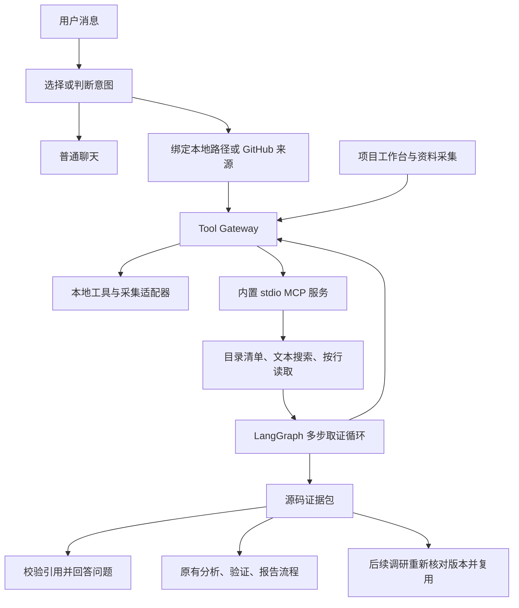

# Project Research Loop Assistant

Project Research Loop Assistant / 个人代码调研助手，支持普通聊天、项目问答和调研报告。用户接入公开 GitHub 地址或本机项目路径后，Agent 通过 Tool Gateway 管理的 MCP 工具搜索和读取代码，将结论绑定可复用的源码证据包，并复用原有 Project Research Package / 项目调研包流程生成报告。

会话入口为 `/assistant`，项目工作台为 `/projects`。下文包含启动步骤、使用方法、MCP 网关架构、证据包复用机制及验证说明。

项目使用：

- FastAPI 提供 REST / SSE API。
- LangGraph `StateGraph` 编排可恢复 Agent Loop。
- MySQL 保存项目、输入源、运行、证据、报告、LLM 调用、运行事件和 graph checkpoint。
- 后台 worker 执行长任务，HTTP 请求只负责排队。
- Next.js 提供中文优先的工程调研工作台。
- OpenAI-compatible LLM provider 接入 DeepSeek、Qwen/DashScope 或自部署 vLLM。

## 能力边界

本项目提供普通聊天和只读工程调研，不修改被分析代码，不执行被分析项目脚本，不创建 commit、issue 或 PR。项目问答经过结构化解析与证据引用校验；调研报告继续使用确定性 verifier，并支持人工评审。

Project Research Package 包含：

```text
Executive Brief
Research Profile
Source Bundle Summary
Engineering Onboarding Guide
Source Inventory
Codebase Map
Architecture Map
Runbook
Findings
Risk Register
Open Questions
Reading Path
Evidence Index
Verifier Result
Run Timeline
LLM Call Summary
Report Snapshot
```

## 本地依赖

建议环境：

- uv 0.11+
- Python 3.11+
- Node.js 20.9+
- MySQL 8+

安装 uv：

```powershell
powershell -ExecutionPolicy ByPass -c "irm https://astral.sh/uv/install.ps1 | iex"
uv --version
```

## 配置环境变量

在仓库根目录复制配置文件：

```powershell
Copy-Item .env.example .env
```

按本机情况修改 `.env`：

```env
DATABASE_URL=mysql+pymysql://root:<local-password>@localhost:3306/loop_engineering
WORKSPACE_ROOT=D:/loop-workspace/projects
NEXT_PUBLIC_API_BASE_URL=http://localhost:8000

LLM_PROVIDER=deepseek
LLM_API_KEY=<your-api-key>
LLM_BASE_URL=https://api.deepseek.com
LLM_MODEL=deepseek-chat
LLM_API_KEY_REQUIRED=true
LLM_TIMEOUT_SECONDS=30
```

Provider 示例：

```env
# Qwen / DashScope OpenAI-compatible mode
LLM_PROVIDER=qwen
LLM_BASE_URL=https://dashscope.aliyuncs.com/compatible-mode/v1
LLM_MODEL=qwen-plus
LLM_API_KEY_REQUIRED=true

# Self-hosted vLLM OpenAI-compatible server
LLM_PROVIDER=vllm
LLM_BASE_URL=http://127.0.0.1:8001/v1
LLM_MODEL=<served-model-name>
LLM_API_KEY_REQUIRED=false
```

`.env` 不要提交到 Git。数据库和 LLM 密钥只放本机。

## 创建数据库

```powershell
mysql -uroot -p -e "CREATE DATABASE IF NOT EXISTS loop_engineering CHARACTER SET utf8mb4 COLLATE utf8mb4_unicode_ci;"
```

## 启动后端 API

```powershell
Set-Location services/api
uv python install 3.11
uv sync --extra dev
uv run alembic upgrade head
uv run python -m uvicorn app.main:app --reload --host 127.0.0.1 --port 8000
```

后端依赖由 `services/api/pyproject.toml` 声明，由 `services/api/uv.lock` 锁定。`uv sync --extra dev` 会创建并同步本地 `.venv`，不需要手动激活虚拟环境。

已安装的后端也需先同步依赖并执行上述数据库迁移，再重启 API 和 Worker。迁移 `20261022_0015` 增加会话、消息和证据包三张表。

健康检查：

```powershell
Invoke-RestMethod http://127.0.0.1:8000/health
```

## 启动后台 Worker

另开一个 PowerShell 终端：

```powershell
Set-Location services/api
$env:PYTHONPATH='.'
uv run python -m app.workers.worker_service --queue default --poll-interval 2
```

worker 会轮询 queued run job，使用 lease/heartbeat 防止重复领取，并把运行过程写入 durable run events。

## 启动前端

另开一个 PowerShell 终端，在仓库根目录执行：

```powershell
npm --prefix apps/web install
npm --prefix apps/web run dev -- --hostname 127.0.0.1 --port 3000
```

浏览器打开：

```text
http://127.0.0.1:3000/assistant
```

## 推荐体验路径

会话入口使用方法：

1. 打开 `/assistant`，可以先与模型普通聊天。
2. 调研时在“项目地址”中填写本机路径（例如 `D:\path\to\project`）或公开仓库地址 `https://github.com/owner/repository`，选择“项目问答”或“生成报告”并发送问题。消息中的完整 GitHub 仓库地址也能识别；本地路径建议放在地址输入框中。
3. 可以询问入口、模块职责或调用链，再生成调研报告。项目问答所用模型需要支持原生工具调用。
4. 后续问题沿用当前项目。一个会话绑定一个来源，切换项目时新建会话。每条项目答复均可查看对应证据包；报告可进入报告页面查看与导出。

本地地址指 API/Worker 所在机器上的路径。浏览器部署到其他机器后，无法用客户端磁盘路径直接读取客户端文件。会话入口目前支持 UTF-8 文本与源码，不包含 PDF、Office 文档或图片解析。

原有工作台流程：

1. 打开 `/projects/new` 创建一个调研项目。
2. 选择调研档位，例如“快速接手”“架构理解”“教学拆解”。
3. 在项目资料页添加本地目录、公开 GitHub URL、网页或 Markdown/PDF 资料。
4. 进入运行页启动调研 Loop，观察后台任务、运行事件和质量评分。
5. 进入报告页生成 Project Research Package。
6. 审阅报告，通过、驳回或要求补充。
7. 在 `/evaluations` 运行调研档位 benchmark，确认核心能力没有退化。

## 处理流程



普通聊天不读取项目。自动判断使用结构化意图输出，支持 `chat / qa / report`，也可在页面明确选择。项目问答的图按“模型决策 → 工具执行 → 观察结果”循环，最多六轮模型决策；搜索结果只是定位线索，实际答复引用按行读取的源码证据。

## MCP 与网关

所有工具共用 `app/tools/gateway.py` 中的 `ToolGateway` 与 `TOOL_REGISTRY`：Agent 调用、原有本地工具和工作台资料采集，都经过同一套校验、调用预算和 ToolCall 账本。原有 `invoke_readonly_tool` 只保留为兼容入口，内部直接委托同一个网关。工具目录 API `/tools` 和工具页面也读取这份注册表。

注册表统一描述工具名称、参数模型、权限级别、启用状态、执行方式和模型可见性。模型拿到的函数定义由注册表按当前任务的工具范围生成；手动构造未展示的工具调用也会在执行前被拒绝。注册表仍由代码维护，没有动态安装或页面启停功能。

MCP 使用 Python SDK 的真实 `ClientSession + stdio_client`，由 `app/tools/mcp_adapter.py` 连接内置 `app.assistant.mcp_server`。MCP 适配器只负责连接与协议调用，本地适配器负责已有采集函数的执行，校验和记账由网关负责。当前一个内置 MCP 服务同时提供本地文件读取和 GitHub 来源准备；每次调用创建并关闭一个连接，尚未实现连接复用。

| 注册名称 | 执行方式 | 用途 | 调用权限 |
| --- | --- | --- | --- |
| `local_filesystem_scan` | 本地函数 | 目录扫描与技术栈线索 | L0，后端调用 |
| `git_metadata_read` | 本地函数 | 读取仓库分支和提交元数据 | L0，后端调用 |
| `web_fetch_read` | 本地函数 | 原有网页抓取占位工具，当前返回 skipped | L0，后端调用 |
| `source.collect` | 本地采集适配器 | 工作台文件、目录、网页及仓库采集 | L1，仅后端绑定来源并授权 |
| `mcp.prepare_github` | MCP | 将用户绑定的公开仓库克隆到独立工作目录，记录 commit | L1，仅后端绑定来源并授权 |
| `mcp.inspect_project` | MCP | 有界目录清单、入口与依赖文件线索 | L0，模型和后端 |
| `mcp.search_project` | MCP | 字面文本搜索，返回定位结果 | L0，模型和后端 |
| `mcp.read_project_file` | MCP | 按行读取源码，返回文件哈希与行号 | L0，模型和后端 |

MCP 工具在模型侧使用 `inspect_project`、`search_project`、`read_project_file` 作为函数名，网关解析为带 `mcp.` 前缀的注册名称，并以注册名称记账。工具别名与完整注册名称执行相同的权限校验。

后端通过 `ToolContext` 绑定 project、run、source、根目录、工具范围和允许的权限级别，模型只能提交工具自己的参数。网关统一校验启用状态、调用方、任务白名单、Pydantic 参数结构及项目归属。L0 用于只读工具；L1 用于可能在受控工作区落盘的资料采集，必须由后端显式授权，模型无法调用。文件服务进一步拒绝越界路径、符号链接、敏感文件和二进制内容；单文件接入仅可读取该文件。每次尝试写入同一份 ToolCall 账本，包含结果状态、耗时与错误摘要。

每个 run 默认最多尝试 16 次工具调用，本地和 MCP 工具合计计数，包含后端的初始采集。计数读取持久化账本，恢复或重试不会重置；未绑定 run 的工作台资料采集按项目记录账本，不计入某次调研的预算。单次源码读取最多 160 行、12,000 字符；证据包最多 10 个片段、40,000 字符。目录遍历、输出清单与搜索命中数也有上限，不能把有限扫描当作整个仓库的穷尽分析。

GitHub 在用户提交地址后才会联网拉取，并使用独立目录保存快照。同一会话后续使用这一份快照，不会自动拉取远端更新；需要新版本时新建会话重新接入。当前入口支持公开仓库，不包括私有仓库凭据管理和 GitHub 写操作。

## 证据包与原有项目复用

每个证据片段包含稳定 ID、来源 ID、相对文件路径、起止行号、实际源码内容和整个文件的 SHA-256；GitHub 来源另记录 commit。证据 ID 由来源、路径、文件哈希和行号生成。每个 run 固化一个证据包，后续包通过 `parent_id` 关联上一个包，应用不会覆盖历史包内容。

继续调研时优先重新读取上次引用过的片段，比较文件版本，并在当前调用预算内补充新证据。已有回答仅用于理解对话，不能代替源码事实。问答发布前检查引用是否属于本次证据包、正文引用是否与引用列表一致；不通过时返回证据不足。该校验确认引用存在，不能自动证明每一句话都被源码语义充分支持。

报告把本次包转为原有 SourceSnapshot，继续进入原有 LangGraph 分析、Analysis Package、verifier、ReportSnapshot 和导出流程，并附带实际源码证据片段。分析与报告 inventory 限定在本次快照与代码地图，不混入旧源码版本。报告与问答使用各自的运行状态和 checkpoint，普通聊天不会成为报告事实。

原有 EvidenceItem 仍使用数据库 ID；新增源码片段使用内容与版本生成的 `E...` ID，两者通过 SourceSnapshot metadata 与报告证据附录关联。证据包已保存后发生任务中断，重试复用同一个包；报告图从持久化 checkpoint 继续。若原有图需要用户补充信息，可进入运行页回答并恢复，完成后报告会回写会话。

## 模型与任务运行

在模型设置页可分别配置“助手聊天”“助手意图判断”“助手源码取证与问答”，对应 `assistant_chat`、`assistant_router`、`assistant_qa`。未配置专用档位时使用 `.env` 的默认兼容模型。问答模型必须支持 Chat Completions 原生 `tools / tool_calls`；仅支持文本补全的端点不适用。原有 analyzer、verifier、report 档位继续服务报告流程。

项目请求先写入 RunJob，由现有 Worker 执行，过程写入 RunEvent，前端通过 SSE 和状态轮询查看进度。断线后按 sequence 游标补读事件，不重新发起调研；可取消任务，失败后可在运行页重试或重新发送问题。普通聊天当前同步返回完整答复，项目任务推送节点进度后返回完整答案，不提供 token 级文本流。

当前是本机个人使用的实现，来源范围限制属于工具调用约束，尚不构成多用户身份认证或操作系统沙箱。代码、README 和工具返回值均被视为待分析数据，模型不应按其中的文字执行指令。

## 常用命令

后端测试：

```powershell
Set-Location services/api
uv run --extra dev python -m pytest tests -q
```

数据库迁移状态：

```powershell
Set-Location services/api
uv run python -m alembic -c alembic.ini current
```

前端构建：

```powershell
npm --prefix apps/web run build
```

运行评估：

```powershell
Invoke-RestMethod -Method POST http://127.0.0.1:8000/evaluations/run
```

## 验证范围

上述后端测试包含普通聊天、真实 stdio MCP 握手和读取、路径范围、统一注册表、本地与 MCP 共用预算、参数校验、模型调用限制、资料采集调用审计、原生工具调用、证据版本更新、无模型降级、报告复用、失败重试和迁移升降级。前端构建同时检查 TypeScript 类型。

开发验证使用临时本地项目、临时数据库和模型模拟响应，没有拉取外部 GitHub 仓库或调用真实模型。实际模型的取证规划与答复质量仍需配置服务后，用带标准答案的项目问答集评估；简历中的准确率应来自这些实测结果。

## 主要页面

```text
/assistant
/projects
/projects/new
/projects/:id
/projects/:id/sources
/projects/:id/inventory
/projects/:id/run
/projects/:id/findings
/projects/:id/codebase
/projects/:id/risks
/projects/:id/report
/settings/llm
/evaluations
```
